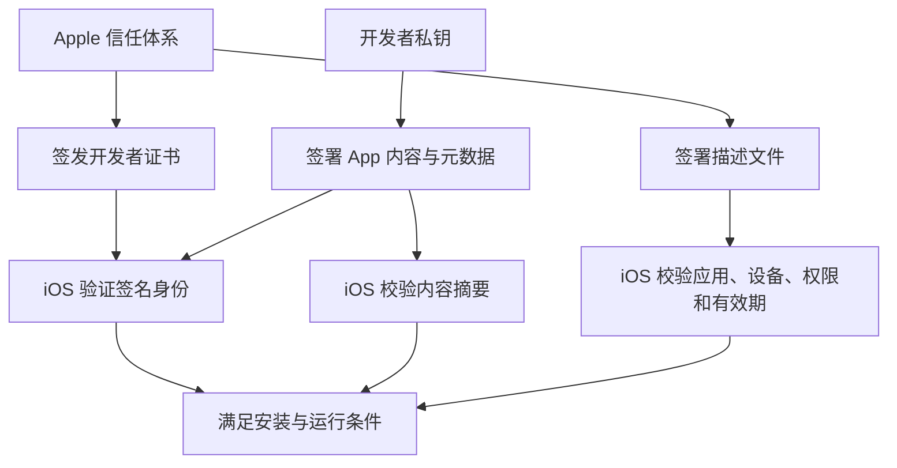
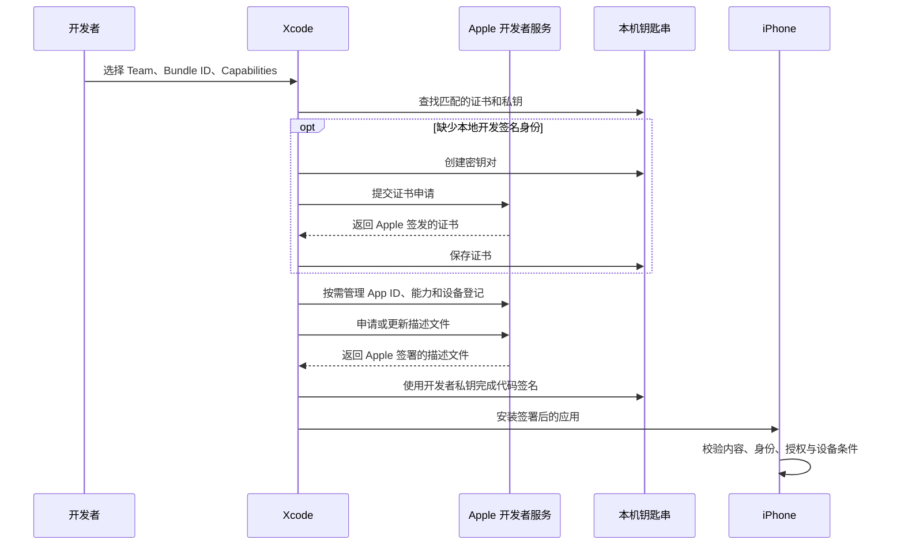

# iOS 签名原理、Xcode 自动签名与 IPA 重签

整理日期：2026-10-15。案例时间均为北京时间（UTC+8）。

本文以真机上的开发包、Ad Hoc 包和企业内部分发包为主，解释证书、私钥、描述文件和代码签名的关系，并结合一次 TikTok 企业 IPA 安装失败说明排查方法。App Store 最终分发经过 Apple 的处理，不能完全套用开发包的设备授权流程。

## 1. iOS 签名要解决什么问题

iOS 需要判断三个问题：

1. **身份**：是谁签署了这个 App，这个签名身份是否可信？
2. **完整性**：App 的代码、配置和受保护的资源在签署后是否发生变化？
3. **授权**：这个签名身份是否被允许签署该 App，以及它是否可以在当前设备上使用声明的系统能力？

代码签名主要建立身份与内容之间的绑定；Provisioning Profile（描述文件）进一步限定授权范围。安装、启动和运行涉及不同阶段的检查，不能把某一次工具校验成功理解成所有条件都已满足。

例如：文件内容未被修改，但描述文件已经过期，iOS 仍会拒绝安装。本文案例正是这种情况。

## 2. 核心组成及各自的职责

| 组成 | 主要内容或职责 | 常见位置或形式 |
| --- | --- | --- |
| 开发者私钥 | 生成 App 的数字签名 | 本机钥匙串；可随证书导出到 `.p12` |
| 开发者证书 | 包含公钥、身份、团队等信息，由 Apple 证书体系签发 | `.cer`，也会包含在签名相关结构中 |
| Provisioning Profile | Apple 签署的授权文件，限定签名证书、App、设备范围、能力与有效期 | `.mobileprovision`；包内通常叫 `embedded.mobileprovision` |
| Entitlements | App 实际声明的系统能力与身份属性 | 构建输入可为 `.entitlements`；最终嵌入代码签名 |
| 代码签名 | 将程序内容摘要、元数据与签名身份绑定 | Mach-O 中的签名结构及 bundle 资源封装 |
| Bundle ID | 应用或扩展的标识 | `Info.plist` 的 `CFBundleIdentifier` |
| Team ID | 开发者团队的标识 | 证书、描述文件及签名相关字段 |
| App ID | 将应用标识与开发者授权范围关联起来 | 通常体现为 `App ID Prefix.Bundle ID` |

App ID Prefix 通常等于 Team ID，但历史账号或特殊场景下可能不同，不能在所有代码中无条件把两者视为同一个字段。

### 2.1 证书与私钥为什么要同时存在

私钥用于生成签名，公钥用于验证签名。证书把公钥与经过 Apple 认证的签名身份关联起来。

- 只有 `.cer`：可以得到公钥与身份信息，无法生成对应身份的签名。
- 有证书及匹配的私钥：具备使用该身份执行签名的基础条件。
- `.p12`：是一种容器，常用于导出证书及其私钥；它不是描述文件。
- IPA：携带供设备验证所需的签名和公开信息，不应携带开发者私钥。

因此，把别人的 `.cer` 导入钥匙串，并不等于拥有了别人的签名能力。Xcode 中“证书存在但缺少私钥”的报错指的就是这个问题。

### 2.2 描述文件由谁签署

**描述文件由 Apple 服务端签署，使用的是 Apple 持有的签名私钥。**

开发者通过网页、Xcode 或受支持的 API 提交配置，Apple 生成并签署描述文件。Xcode Managed 表示文件由 Xcode 管理其申请和更新流程，不表示它由 Xcode 自己的密钥签发。

描述文件可以理解为 Apple 出具的一份机器可验证的授权：

> 允许这些证书对应的签名者，在规定有效期内，为匹配的应用使用指定能力，并按规定的分发方式在允许的设备上运行。

它的内容通常包括：

| 字段 | 含义 |
| --- | --- |
| `DeveloperCertificates` | 允许用于签署 App 的证书集合 |
| `TeamIdentifier` | 所属开发者团队 |
| `Entitlements` | 授权的应用身份、权限及其取值范围 |
| `ProvisionedDevices` | 开发或 Ad Hoc 场景允许的设备 UDID |
| `ProvisionsAllDevices` | 企业内部分发授权使用的相关标记 |
| `CreationDate` / `ExpirationDate` | 文件的创建与到期时间 |
| `UUID` / `Name` | 文件标识与名称，便于选择和管理 |

描述文件采用 CMS 封装，其内容受到 Apple 数字签名保护。手工修改有效期、UDID 或权限字段会破坏签名，无法通过编辑文本来延长有效期或扩展权限。

详细机制见 [Apple TN3125：Provisioning Profiles](https://developer.apple.com/documentation/technotes/tn3125-inside-code-signing-provisioning-profiles)。

### 2.3 Profile 中的权限与 App 的权限有什么区别

描述文件中的 entitlements 是授权范围；App 签名中的 entitlements 是 App 实际声明的能力。两者需要按各字段的匹配规则相容，包括精确匹配、通配符或允许的值集合等。

例如：

```text
描述文件允许：application-identifier = ABCDE12345.com.example.demo
App 实际声明：application-identifier = ABCDE12345.com.example.demo
结果：应用身份匹配

描述文件未授权：某个 App Group
App 实际声明：使用该 App Group
结果：声明超出授权范围，可能在构建或安装校验阶段失败
```

工程里的 `.entitlements` 文件只是输入。修改它不能让账号自动获得 Apple 尚未授予的能力。Entitlements 也不同于相机、麦克风等运行时隐私授权弹窗；涉及这些资源时，应用还必须满足对应的隐私授权要求。

## 3. 两种签名如何形成信任关系

这里存在两个不同的签名动作：

| 被签署的对象 | 签署者 | 证明的内容 |
| --- | --- | --- |
| 描述文件 | Apple | Apple 对应用、签名身份、设备范围和能力的授权 |
| App 代码及关联元数据 | 开发者 | 持有相应私钥的人签署了这些内容 |

开发者证书本身同样由 Apple 的证书体系签发。设备通过信任链验证证书，并分别验证描述文件与 App 签名。



签名机制的密码学部分证明身份与完整性；描述文件、分发规则及设备策略共同决定授权是否成立。

## 4. App 的代码签名具体如何生成

IPA 本质上是一个打包容器。签名不是对整个 ZIP 文件只做一次操作，而是对其中的代码对象及 bundle 内容建立保护关系。

可以把过程简化为：

1. 对可执行文件的代码页计算哈希。
2. 对 `Info.plist`、entitlements 等相关数据计算摘要。
3. 建立资源封装清单，记录受保护资源的哈希和嵌套代码的相关信息。
4. 将相关摘要组织到 `CodeDirectory` 等签名结构中。
5. 使用开发者私钥对相应签名数据生成数字签名，供设备用公钥验证。

`_CodeSignature/CodeResources` 是常见的 bundle 资源清单；可执行文件内还包含自身的代码签名结构。实际格式包含多个槽位和编码细节，并不等同于一个单独的哈希值。

```text
代码页 ──────────→ 页哈希 ──────────┐
Info.plist ───────→ 摘要 ────────────┤
Entitlements ─────→ 摘要 ────────────┼→ CodeDirectory → 数字签名
受保护资源 → 资源清单 → 清单摘要 ────┘
```

签名后修改受保护的代码、配置或资源，重新计算的摘要就会与签名保护的数据不一致。这也是修改 bundle 后通常需要重新签名的原因。

App 中的 Framework、动态库和扩展也需要正确签名。重签时通常先处理内部代码，再签外层 bundle；仅重签最外面的 `.app` 无法修复所有内部签名问题。

详细结构见 [Apple TN3126：Code Signing Hashes](https://developer.apple.com/documentation/technotes/tn3126-inside-code-signing-hashes)。

## 5. 安装和运行时 iOS 检查什么

下表是逻辑上的检查分类，不代表所有系统版本都有相同的执行顺序。

| 检查项 | 要确认的事情 | 常见失败原因 |
| --- | --- | --- |
| 证书与信任 | 签名身份是否可信、是否满足当前分发策略 | 证书失效、撤销或信任条件不满足 |
| 内容完整性 | 当前内容是否仍与签名一致 | 文件被修改、嵌套代码漏签 |
| 描述文件真实性 | Profile 的 Apple 签名是否有效 | 文件被修改或内容无效 |
| 描述文件有效期 | 授权是否仍在有效期内 | 主 App 或某个扩展的 Profile 过期 |
| 证书匹配 | 签名证书是否被 Profile 授权 | 使用了另一张未被允许的证书 |
| 应用身份匹配 | App ID 与 Bundle ID 等是否满足授权 | 混用了其他 App 或团队的配置 |
| 设备匹配 | 当前设备是否符合分发范围 | 开发包或 Ad Hoc 包漏登记 UDID |
| 能力匹配 | App 声明的 entitlements 是否得到授权 | App Groups、Keychain、推送等权限不匹配 |
| 内嵌组件 | 扩展、Framework 等是否满足各自的规则 | 扩展 Profile 过期、动态库团队不匹配 |

设备还会执行系统版本、架构、安装空间等检查，这些不是密码学签名本身的内容。

校验也不只发生在安装时。启动和加载动态库等阶段仍有签名检查。通常，App 可以加载系统库及与其拥有相同 Team ID 的非系统库。企业内部分发应用还涉及设备信任与向 Apple 确认运行授权。

因此：

```text
codesign 验证内容完整性成功
             ≠
当前 iPhone 上全部安装和运行条件满足
```

参考 [Apple 平台安全：App 代码签名流程](https://support.apple.com/guide/security/app-code-signing-process-sec7c917bf14/web)与 [TN2319：安装失败排查](https://developer.apple.com/library/archive/technotes/tn2319/_index.html)。

## 6. Xcode 的 Automatically manage signing 做了什么

自动签名自动管理证书、App ID、设备和描述文件，并在构建时选择匹配的材料完成签名。它依然遵守相同的 Apple 授权与设备校验规则。

以下以“连接 iPhone，使用 Xcode 开发调试”为例。已有合适材料时会复用，并非每次构建都重新申请。

### 6.1 确定团队和应用身份

开发者选择 Team，并配置 Bundle ID 和 Capabilities。Xcode 根据工程中各个 Target 的要求，创建或匹配开发者平台上的 App ID，并在账号有权限的情况下配置相应能力。

主 App 与各个扩展通常有不同的 Bundle ID，需要分别满足各自的签名配置。

### 6.2 查找或创建签名身份

Xcode 检查是否已有合适的证书及对应私钥。如果需要创建新的本地开发签名身份，常规流程是：

1. 在本机生成密钥对。
2. 通过证书申请流程把公钥等信息提交给 Apple。
3. Apple 验证请求后签发开发者证书。
4. 本机保存证书，私钥保留在钥匙串中。

Apple 签发证书不意味着把开发者私钥放进描述文件。描述文件与 App 都不需要包含这个私钥。

部分分发工作流支持云端托管证书，签名私钥不一定存放在本机。这里描述的是常规本地开发调试流程。

### 6.3 注册设备

对于需要设备登记的工作流，Xcode 获取连接设备的 UDID，并按权限和配额将它注册到开发者团队。随后让相应描述文件包含这个设备。

Apple Account 登录成功、开发者模式开启、设备在 Profile 中被授权，是不同条件，不能相互替代。

### 6.4 请求 Apple 生成或更新描述文件

Xcode 根据以下信息申请匹配的 Profile：

- 所选团队及应用标识。
- 可用签名证书。
- 所需 entitlements。
- 分发类型与设备范围。

**Apple 在服务端生成并签署描述文件，Xcode 将其下载到本机。** 新增设备、调整能力或现有文件不再适用时，Xcode 可能需要更新它。

这一步不是 Xcode 在本机自行生成一份能被 iOS 信任的授权书。

### 6.5 构建与签署

Xcode 构建应用和各个扩展，选择匹配的描述文件，生成最终 entitlements，嵌入 Profile，并使用对应签名身份签署代码。内部组件与外层 App 的签名需要保持一致和有效。



流程参考：[Xcode Signing & Capabilities 工作流](https://help.apple.com/xcode/mac/current/en.lproj/dev60b6fbbc7.html)、[导出本地签名材料](https://help.apple.com/xcode/mac/current/en.lproj/dev8a2822e0b.html)、[签名身份与云端托管证书](https://developer.apple.com/documentation/xcode/sharing-your-teams-signing-certificates)。

### 6.6 自动签名与手动签名的边界

| 项目 | 自动签名 | 手动签名 |
| --- | --- | --- |
| App ID、证书、Profile 管理 | Xcode 根据配置和权限处理 | 开发者或 CI 管理 |
| Profile 的签署者 | Apple | Apple |
| App 的签名 | 使用所选开发者签名身份 | 使用所选开发者签名身份 |
| 最终 iOS 校验要求 | 相同的授权和完整性要求 | 相同的授权和完整性要求 |
| 已经导出的 IPA | 不会因为勾选选项自动改变 | 需要专门重签或重新导出 |

自动签名不能让个人团队获得另一个团队的 App Groups、共享 Keychain 或特殊能力，也不能绕过账号角色、设备配额与能力审批。

## 7. 几种常见分发方式的区别

| 方式 | 主要用途 | 设备授权特点 |
| --- | --- | --- |
| Development | 真机开发调试 | 通过 Profile 授权测试设备，并受开发环境条件约束 |
| Ad Hoc | 向指定测试设备分发 | 设备 UDID 必须包含在对应 Profile 中 |
| Enterprise / In-House | 企业内部应用分发 | 使用企业授权，通常不逐台列出 UDID；仍有信任及验证要求 |
| App Store | 商店分发 | 上传后由 Apple 处理最终分发，不依赖开发 Profile 中的测试设备名单 |

企业 Profile 中的 `ProvisionsAllDevices=true` 不能理解为任意 App、权限或签名材料都会被接受。证书、权限、有效期和企业分发条件仍需满足。

## 8. 重签 IPA 在做什么

重签是给已有二进制建立新的签名与授权关系，通常不需要重新编译源代码。典型过程是：

1. 解包 IPA，识别主 App、扩展、Framework 和动态库。
2. 准备有效证书、对应私钥以及匹配的描述文件。
3. 根据新授权调整 Bundle ID、相关引用与 entitlements。
4. 为主 App 和需要 Profile 的扩展放入匹配的描述文件。
5. 由内到外重新签署代码对象和 bundle。
6. 校验签名、描述文件及权限匹配关系，重新打包。
7. 在目标设备安装并验证启动和业务功能。

不应把“重签成功”直接等同于“业务功能全部正常”。跨团队重签可能影响：

- Keychain 中原团队的共享数据访问。
- App Groups 共享容器。
- 推送、关联域名及依赖团队配置的服务。
- 原团队才拥有的受限能力。
- 程序或服务端对应用标识的校验。

只替换 Profile 不能解决所有问题；如果新的 Profile 不授权原签名证书，或者修改了受签名保护的内容，就必须相应更新代码签名。采用另一团队的证书时，尤其要检查全部嵌套代码和权限。

## 9. 实例：Musically.ipa 为什么无法验证完整性

### 9.1 实际检查结果

本次检查日期为 **2026-10-15**，目标设备为 **iPhone 11 Pro，iOS 18.5**。

| 项目 | 结果 |
| --- | --- |
| 主 App Bundle ID | `com.zhiliaoapp.musically.ep` |
| 版本 | `45.7.0 (457000)` |
| 签名团队 | `9M34YP5WSX`，TikTok Inc. |
| 主 App 证书与 Profile 到期日 | `2026-11-07` |
| 企业分发标记 | `ProvisionsAllDevices=true` |
| 本机代码签名完整性复核 | 通过 |
| 包内扩展 Profile | 9 个均已过期 |

各扩展的描述文件到期日如下：

| 扩展 | 到期日 |
| --- | --- |
| `AWEVideoWidget.appex` | 2026-10-09 |
| `AwemeBroadcastExtension.appex` | 2026-10-09 |
| `AwemeNotificationService.appex` | 2026-10-09 |
| `AwemeShareExtension.appex` | 2026-10-09 |
| `AwemeWidgetExtension.appex` | 2026-10-11 |
| `TikTokIntentExtension.appex` | 2026-10-09 |
| `TikTokMessageExtension.appex` | 2026-10-09 |
| `WalletAuthExtension.appex` | 2026-10-09 |
| `WalletShareExtension.appex` | 2026-10-09 |

在手机上复现安装时，系统明确返回：

```text
Failed to install embedded profile for
com.zhiliaoapp.musically.ep.PushNotificationAttachment
: 0xe8008011 (This provisioning profile has expired.)

LegacyErrorString = ApplicationVerificationFailed
FunctionName = -[MIInstallableBundle _installEmbeddedProfilesWithError:]
```

这次失败是扩展 Profile 过期。主 App 的证书和 Profile 未过期，无法弥补扩展授权失效。

修复需要为相关扩展更新有效且匹配的描述文件，再正确重新导出或重签。重新信任企业开发者、开启开发者模式、重复下载同一份 IPA，都不能延长这些文件的有效期。

### 9.2 当前账号为什么只能判断“具备重签基础条件”

本机检查发现有可用开发签名身份，且团队 `ZL7YRX7GX9` 的通配开发 Profile 包含当前设备，有效期至 `2027-10-08`。

这说明具备对匹配授权范围的 App 进行本地开发签名的基础条件，但该通配 Profile 只提供基础权限。原 TikTok 包中的共享 Keychain、App Groups 和其他能力不能因此自动保留。

因此，跨团队重签需要处理应用身份、权限与扩展，并以设备实测验证功能。该检查本身没有完成重签，也没有证明重签后的登录、推送或直播功能正常。

### 9.3 流水线的 dev_resign 错误属于另一个阶段

另一次流水线日志在准备签名材料时返回：

```text
Preparing to fetch p12 & mp files for iOS device ...
Trying to register the device ...
not found a valid account in the scope with ID 34:
sql: no rows in result set
```

这表明失败发生在远端签名服务查找账号、准备证书与 Profile 的阶段，尚未执行实际重签。日志支持的结论是：服务在 `scope 34` 下没有找到可用账号；仅凭这一行不能确定是配置缺失、scope 选择错误还是账号状态异常。

它与扩展 Profile 过期是两个独立问题，也不代表当前 Mac 钥匙串中的开发签名身份不可用。

## 10. 实际排查时可用的命令

下面命令用于检查，不修改原始 IPA。先把 IPA 解压到独立目录，并将示例路径替换为实际路径。

### 10.1 检查本机签名身份

```bash
security find-identity -v -p codesigning
```

用于查看系统识别的有效代码签名身份。找到身份后，仍需核对匹配的 Profile、目标设备和权限范围。

### 10.2 查看与验证 App 签名

```bash
codesign -dvvv '/path/to/Payload/Example.app'
codesign -d --entitlements - '/path/to/Payload/Example.app'
codesign --verify --deep --strict --verbose=4 '/path/to/Payload/Example.app'
```

这里的 `--deep` 用于递归验证，不表示重签时可以省略对嵌套组件的独立处理。验证结果也不能替代 iPhone 上的安装授权校验。

如果运行环境限制了系统证书服务或钥匙串访问，可能出现环境相关报错，应区分工具访问失败和包本身签名失败。本次检查曾出现这种情况，在允许访问系统验证服务后代码签名完整性验证通过。

### 10.3 解码描述文件

```bash
security cms -D \
  -i '/path/to/Payload/Example.app/embedded.mobileprovision' \
  -o '/tmp/example-profile.plist'

plutil -p '/tmp/example-profile.plist'
```

重点查看 `ExpirationDate`、`DeveloperCertificates`、设备范围及 `Entitlements`。主 App 与所有扩展的 Profile 都应检查。

必要时可用 OpenSSL 辅助解析：

```bash
openssl smime -inform der -verify -noverify \
  -in '/path/to/Payload/Example.app/embedded.mobileprovision' \
  -out '/tmp/example-profile.plist'
```

此处 `-noverify` 会跳过签名者证书链的信任验证。即使输出 `Verification successful`，也不能据此认定 Apple 信任链、有效期和设备授权全部有效。

### 10.4 读取真机安装错误

在确实需要复现安装、且目标包和设备已确认时，可使用：

```bash
xcrun devicectl device install app \
  --device '<设备标识>' \
  '/path/to/Payload/Example.app' \
  --json-output '/tmp/example-install-result.json'
```

这个命令会实际安装或更新应用。查看最内层错误，例如 `This provisioning profile has expired`，通常比手机界面的“无法验证完整性”更能直接定位问题。

## 11. 参考资料

- [Apple TN3125：Inside Code Signing — Provisioning Profiles](https://developer.apple.com/documentation/technotes/tn3125-inside-code-signing-provisioning-profiles)
- [Apple TN3126：Inside Code Signing — Hashes](https://developer.apple.com/documentation/technotes/tn3126-inside-code-signing-hashes)
- [Apple Platform Security：App code signing process](https://support.apple.com/guide/security/app-code-signing-process-sec7c917bf14/web)
- [Xcode：Signing & Capabilities workflow](https://help.apple.com/xcode/mac/current/en.lproj/dev60b6fbbc7.html)
- [Xcode：Export signing certificates and provisioning profiles](https://help.apple.com/xcode/mac/current/en.lproj/dev8a2822e0b.html)
- [Xcode：Synchronizing code signing identities with your developer account](https://developer.apple.com/documentation/xcode/sharing-your-teams-signing-certificates)
- [Apple TN2319：Installation Failure Troubleshooting for iOS](https://developer.apple.com/library/archive/technotes/tn2319/_index.html)
