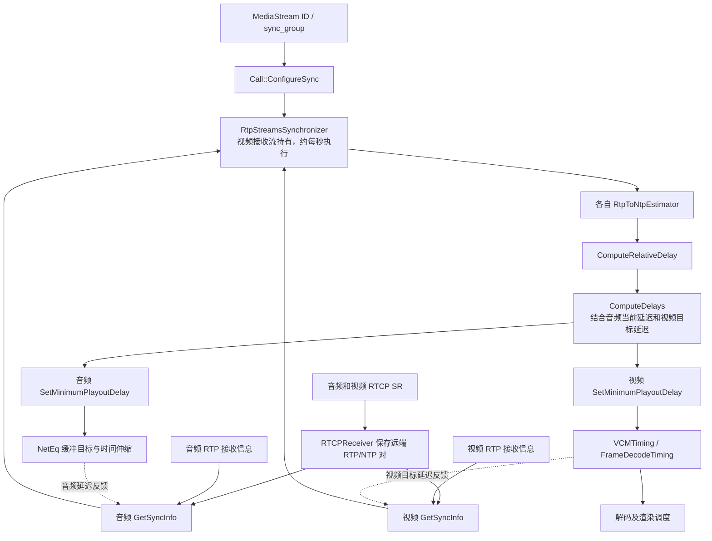

# WebRTC 音视频同步原理：基于当前源码的实现解析

> 分析日期：2026-10-22（Asia/Shanghai）
>
> 源码目录：`/Users/bytedance/code/other/webrtc-checkout/src`
>
> 源码版本：`6655e210cf9fe602fb7c60a36af505f6b2ede03f`，提交日期 2025-06-26
>
> “当前”指本地检出的上述版本，不代表上游最新实现。本文依据本地 C++ 源码和已有测试静态分析；未编译或运行 WebRTC 测试，也未测量真实设备的口型同步效果。

## 1. 核心结论与阅读范围

当前 WebRTC 的接收端音视频同步，是一个**以 RTCP Sender Report（SR）建立跨媒体时间映射、以接收时间和接收端延迟估计播放偏差、通过音频和视频最小播放延迟进行调节的周期控制过程**。

完整链路可以概括为：

1. 根据相同且非空的 `sync_group`，给视频接收流关联一个音频接收流。
2. 分别利用音频、视频 SR 中的 RTP/NTP 时间戳对，拟合各自的 RTP → 发送端 NTP 映射。
3. 取两路最新接收的 RTP 时间戳和本地接收时间，计算采集到接收阶段的相对时延。
4. 加上视频目标延迟，减去音频当前缓冲及设备延迟，得到需要纠正的偏差。
5. 经过平滑、死区和单次步长限制，优先撤销较慢一侧已有的额外延迟，或者增加较快一侧的延迟。
6. 音频通过 NetEq 的目标缓冲及时间伸缩执行；视频通过播放延迟约束、解码调度和渲染调度执行。

音频与视频都可能被调整。因此，“始终以音频为绝对主时钟，只让视频追音频”不足以描述这份源码。另一方面，播放偏差统计确实使用音频的当前播放 RTP 时间戳作为参照；这与控制器的输入不是同一条链路。

本文覆盖 native `Call`、`AudioReceiveStreamImpl`、`VideoReceiveStream2` 及其下游。PeerConnection 部分追踪到同步分组的来源；浏览器合成器、平台扬声器和屏幕真正呈现时刻不在该控制器直接观测范围内。

## 2. 模块分工与数据流



| 模块 | 主要职责 | 源码入口 |
| --- | --- | --- |
| `Call` | 选择同组音频与视频并绑定 | [S01] |
| `Syncable` | 抽象同步信息、最小延迟设置和播放时间戳接口 | [S02] |
| `RtpStreamsSynchronizer` | 周期采样、维护映射、调用控制算法、下发延迟 | [S03] |
| `RtpToNtpEstimator` | RTP 解绕和 RTP/NTP 线性回归 | [S04] |
| `StreamSynchronization` | 相对时延计算及延迟控制状态机 | [S05] |
| `ChannelReceive` / NetEq | 音频延迟测量与缓冲调节 | [S06]、[S07] |
| `VideoReceiveStream2` / `VCMTiming` | 视频延迟约束合并与播放时间计算 | [S08]、[S09] |
| `VideoStreamBufferController` / `FrameDecodeTiming` | 根据 render time 决定何时释放帧给解码器 | [S10]、[S11] |
| `IncomingVideoStream` / `VideoRenderFrames` | 可选的解码后帧平滑与定时交付 | [S12]、[S13] |

`video/rtp_streams_synchronizer2.cc` 中的类名仍是 `RtpStreamsSynchronizer`，不是 `RtpStreamsSynchronizer2`。`DecodeSynchronizer` 则负责将解码调度合并到 metronome tick，不承担这里的音视频口型同步算法。[S29]

## 3. 哪些流会参与同步

### 3.1 从 MediaStream ID 到 sync_group

在媒体引擎中，音频接收配置使用 `stream_ids[0]`，视频接收配置使用 `sp.stream_ids()[0]` 作为 `config.sync_group`，前提是对应列表非空。[S14]、[S15]

SDP 解析代码将 `a=msid` 或 SSRC 级别的 msid 信息转换为 `StreamParams` 的 stream IDs。native Call 使用者也可以直接设置接收配置中的 `sync_group`。[S16]

因此，该实现的配对入口是 `sync_group`：

- 音频和视频 SSRC 可以不同；SSRC 识别具体 RTP 流。
- 两路 RTP 时间戳可以有不同起点和不同频率。
- 同一 PeerConnection 下的所有流不会自动彼此同步。
- 配置多个 stream IDs 时，此处只取第一个作为同步组。
- CNAME 有 RTP/RTCP 层面的标识用途，但 `Call::ConfigureSync()` 不按 CNAME 查找配对关系。

### 3.2 当前每组只支持一对音视频

`FindAudioStreamForSyncGroup()` 仅在组名非空时查找并返回一条匹配的音频流；`ConfigureSync()` 遍历匹配的视频流，只为第一条设置该音频，其余调用 `SetSync(nullptr)`。代码明确注明同一组内多个 A/V pair 暂不支持。[S01]

这里的“第一条”是内部容器遍历意义上的第一条，不应理解为稳定的主摄像头、第一条创建的轨道或业务优先级。应用若有多对独立的音视频，应明确规划各自的分组。

### 3.3 启动、停止和执行队列

`VideoReceiveStream2` 构造同步器时传入 `call->worker_thread()`。绑定音频后创建 `StreamSynchronization`，通过 `RepeatingTaskHandle::DelayedStart` 首次延迟 1000 ms 执行，随后每次返回 1000 ms 作为下一轮间隔。[S03]、[S30]

- 重复设置同一个音频指针会直接返回。
- 解除绑定会停止重复任务并销毁控制器。
- 更换音频会重建控制器；已运行的重复任务继续使用。
- `ConfigureSync()` 没有显式清空两个 `Measurements` 对象中的映射历史，也没有直接把下游已设置的最小延迟归零。不能把“解绑”解释成“立即恢复零同步延迟”。

这些流程在 worker/main sequence 上串行执行。源码中有历史线程注释和迁移 TODO；判断当前路径应优先看构造参数、实际 `PostTask` 和 sequence checker。

## 4. 同步涉及的时间域

| 时间或量 | 单位与语义 | 能否直接跨音视频比较 |
| --- | --- | --- |
| RTP timestamp | 32 位媒体时钟计数，可能回绕 | 不能；频率和起点可能不同 |
| SR 的 NTP timestamp | 发送端 NTP 时间，64 位秒/小数表示 | 两路发送端时间基准一致时可以 |
| 本地接收时间 | 接收端本地毫秒时间 | 两路处于一致本地时间域时可以 |
| 视频 render time | 接收端本地预期呈现时刻 | 是调度时间，不是发送端采集时间 |
| 音频 playout RTP timestamp | 当前播放内容对应的媒体时间位置 | 需映射到 NTP 后才能与视频比较 |
| delay | 时间差，通常为 ms | 必须先确认包含哪些处理阶段 |

音频 RTP 频率应取协商的 codec clock rate，而不能笼统使用设备输出采样率；视频这条链路采用 90 kHz。源码 `ChannelReceive::GetRtpTimestampRateHz()` 优先取 decoder format 的 RTP clock rate，并保留了输出采样率兜底及相关 TODO。[S17]

### 4.1 为什么原始 RTP 时间戳不能比较

假设音频每毫秒前进 48 tick，视频每毫秒前进 90 tick。即使同一时刻采集，两路时间戳值也不必相等，且还可能各自叠加起始偏移。直接计算 `video_rtp - audio_rtp` 没有同步意义。

需要分别建立：

```text
音频：C_a = f_a(RTP_a)
视频：C_v = f_v(RTP_v)
```

其中 `C_a`、`C_v` 是同一发送端时间基准中的媒体采集时刻估计。

### 4.2 不要求接收机与发送机的绝对时间相等

核心算法使用两路本地接收时间之差，再减去两路发送端采集时间之差。只要两路发送端时间基准一致，发送端与接收端之间的共同固定时钟偏移会抵消。

但如果音频和视频来自互不对齐的独立时钟，或者中间设备错误地重写了其中一条流的 RTP/SR 映射，偏移不会自行消失。控制器只能按它收到的映射进行判断。

## 5. 发送端如何提供 RTP 与 NTP 的对应关系

### 5.1 媒体时间戳产生

视频 `VideoStreamEncoder::OnFrame()` 优先使用帧已有的 `ntp_time_ms`；否则根据帧时间或任务时间转换得到该值，再以 `90 × ntp_time_ms` 生成这一阶段的 32 位 RTP 时间戳。[S18]

音频 `ChannelSend::ProcessAndEncodeAudio()` 用输入帧的每声道样本数推进内部 `timestamp_`，并对恢复发送后的时间间隙作补偿。发送数据时，送给 RTCP 模块的是未加发送起点偏移的 RTP timestamp，而实际 RTP 帧加上 `StartTimestamp()`。[S19]

这些事实用于说明“媒体时间轴”和“发包时刻”的区别。音频还要经过编码路径，不能据此断言任意 codec 的 RTP clock rate 都等于输入或输出 PCM 采样率。

### 5.2 Sender Report 的一对时间戳对应同一时刻

`RTCPSender::SetLastRtpTime()` 保存最新媒体 RTP timestamp 和对应 capture time；没有 capture time 时会退回当前本地时刻。`BuildSR()` 再把 RTP timestamp 外推到发送 SR 的当前时刻：[S20]

```text
SR_RTP = timestamp_offset
       + last_rtp_timestamp
       + (SR_now_ms - last_capture_time_ms) × rtp_rate_khz

SR_NTP = ConvertTimestampToNtpTime(SR_now)
```

实际实现对 `now` 的微秒值做毫秒舍入。这里 SR 的 RTP 字段不是简单复制最后一个包的 timestamp，而是与 SR NTP 对齐的媒体时钟位置。

由此可以用连续 SR 拟合任意媒体 RTP timestamp 对应的发送端时间。精度依赖采集时间输入和时钟映射的一致性；缺失或错误的采集时间可能把发送处理延迟带入映射。

### 5.3 接收端保存什么

`RTCPReceiver::HandleSenderReport()` 在 SR 的 sender SSRC 匹配配置的 remote SSRC 时，保存远端 NTP、远端 RTP、SR 本地到达时间等信息。音频和视频的 `GetSyncInfo()` 均通过 `GetSenderReportStats()` 读取其中的远端 RTP/NTP 对。[S21]、[S06]、[S22]

**SR 的网络到达时间不是该 RTP/NTP 映射中的 NTP 值。** 将 SR 的接收时刻与发送端 RTP timestamp 直接配对，会把 RTCP 网络延迟混入本应表示发送端媒体时钟的映射。

## 6. RTP → NTP 映射的具体算法

`RtpToNtpEstimator` 为每路流独立维护映射。[S04]

### 6.1 解绕与线性回归

先用 `RtpTimestampUnwrapper` 将 32 位 RTP timestamp 展开为 64 位计数，再以 SR 样本做最小二乘线性拟合。解绕处理正常回绕，但并不自动保证乱序或跳变后的样本递增；后续仍会校验样本：

```text
x_i = unwrapped RTP timestamp
y_i = NTP 的 64 位数值，单位为 2^-32 秒

k = Σ((x_i - mean(x)) × (y_i - mean(y))) / Σ((x_i - mean(x))²)
b = mean(y) - k × mean(x)

estimated_NTP(rtp) = k × unwrap(rtp) + b
estimated_frequency_khz = (2^32 / 1000) / k
```

- 至少需要两个有效且不同的 RTP/NTP 样本才能得到参数。
- 最多保留最近 20 个 SR 样本。
- 同步器每秒读取当时保存的最新 SR，因此估计器看到的并不必然是每一个到达的 SR。
- 相同 NTP 或相同展开后 RTP 被识别为 `kSameMeasurement`，不会重复加入回归。
- 同步器只拒绝 `kInvalidMeasurement`；同一个 SR 可以继续支持基于新媒体包的同步计算。

使用回归估计斜率意味着映射可以跟踪实际媒体时钟频率，而不只是固定除以 48 或 90。这是处理时钟漂移的重要组成部分，但不等于校准了硬件时钟，也不保证能消除任意大小的漂移。

### 6.2 异常样本处理

实现拒绝或处理以下情况：

| 情况 | 行为 |
| --- | --- |
| NTP 无效，例如 0 | 返回 invalid |
| NTP 或展开后的 RTP 与已有样本重复 | 返回 same |
| 新 NTP 不递增或向前跳超过 1 小时 | 进入异常样本处理 |
| 新 RTP 不递增 | 进入异常样本处理 |
| 展开后的 RTP 向前跳超过 `1 << 25` | 进入异常样本处理 |
| 上述异常递增样本累计到阈值 3 | 清空历史和拟合参数，将这次样本作为新的起点 |

注意：无效 NTP 和重复样本走提前返回，不能将“三次异常重置”笼统理解成任意三次失败都会触发。重建后仍需足够的新样本才能恢复估计。

## 7. 同步控制器每次读取哪些测量值

`Syncable::Info` 包含三组信息：[S02]

| 字段 | 实际来源和意义 |
| --- | --- |
| `capture_time_ntp_secs/frac` | 最近 SR 的远端 NTP |
| `capture_time_source_clock` | 同一 SR 的远端 RTP timestamp |
| `latest_received_capture_timestamp` | 当前保存的最新接收媒体 RTP timestamp |
| `latest_receive_time_ms` | 与该媒体 RTP 信息一起保存的本地接收处理时刻 |
| `current_delay_ms` | 音频为当前延迟估计；视频为目标延迟，语义并不相同 |

SR 样本与最新媒体包无需来自同一个采集时刻，也不需要音频和视频最新包恰好对应同一采集时刻；映射就是用来补偿这个差异的。

### 7.1 音频测量

`ChannelReceive::OnRtpPacket()` 保存 `packet.Timestamp()` 与 `TimeMillis()`。这里“最新接收”指最近处理的包，并不是取所有 RTP timestamp 的最大值，乱序也可能改变这组观测。其 `GetSyncInfo()` 计算：[S06]、[S23]

```text
D_a = NetEq::FilteredCurrentDelayMs() + playout_delay_ms_
```

其中 NetEq 的当前延迟为：

```text
FilteredCurrentDelayMs
  = (过滤后的 packet buffer 样本数 + sync buffer 中尚待播放的样本数)
    / 每毫秒样本数
```

`playout_delay_ms_` 来自 Audio Device Module（ADM）的 `PlayoutDelay()`。所以 `D_a` 包含 NetEq 已缓冲的数据和设备播放延迟，不是单纯的网络 jitter，也不是上次同步器请求的最小延迟。[S07]、[S17]

### 7.2 视频测量

`RtpVideoStreamReceiver2` 在接收负载处理路径中，仅对 `!rtp_packet.recovered()` 更新这组接收时间戳。它记录 RTP timestamp 与 `env_.clock().CurrentTime()`；这组信息是接收包级别的观测，并非实际屏幕呈现时间。[S22]

`VideoReceiveStream2::GetInfo()` 补上：[S08]

```text
D_v = VCMTiming::TargetVideoDelay()
    = max(min_playout_delay,
          jitter_delay + EstimatedMaxDecodeTime + render_delay)
```

这里读的是视频**目标总延迟**，不是实际帧缓冲驻留时间，也不是 `VCMTiming::current_delay_`。因此控制器使用的是“音频当前测量 + 视频目标模型”的组合，不应将二者都叫作精确的实际端到端延迟。

### 7.3 新鲜度检查

`UpdateDelay()` 的关键顺序是：[S03]

```text
读取音频 GetInfo → 更新音频 RTP/NTP 映射 → 检查音频接收时间是否变化
读取视频 GetInfo → 更新视频 RTP/NTP 映射 → 检查视频接收时间是否变化
ComputeRelativeDelay → ComputeDelays → 向两路下发最小延迟
```

任一路信息缺失、样本非法，或接收时间与上次采样相同，都会提前结束本轮控制。这避免了音频停止输入后持续根据旧观测增加延迟。

该检查比较的是接收时间是否改变，没有在这条路径上额外要求“最新 SR 距现在必须小于某个阈值”。已有有效映射且媒体持续到达时，重复 SR 本身不会阻止控制。

## 8. 相对时延公式及其物理意义

定义：

```text
R_a、R_v：音频、视频最近观测的本地接收时间，ms
C_a、C_v：将对应 RTP timestamp 映射到发送端 NTP 得到的采集时间，ms
D_a：音频当前接收端延迟
D_v：视频目标接收端延迟
```

### 8.1 到达前阶段的相对延迟

`StreamSynchronization::ComputeRelativeDelay()` 的核心公式是：[S05]

```text
relative_delay_ms = (R_v - R_a) - (C_v - C_a)
                  = (R_v - C_v) - (R_a - C_a)
```

第二行只是代数解释，不意味着两台机器的绝对时钟已经对齐。

假设两路满足 `R_i = C_i + K + L_i`，其中 `K` 是发送端与接收端的共同固定时钟偏移，`L_i` 是采集到接收阶段的延迟，则：

```text
relative_delay_ms = L_v - L_a
```

- 正值：视频从媒体采集时刻到接收观测点的延迟更大。
- 负值：音频这一段延迟更大。
- 它可能包含采集后编码、发送排队、传输等多种因素，不能简单等同于两路网络单向时延之差。
- 绝对值超过 10000 ms 时，返回失败，本轮不控制。

头文件注释把该返回值描述成 rendered relative audio；按函数实际表达式，此时还没有加接收端播放延迟。因此本文将它明确称为“到达前阶段的相对延迟”。

### 8.2 控制使用的总偏差

`ComputeDelays()` 再计算：

```text
current_diff_ms = D_v - D_a + relative_delay_ms
```

用模型表达就是：

```text
current_diff ≈ 视频总播放延迟 - 音频总播放延迟
```

正值表示视频较晚、声音较早；负值表示音频较晚、画面较早。由于视频项是目标值、各项也存在估计误差，这仍是用于控制的估计偏差，不是屏幕和扬声器的物理测量值。

### 8.3 非同采集时刻的计算示例

下面的发送端时间仅取相对毫秒值以方便计算，接收端时间可以具有任意共同固定偏移：

| 量 | 音频 | 视频 |
| --- | ---: | ---: |
| 映射后的采集时间 `C` | 1000 | 1033 |
| 本地接收时间 `R` | 2100 | 2213 |
| 接收端延迟 `D` | 60 | 100 |

```text
relative_delay = (2213 - 2100) - (1033 - 1000) = 80 ms
current_diff   = 100 - 60 + 80 = 120 ms
```

视频比音频晚 120 ms 的控制估计中，80 ms 来自到达前差异，40 ms 来自接收端延迟差异。33 ms 的采集时间差已扣除，不会被误判成网络差异。

## 9. 延迟控制算法：平滑、死区、限速和状态保持

### 9.1 算法参数

| 参数 | 本版本取值 | 作用 |
| --- | ---: | --- |
| 同步任务间隔 | 1000 ms | 周期采样与调节，不是逐帧校正 |
| `kFilterLength` | 4 | 一阶递归平滑 |
| `kMinDeltaMs` | 30 ms | 对平滑后偏差设死区 |
| `kMaxChangeMs` | 80 ms | 限制本轮控制步长 |
| `kMaxDeltaDelayMs` | 10000 ms | 相对延迟有效范围及目标输出上限偏移 |
| 控制器初始 base target | 0 ms | 额外延迟控制的基线 |

源码：[S03]、[S05]。

### 9.2 一次更新的前半部分

```cpp
current_diff = current_video_target - current_audio_delay + relative_delay;
avg_diff = (3 * avg_diff + current_diff) / 4;

if (abs(avg_diff) < 30)
  return false;

step = clamp(avg_diff / 2, -80, 80);
avg_diff = 0;
```

实际使用整数运算，除法向零截断。这里不是“最近四个样本的普通平均”，而是递归平滑；成功决定一次控制动作后，将平均状态清零，减小过冲。

上例初始 `avg_diff = 0` 时：

```text
current_diff = 120
avg_diff     = 30
step         = 15
```

30 ms 恰好达到阈值，因此会调节。若两侧没有历史额外延迟，本轮音频最小延迟请求为 15 ms，而不是一次增加 120 ms。后续是否改变实际播放、何时继续增长，取决于 NetEq 当前目标及下一轮反馈。

若控制偏差恒为 80 ms 且尚未执行动作，前两轮平均值为 20、35 ms：第一轮不动作，第二轮产生 17 ms 步长。可见原始偏差超过 30 ms 不代表本轮必定调整。

### 9.3 调节方向

控制器为两路分别维护 `extra_ms` 和 `last_ms`。令 `B` 为 `base_target_delay_ms_`：

| 偏差 | 优先操作 | 没有可撤销的额外延迟时 |
| --- | --- | --- |
| `step > 0`：视频较晚 | 减少已有视频 `extra_ms`，把音频 extra 设为 B | 增加音频 extra，把视频 extra 设为 B |
| `step < 0`：音频较晚 | 减少已有音频 `extra_ms`，把视频 extra 设为 B | 增加视频 extra，把音频 extra 设为 B |

这使控制器尽量先利用已有的可回收缓冲，避免为了同步不断把两路都往高延迟推。

但不能把该表当成完整实现。后续还有 `last_ms` 状态保持和限幅：

```text
video.extra = max(video.extra, B)

new_video = video.extra > B ? video.extra : video.last
new_video = min(max(new_video, video.extra), B + 10000)

new_audio = audio.extra > B ? audio.extra : audio.last
new_audio = min(max(new_audio, audio.extra), B + 10000)

video.last = new_video
audio.last = new_audio
```

因此 extra 回到基线时，输出可能保留上一次的 last 值，而不是立即降到基线；`extra_ms` 也不是当前实际缓冲毫秒数。排障或移植算法时应保留这部分状态机，不能用一个无状态的 `max(偏差, 0)` 替代。

80 ms 限制作用于 `step`，不是对所有最终输出与前次值做统一的差值限幅，更不代表硬件播放时刻最多每秒变化 80 ms。

### 9.4 下发失败与 base target 的边界

同步器调用两路 `SetMinimumPlayoutDelay()`；某一路返回 false 时，调用对应 `ReduceAudioDelay()` 或 `ReduceVideoDelay()`，将其内部 extra 乘以 0.9。它没有在这轮立刻重试，也没有直接同步修改 last 值。[S03]、[S05]

本版本视频 setter 始终返回 true，但后续约束合并仍可能裁剪请求。因此“返回 true”不等于最终有效值与请求完全一致。

`StreamSynchronization` 提供 `SetTargetBufferingDelay()`，会平移两路内部状态及基线。不过本次全树检索发现，其生产同步器路径没有调用；除定义外，调用位于该类的单元测试中。应用层的 `SetBaseMinimumPlayoutDelayMs()` 是各接收流独立施加的约束，不能和这个控制器内部基线接口混为一谈。

## 10. 音频如何执行同步器的请求

### 10.1 请求变成 NetEq 的最小缓冲约束

调用链为：

```text
RtpStreamsSynchronizer::UpdateDelay
  → AudioReceiveStreamImpl::SetMinimumPlayoutDelay
  → ChannelReceive::SetMinimumPlayoutDelay
  → NetEqImpl::SetMinimumDelay
  → controller / DelayConstraints::SetMinimumDelay
```

`ChannelReceive` 先将值限制在 0～10000 ms，NetEq 再检查范围及当前约束。`DelayConstraints` 的最小延迟上限还受已设置的最大延迟，以及缓冲容量对应时长的 75% 约束。[S07]、[S24]

NetEq 的有效目标不是简单等于同步器请求：

```text
effective_min = max(sync_minimum_delay, 经容量等条件限制的 base_minimum_delay)
target = Clamp(delay_manager 给出的自适应目标)
```

Clamp 会应用最小约束、显式最大约束和包缓冲容量约束。同步器写的是一个下限；网络抖动自适应本身要求更大缓冲时，该同步请求可能暂时不改变实际行为。

同步器给音频的输出也不是“在当前延迟上再加这么多毫秒”，而是传入最小延迟接口的绝对请求值。尤其不能把 `current_audio_delay_ms` 与输出目标直接相加。

### 10.2 通过时间伸缩改变积压量

`DecisionLogic::ExpectedPacketAvailable()` 在允许时间伸缩、非特定丢包恢复状态、非 DTMF 等条件下，根据播放延迟与目标比较，选择：[S25]

- `kPreemptiveExpand`：播放延迟低于目标时，延长音频输出内容，以积累缓冲。
- `kAccelerate` / `kFastAccelerate`：积压明显较高时，压缩音频输出内容，以减少缓冲。
- `kNormal`：正常输出。

这些操作实现内容时间轴相对于固定音频输出节奏的微调。A/V 同步控制器本身不直接改变声卡采样率，也不会逐帧命令音频线程 sleep。丢包隐藏、舒适噪声、目标延迟限制和实际包到达情况都会影响收敛。

## 11. 视频如何执行同步器的请求

### 11.1 合并多个播放延迟来源

视频 setter 保存 `syncable_minimum_playout_delay_`，然后调用 `UpdatePlayoutDelays()`：[S08]

```text
requested_min = max(
    frame_minimum_playout_delay,    // 帧携带的播放延迟信息
    base_minimum_playout_delay,     // 接收端应用设置
    syncable_minimum_playout_delay  // A/V 同步器设置
)

如果帧明确给出 max，且 requested_min > frame_max：
    effective_min = frame_max
否则：
    effective_min = requested_min
```

可选值缺失时不参与有效取最大值；若全部缺失，函数直接返回。

**发送端通过帧给出的最大播放延迟具有优先级。** 例如同步器要求视频最小延迟 200 ms，但帧要求最大 100 ms，则这里实际设置的最小值只有 100 ms，并输出告警。这是同步偏差可能持续存在的一种明确代码原因。

### 11.2 从目标延迟到 render time

`VCMTiming` 的普通路径使用：[S09]

```text
target_delay = max(min_playout_delay,
                   jitter_delay + estimated_decode_time + render_delay)

estimated_complete_time = TimestampExtrapolator(RTP timestamp)
actual_delay = clamp(current_delay, min_playout_delay, max_playout_delay)
render_time = estimated_complete_time + actual_delay
```

`TimestampExtrapolator` 使用 RTP 时间戳和本地帧接收信息，预测本地帧完成时间。这是接收端调度时钟的映射，和 SR 建立的 RTP → 发送端 NTP 映射职责不同。[S10]、[S31]

若外推暂时没有结果，普通路径直接返回 `now`。`TargetVideoDelay()` 本身没有把目标限制到最大播放延迟内，而实际 render time 路径会对 `current_delay_` 做 min/max 限制；目标与实际调度值因此可能不同。

### 11.3 解码时机和迟到帧处理

`FrameDecodeTiming` 根据 render time 计算可等待时间：[S11]

```text
max_wait ≈ render_time - now - estimated_decode_time - render_delay
```

随后将等待时间限制在零与允许等待时间之间，生成 `latest_decode_time` 和 `render_time`。若某帧严重迟到且还有更新的可解码帧，会返回空调度结果；缓冲控制器丢弃当前可解码 temporal unit 并尝试下一组。[S10]

`VideoStreamBufferController::OnFrameReady()` 更新 jitter estimator，并调用的是：

```cpp
timing_->UpdateCurrentDelay(render_time, now);
```

这个重载根据解码时刻相对目标渲染时刻的迟到量修正 `current_delay_`，同时受到 target delay 限制。

源码还保留了 `UpdateCurrentDelay(uint32_t frame_timestamp)`，其中有“每秒最多变化 100 ms”的逻辑，但当前这条缓冲控制器主路径并未调用该重载。不能将旧接收路径中的 100 ms/s 规则直接描述为本版本视频 A/V 同步输出必然遵守的规则。

### 11.4 解码后的渲染平滑

默认接收配置启用 `enable_prerenderer_smoothing`。启用时，解码后视频通过 `IncomingVideoStream` 的独立高优先级队列进入 `VideoRenderFrames`，大致在以下时刻释放给上层 renderer：[S12]、[S13]、[S30]

```text
release_time = frame.render_time_ms - render_delay_ms
```

提前释放是为了给真正的渲染操作预留时间。多个帧已经到期时，这一层会选最新可释放帧，并计入被跳过帧的丢帧统计。关闭 prerenderer smoothing 时，这层等待被绕过，后续呈现行为更依赖 renderer。

`VideoReceiveStream2::OnFrame()` 最终调用 `config_.renderer->OnFrame()`。源码明确说明：没有真正的 frame-rendered 回调，此时帧可能已显示，也可能尚未显示。因此，呈现后的 GPU、合成器或显示设备排队不一定被本层准确观测。

### 11.5 低延迟分支

当 `min_playout_delay == 0` 且 `max_playout_delay <= 500 ms` 时，`VCMTiming` 使用低延迟渲染分支，返回零 render time，表示尽快解码/渲染；特定条件下还通过 pacing 防止瞬间向解码器投入太多帧。[S09]

如果同步器将有效最小延迟提升为正值，会改变这一分支条件；如果帧给出的最大延迟将最小值重新压到零，则仍可能保留低延迟分支。分析屏幕共享或零缓冲配置时，应检查合并后的最终 min/max，而不是仅看同步器输出。

## 12. 播放偏差统计：与控制计算分开理解

### 12.1 统计触发路径

```text
视频帧交付 renderer
  → VideoReceiveStream2::OnFrame 将统计任务投递到 worker
  → RtpStreamsSynchronizer::GetStreamSyncOffsetInMs
  → ReceiveStatisticsProxy::OnSyncOffsetUpdated
```

该统计路径不调用 `ComputeDelays()`，也不把算出的 `sync_offset_ms` 直接作为下一轮控制器的误差输入。[S26]、[S27]

### 12.2 音频当前播放位置从哪里来

`ChannelReceive::UpdatePlayoutTimestamp()` 从 NetEq 取得播放 RTP timestamp，再扣除 ADM 报告的设备播放延迟：[S17]

```text
audio_playout_rtp = neteq_playout_rtp - device_delay_ms × rtp_rate_khz
```

NetEq 会把内部播放时间戳转换回外部 RTP 时间域。尚未解码首包或正在播放某些 CNG 模式时，NetEq 返回空值。[S07]

当前实现是在 RTP/RTCP 接收路径上调用 `UpdatePlayoutTimestamp()`；仅在非 RTCP 更新且播放 timestamp 改变时，保存新的 `(playout_rtp, observation_time)`。这不是每个声卡输出回调都直接上报一次的硬件播放时间。

如果这次拿不到新的 NetEq timestamp，函数会提前返回，之前保存的观测不一定被清空。静音、CNG 或停止收包时分析统计，需要注意样本是否陈旧。

### 12.3 把两个媒体位置换算到同一观测时刻

`GetStreamSyncOffsetInMs()` 使用前面已建立的两路 RTP/NTP 映射：[S26]

```text
A_obs = audio_rtp_to_ntp(audio_playout_rtp)
A_now = A_obs + (now - audio_observation_time)

V_frame = video_rtp_to_ntp(current_video_frame_rtp)
V_now = V_frame - max(render_time - now, 0)

sync_offset_ms = A_now - V_now
```

含义：

- `sync_offset_ms > 0`：音频播放到的采集时间更靠后，即声音领先、画面落后。
- `sync_offset_ms < 0`：视频内容时间更靠后，即画面领先、声音落后。
- 例如此刻声音播放到发送端内容时间 5000 ms，画面对应 4900 ms，偏差为 +100 ms。

音频外推按本地经过时间 1:1 推进，不是精确模拟每次 NetEq 时间伸缩。视频只有在 render time 尚未到来时才减去待渲染时间；已经迟到时不做对应的额外补偿。这些都是统计误差的来源。

输出中的 `video_playout_ntp_ms` 是估算的当前视频内容位置，不能直接当成接收机屏幕显示的 wall-clock 时间。

### 12.4 统计值与控制值对照

| 值 | 输入 | 主要用途 | 正值含义 |
| --- | --- | --- | --- |
| `relative_delay_ms` | 接收时间差和采集时间差 | 估计到达前相对时延 | 视频这一段更晚 |
| `current_diff_ms` | relative + 视频目标延迟 − 音频当前延迟 | 控制最小播放延迟 | 估计视频播放更晚 |
| `sync_offset_ms` | 音频播放 RTP 与当前视频帧 RTP 的 NTP 映射 | 播放同步统计 | 声音内容领先、画面落后 |

三者具有相关性，但不能互换，也不要求每一时刻数值相等。

`ReceiveStatisticsProxy` 保留有符号 `stats_.sync_offset_ms`，而加入 `sync_offset_counter_` 的是绝对值，后者用于 `WebRTC.Video.AVSyncOffsetInMs` 指标。初始尚无有效同步统计时，native 视频 Stats 使用 `std::numeric_limits<int>::max()`，不能把它当成真实巨大偏差。[S27]、[S32]

## 13. RTT、Absolute Capture Time 与本同步链路的关系

### 13.1 控制器不直接使用 RTT 校准两路时间

`RtpStreamsSynchronizer` 自己持有两个 `RtpToNtpEstimator`，只需要 SR 的远端 RTP/NTP 对。`ComputeRelativeDelay()` 没有 RTT 参数。

另一方面，音视频接收器内还存在 `RemoteNtpTimeEstimator`。它利用 SR、接收端当前 NTP 和 RTT/2，估计远端到本地时钟偏移，隐含路径对称假设，并用于本地时钟域的采集时间估计等功能。[S28]

在音频 `ReceivedRTCPPacket()` 和视频 `DeliverRtcp()` 中，先解析 RTCP，再检查 RTT 是否有效，以决定是否更新这个额外的 estimator。因此，后面的 RTT 不可用提前返回，不等于前面 SR 未被保存，也不等于 A/V 控制器一定拿不到映射样本。

RTT 仍可能间接影响同步，例如视频 jitter estimator 会使用 RTT 信息调整延迟估计；但这不同于说核心 A/V 相对时差必须先用 RTT/2 计算单向网络延迟。[S10]

### 13.2 Absolute Capture Time 没有直接替代这条 SR 链路

音视频接收代码确实解析/插值 Absolute Capture Time，并维护相关采集时钟偏移信息。不过这里 `Syncable::Info` 的采集映射字段来自 `GetSenderReportStats()`；同步器没有直接消费该扩展。[S06]、[S22]

所以不能据“当前源码支持 Absolute Capture Time”推导出“该 A/V 同步控制已经不依赖 SR”，也不能据此保证“收到首个带 ACT 的包就能完成这条同步路径的初始化”。

## 14. 启动过程、异常和能力边界

### 14.1 从开始播放到开始同步

```text
完成 sync_group 配对
  → 首次约 1 秒后的同步任务
  → 两路 GetInfo 均有 SR 和媒体接收信息
  → 每路累计至少两个有效且不同的 SR 样本，得到拟合参数
  → 两路接收时间均持续更新
  → 相对时延有效，平滑后偏差达到阈值
  → 发出播放延迟调整请求
  → NetEq / 视频调度实际响应
```

音视频在这些前提齐备之前可以已经独立播放。因此“开始播放”和“同步开始收敛”不是同一时刻。启动耗时取决于 SR 到达、周期采样和下游响应，不能从 1000 ms 控制间隔推导出“一秒内必然同步”。

### 14.2 常见场景

| 场景 | 代码机制或预期影响 |
| --- | --- |
| 未设置相同非空 sync_group | 找不到有效 A/V 配对，控制任务不工作 |
| 同组有多个视频 | 仅一个视频绑定音频，其他解绑 |
| 尚无足够 SR 样本 | RTP → NTP 估计无效，本轮不控制 |
| 媒体持续到达但 SR 暂未更新 | 可以沿用已有映射；长期漂移的跟踪精度可能下降 |
| 任一路停止接收 | 接收时间不变，控制提前返回，保留此前已下发状态 |
| 时钟或 RTP 时间戳突变 | 估计器拒绝样本或重建，需要重新积累映射 |
| 相对时延超出 ±10 秒 | 本轮不控制 |
| 视频目标持续变大 | 可能继续增加音频最小延迟，或先回收视频额外延迟 |
| NetEq 自适应目标高于同步请求 | 下发成功也可能看不到立即变化 |
| 视频帧最大延迟小于同步需求 | 视频请求被覆盖，可能保留残余不同步 |
| 输出设备/渲染器存在未准确上报的延迟 | native 偏差统计与真实听觉/视觉感受可能不一致 |

最后一项是根据观测点推导出的工程边界，不是对某个具体设备故障的诊断。

### 14.3 SFU 和跨设备来源

从时间差公式可推导：SFU 转发、改写 SSRC 或切换源时，必须保留或重建一致的 RTP/SR 时间映射；两路源时钟还需要可比较。只给两路相同的分组字符串，不能修复错误的采集时间关系。

本结论是对该实现所需输入条件的推导；本文没有分析某个 SFU 的实际重写策略。切换来源后的恢复，也应结合时间戳连续性、估计器历史及实际重新配置方式验证。

## 15. 日志、断点和排障步骤

### 15.1 推荐观测项

| 位置 | 记录内容 | 可回答的问题 |
| --- | --- | --- |
| `Call::ConfigureSync()` | group、audio/video SSRC、实际绑定对象 | 是否真的启用了这对流的同步 |
| `GetSyncInfo()` | SR 的 NTP/RTP、最新媒体 RTP 和接收时间 | 样本是否有效、是否继续更新 |
| `RtpToNtpEstimator` | update result、频率、参数有效性 | 是否在拒绝/重建映射 |
| `UpdateDelay()` | audio/video current delay、relative delay | 偏差主要在哪个阶段 |
| `ComputeDelays()` | current/avg diff、step、extra/last | 为什么本轮不动或方向改变 |
| 音频 setter / NetEq | 请求最小值、base/max、目标、实际缓冲、时间伸缩行为 | 请求能否被执行 |
| 视频 `UpdatePlayoutDelays()` | frame/base/sync min、frame max、最终 min/max | 哪个约束覆盖了同步请求 |
| `VCMTiming` / decode scheduler | target/current delay、render time、迟到和丢帧 | 视频如何转化为实际调度 |
| `GetStreamSyncOffsetInMs()` | 播放 RTP、观测时间、render time、最终 offset | 播放统计是否与控制趋势一致 |

已有日志/trace 包括：

```text
Sync info stats
Sync delay stats
Sync video delay
SyncCurrentVideoDelay
SyncCurrentAudioDelay
SyncRelativeDelay
Maximum playout delay ... overrides minimum delay
Multiple playout delays set
Multiple consecutively invalid RTCP SR reports, clearing measurements.
```

其中 `UpdateDelay()` 的信息日志使用大于 10 秒的节流条件，但提前返回可能使当轮日志没有输出；不能把没有看到日志等同于任务从未运行。Trace counter 也只在测量及相对延迟计算通过后记录。[S03]

### 15.2 一条可执行的排查顺序

1. 确认实际运行二进制对应的提交、field trials 和 renderer 配置，先排除源码版本不一致。
2. 查看同步配对，确认同组非空且当前视频没有成为同组被排除的后续流。
3. 检查两路 SR 与 RTP 对应关系，至少拿到各两个不同有效 SR；不要用 RTP 包到达时间冒充 SR NTP。
4. 按第 8 节公式手算 `relative_delay` 和 `current_diff`，确认正负号与声音/画面的领先方向一致。
5. 记录滤波状态，区分“未过死区”和“已产生请求但下游未响应”。
6. 分别比较音频请求/NetEq 目标/实际延迟，以及视频请求/最终 min-max/target/current/render time。
7. 再看有符号 `sync_offset_ms` 和真实设备呈现效果，必要时排查 ADM 估计、渲染队列及采集时间来源。

不建议只增大某个最小延迟来掩盖未知偏差：它可能改变低延迟分支，或被另一约束覆盖。应先确定偏差方向、来源及哪一侧还有可调空间。

## 16. 已有测试提供了哪些证据

以下是本次阅读的测试入口，描述的是测试设计覆盖范围，**不代表本次已运行通过**。

| 测试源码 | 覆盖重点 |
| --- | --- |
| `StreamSynchronizationTest` | 无偏差、需要延迟某一侧、双方延迟、不同 clock drift、base target |
| `NoAudioIncomingUnboundedIncrease` | 直接反复调用算法而无有效音频进展会将请求推到 10000 ms；说明调用者新鲜度检查的重要性 |
| `rtp_to_ntp_estimator_unittest.cc` | RTP 回绕、时间戳跳变、无效/重复/旧 SR、拟合参数与平均误差 |
| `VCMTimingTest` | render time、等待时间、不同 current delay 更新分支及低延迟行为 |
| `VideoStreamBufferController` 相关测试 | 接收 timestamp 输入、调度、缓冲及迟到行为 |
| `ReceiveStatisticsProxyTest` | 有符号同步统计与 AVSyncOffset histogram |
| `CallPerfTest::Synchronization_*` | 端到端同步、音视频创建顺序、FEC、媒体及 NTP clock drift |

对应源码入口见 [S33]～[S38]。端到端测试的 observer 跳过前 2 秒，以 `abs(sync_offset_ms) < 50 ms` 判为同步，并在运行超过 30 秒且满足同步条件时结束正常观察。这是测试条件，不是实现对所有设备/网络的 50 ms SLA，也不能和控制器的 30 ms 平滑误差死区混用。[S38]

本次没有改动生产代码，没有新增镜像实现的测试。文档校验范围为：源码符号和行号、调用路径、关键常量、公式示例、Markdown 链接及结构。

## 17. 关键问题速查

| 问题 | 基于本版本源码的回答 |
| --- | --- |
| 是音频主时钟还是视频主时钟？ | 控制上两路都可调；播放偏差统计使用音频播放位置作参照 |
| 每帧都会校正 A/V 吗？ | 控制任务约每秒运行；音视频自身调度频率更高 |
| 两路 RTP timestamp 相等就同步吗？ | 不成立，必须分别映射到共同时间基准 |
| 接收端必须和发送端做系统 NTP 对时吗？ | 核心相对差值允许共同固定偏移抵消；发送侧两路时间关系仍须一致 |
| 没有 RTT 能同步吗？ | 核心 SR 映射和 relative delay 不直接依赖 RTT；其他估计和缓冲功能可能受影响 |
| 有 Absolute Capture Time 就不需要 SR 吗？ | 这条控制路径仍从 SR 获取映射样本 |
| `current_delay_ms` 两路意义相同吗？ | 音频是实际缓冲/设备延迟估计；视频是目标延迟 |
| 输出目标是额外增加量吗？ | 下发为最小播放延迟请求值，不能再加到当前实际延迟上 |
| 同组多路视频都会同步吗？ | 本版本只绑定一对 A/V |
| 设置成功代表同步已完成吗？ | 不代表；还有下游约束、执行滞后及观测误差 |
| `sync_offset_ms` 就是真实口型误差吗？ | 是 native 链路估计值，真正显示/发声仍可能有额外误差 |

## 18. 源码索引

以下链接定位本地源码的函数或类型起点。行号对应本文声明的提交；更新源码后需重新核对。

| 编号 | 文件与定位 | 阅读重点 |
| --- | --- | --- |
| [S01] | `call/call.cc:1377` | 同步配对；上方为 FindAudioStreamForSyncGroup |
| [S02] | `call/syncable.h:23` | Info 数据结构与同步接口 |
| [S03] | `video/rtp_streams_synchronizer2.cc:61` | 绑定、重复任务、UpdateDelay |
| [S04] | `rtc_base/rtp_to_ntp_estimator.cc:33` | 线性回归、样本过滤、RTP/NTP 外推 |
| [S05] | `video/stream_synchronization.cc:36` | 相对时延、控制算法及内部状态 |
| [S06] | `audio/channel_receive.cc:1098` | 音频 SR、接收测量和当前延迟 |
| [S07] | `modules/audio_coding/neteq/neteq_impl.cc:277` | NetEq 延迟设置、当前延迟和播放时间戳 |
| [S08] | `video/video_receive_stream2.cc:783` | 视频同步信息、setter；同文件 UpdatePlayoutDelays 合并约束 |
| [S09] | `modules/video_coding/timing/timing.cc:206` | render time、目标延迟、解码等待与低延迟路径 |
| [S10] | `video/video_stream_buffer_controller.cc:156` | 输入接收时间、释放帧、更新 jitter 和调度 |
| [S11] | `video/frame_decode_timing.cc:32` | 解码时机及过期帧处理 |
| [S12] | `video/render/incoming_video_stream.cc:50` | 渲染平滑队列与定时出队 |
| [S13] | `video/render/video_render_frames.cc:93` | 到期帧选择和提前交付时间 |
| [S14] | `media/engine/webrtc_voice_engine.cc:313` | 音频同步组来源 |
| [S15] | `media/engine/webrtc_video_engine.cc:3034` | 视频同步组来源 |
| [S16] | `pc/webrtc_sdp.cc:536` | SDP msid 到 StreamParams |
| [S17] | `audio/channel_receive.cc:1122` | 音频设备延迟扣除和 RTP clock rate |
| [S18] | `video/video_stream_encoder.cc:1561` | 视频采集时间与 RTP timestamp |
| [S19] | `audio/channel_send.cc:835` | 音频样本时间推进；同文件发送路径处理 RTP offset |
| [S20] | `modules/rtp_rtcp/source/rtcp_sender.cc:307` | 记录媒体时间，随后 BuildSR 外推 RTP timestamp |
| [S21] | `modules/rtp_rtcp/source/rtcp_receiver.cc:534` | 接收和保存 SR 时间映射 |
| [S22] | `video/rtp_video_stream_receiver2.cc:421` | 视频 SR 和包接收信息；同文件处理 ACT、RTCP 和 recovered 包 |
| [S23] | `audio/channel_receive.cc:663` | 音频 RTP 接收时间和时间戳记录 |
| [S24] | `modules/audio_coding/neteq/delay_constraints.cc:31` | NetEq min/base/max 和容量约束 |
| [S25] | `modules/audio_coding/neteq/decision_logic.cc:270` | 时间伸缩的决策条件 |
| [S26] | `video/rtp_streams_synchronizer2.cc:176` | 独立的播放偏差估计路径 |
| [S27] | `video/receive_statistics_proxy.cc:764` | 有符号偏差与绝对值计数 |
| [S28] | `modules/rtp_rtcp/source/remote_ntp_time_estimator.cc:57` | 利用 RTT/2 估计远端到本地时钟偏移 |
| [S29] | `video/decode_synchronizer.h:31` | metronome 解码调度，与 A/V 控制区分 |
| [S30] | `video/video_receive_stream2.cc:263` | 同步器所在队列；同文件 Start 选择渲染平滑路径 |
| [S31] | `modules/video_coding/timing/timestamp_extrapolator.cc:106` | RTP 到接收端本地帧完成时间外推 |
| [S32] | `call/video_receive_stream.h:165` | native Stats 的未初始化同步偏差标记 |
| [S33] | `video/stream_synchronization_unittest.cc:277` | 同步算法测试 |
| [S34] | `rtc_base/rtp_to_ntp_estimator_unittest.cc:27` | RTP/NTP 映射及异常测试 |
| [S35] | `modules/video_coding/timing/timing_unittest.cc:84` | 视频 timing 测试 |
| [S36] | `video/video_stream_buffer_controller_unittest.cc:255` | 视频缓冲与调度测试 |
| [S37] | `video/receive_statistics_proxy_unittest.cc:838` | 同步偏差统计测试 |
| [S38] | `call/call_perf_tests.cc:135` | 端到端同步观测阈值；后续为 Synchronization_* 测试 |

[S01]: /Users/bytedance/code/other/webrtc-checkout/src/call/call.cc:1377
[S02]: /Users/bytedance/code/other/webrtc-checkout/src/call/syncable.h:23
[S03]: /Users/bytedance/code/other/webrtc-checkout/src/video/rtp_streams_synchronizer2.cc:61
[S04]: /Users/bytedance/code/other/webrtc-checkout/src/rtc_base/rtp_to_ntp_estimator.cc:33
[S05]: /Users/bytedance/code/other/webrtc-checkout/src/video/stream_synchronization.cc:36
[S06]: /Users/bytedance/code/other/webrtc-checkout/src/audio/channel_receive.cc:1098
[S07]: /Users/bytedance/code/other/webrtc-checkout/src/modules/audio_coding/neteq/neteq_impl.cc:277
[S08]: /Users/bytedance/code/other/webrtc-checkout/src/video/video_receive_stream2.cc:783
[S09]: /Users/bytedance/code/other/webrtc-checkout/src/modules/video_coding/timing/timing.cc:206
[S10]: /Users/bytedance/code/other/webrtc-checkout/src/video/video_stream_buffer_controller.cc:156
[S11]: /Users/bytedance/code/other/webrtc-checkout/src/video/frame_decode_timing.cc:32
[S12]: /Users/bytedance/code/other/webrtc-checkout/src/video/render/incoming_video_stream.cc:50
[S13]: /Users/bytedance/code/other/webrtc-checkout/src/video/render/video_render_frames.cc:93
[S14]: /Users/bytedance/code/other/webrtc-checkout/src/media/engine/webrtc_voice_engine.cc:313
[S15]: /Users/bytedance/code/other/webrtc-checkout/src/media/engine/webrtc_video_engine.cc:3034
[S16]: /Users/bytedance/code/other/webrtc-checkout/src/pc/webrtc_sdp.cc:536
[S17]: /Users/bytedance/code/other/webrtc-checkout/src/audio/channel_receive.cc:1122
[S18]: /Users/bytedance/code/other/webrtc-checkout/src/video/video_stream_encoder.cc:1561
[S19]: /Users/bytedance/code/other/webrtc-checkout/src/audio/channel_send.cc:835
[S20]: /Users/bytedance/code/other/webrtc-checkout/src/modules/rtp_rtcp/source/rtcp_sender.cc:307
[S21]: /Users/bytedance/code/other/webrtc-checkout/src/modules/rtp_rtcp/source/rtcp_receiver.cc:534
[S22]: /Users/bytedance/code/other/webrtc-checkout/src/video/rtp_video_stream_receiver2.cc:421
[S23]: /Users/bytedance/code/other/webrtc-checkout/src/audio/channel_receive.cc:663
[S24]: /Users/bytedance/code/other/webrtc-checkout/src/modules/audio_coding/neteq/delay_constraints.cc:31
[S25]: /Users/bytedance/code/other/webrtc-checkout/src/modules/audio_coding/neteq/decision_logic.cc:270
[S26]: /Users/bytedance/code/other/webrtc-checkout/src/video/rtp_streams_synchronizer2.cc:176
[S27]: /Users/bytedance/code/other/webrtc-checkout/src/video/receive_statistics_proxy.cc:764
[S28]: /Users/bytedance/code/other/webrtc-checkout/src/modules/rtp_rtcp/source/remote_ntp_time_estimator.cc:57
[S29]: /Users/bytedance/code/other/webrtc-checkout/src/video/decode_synchronizer.h:31
[S30]: /Users/bytedance/code/other/webrtc-checkout/src/video/video_receive_stream2.cc:263
[S31]: /Users/bytedance/code/other/webrtc-checkout/src/modules/video_coding/timing/timestamp_extrapolator.cc:106
[S32]: /Users/bytedance/code/other/webrtc-checkout/src/call/video_receive_stream.h:165
[S33]: /Users/bytedance/code/other/webrtc-checkout/src/video/stream_synchronization_unittest.cc:277
[S34]: /Users/bytedance/code/other/webrtc-checkout/src/rtc_base/rtp_to_ntp_estimator_unittest.cc:27
[S35]: /Users/bytedance/code/other/webrtc-checkout/src/modules/video_coding/timing/timing_unittest.cc:84
[S36]: /Users/bytedance/code/other/webrtc-checkout/src/video/video_stream_buffer_controller_unittest.cc:255
[S37]: /Users/bytedance/code/other/webrtc-checkout/src/video/receive_statistics_proxy_unittest.cc:838
[S38]: /Users/bytedance/code/other/webrtc-checkout/src/call/call_perf_tests.cc:135
