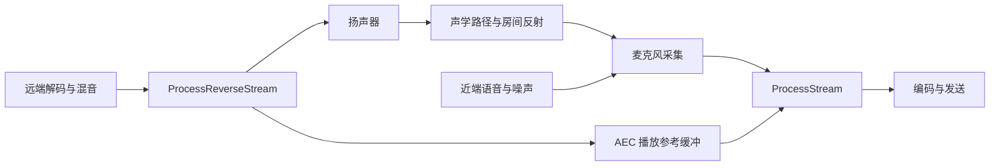
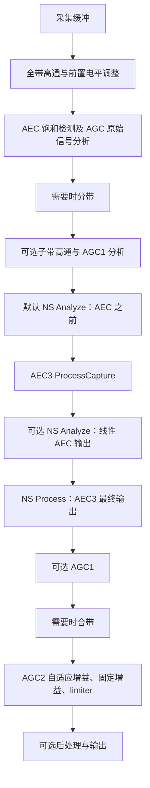
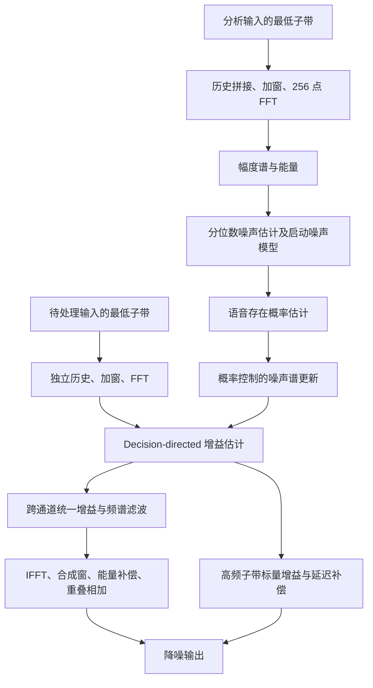

# WebRTC 音频 3A 技术原理与源码实现详解

> 源码基线：本地 WebRTC `src` 仓库，提交 `6655e210cf9fe602fb7c60a36af505f6b2ede03f`，提交日期 2025-06-26。文档整理日期：2026-10-22。本文描述该版本的实现，不代表所有 WebRTC 版本或某个产品的线上配置。
>
> 分析范围：Audio Processing Module（APM）中的 AEC3、NoiseSuppressor、AGC2，以及 AECM、AGC1 的兼容路径。本文依据本地源码静态阅读编写；公式分为通用理论模型和源码等价表达，涉及实际效果的结论需要音频实验验证。文末提供可点击的源码索引。

## 目录

1. [3A 的问题定义与信号模型](#s1)
2. [APM 架构、数据格式与真实处理顺序](#s2)
3. [AEC：回声消除的理论与 AEC3 实现](#s3)
4. [ANS / NS：噪声抑制的理论与实现](#s4)
5. [AGC：自动增益控制的理论与 AGC2 实现](#s5)
6. [三种算法的相互影响与典型时序](#s6)
7. [配置与接入示例](#s7)
8. [验证、指标与排障](#s8)
9. [源码阅读路线与索引](#s9)
10. [术语表与常见误解](#s10)

<a id="s1"></a>

## 1. 3A 的问题定义与信号模型

### 1.1 三个 A 分别解决什么问题

| 模块 | 名称 | 主要输入 | 解决的问题 | 主要代价或限制 |
| --- | --- | --- | --- | --- |
| AEC | Acoustic Echo Cancellation，声学回声消除 | 麦克风信号、扬声器播放参考 | 防止远端用户听到自己的声音再次从本端传回 | 依赖参考信号、时延对齐和声学路径估计；双讲时需要保护近端语音 |
| ANS / NS | Acoustic Noise Suppression / Noise Suppression，噪声抑制 | 麦克风或前级输出 | 减少风扇、空调、电路底噪等干扰 | 降噪越强，越可能伤害弱语音或产生频谱伪影 |
| AGC | Automatic Gain Control，自动增益控制 | 处理后的音频；可选设备音量反馈 | 缩小不同说话距离、设备增益造成的电平差异 | 放大语音也会放大残余噪声；过强压缩会影响自然度 |

工程中常称“3A”，但该源码目录与配置中实际采用 `noise_suppression`、`ns` 命名，没有独立的“ANS 引擎”。3A 也不等于完整的音频系统：编解码、丢包补偿、抖动缓冲、波束形成、去混响等各自处理不同问题。

### 1.2 麦克风信号模型

对单扬声器、单麦克风，可用下式理解问题：

$$
d[n]=s[n]+v[n]+y[n]
$$

$$
y[n]=\sum_{\ell=0}^{L-1}h[\ell]x[n-D-\ell]+u[n]
$$

其中：

- $d[n]$：采集到的麦克风信号。
- $s[n]$：本端希望发送的近端语音。
- $v[n]$：环境与设备噪声。
- $x[n]$：送往扬声器的数字播放参考。
- $h[\ell]$：扬声器、空气、房间反射、麦克风等形成的线性声学路径。
- $D$：用于建模的整体延迟；具体实现会拆分设备缓冲时延与滤波器内部延迟。
- $u[n]$：线性卷积难以解释的成分，例如扬声器非线性失真。

理想目标是输出稳定、清晰的 $s[n]$，但只有 $d[n]$ 与 $x[n]$ 可观测，其他量都需要估计。AEC 利用“回声与播放参考相关”；NS 利用“噪声与语音统计特征不同”；AGC 利用“语音电平和峰值可以在线估计”。

多扬声器时，回声变成多个路径的叠加：

$$
y_c[n]=\sum_{r=1}^{R}\sum_{\ell}h_{c,r}[\ell]x_r[n-D-\ell]+u_c[n]
$$

因此，真正的多通道 AEC 不只是把单通道算法复制一次：每个采集通道需要估计多个播放通道到它的路径，参考通道之间高度相关时也会增加辨识难度。

### 1.3 四类运行状态

| 状态 | 远端播放 | 近端说话 | 算法关注点 |
| --- | --- | --- | --- |
| 远端单讲 | 有 | 无 | 学习声学路径，尽量降低回声 |
| 近端单讲 | 无 | 有 | 保持语音质量，避免不必要的衰减 |
| 双讲 | 有 | 有 | 防止近端语音污染滤波器，兼顾回声与近端保真 |
| 双端静音 | 无 | 无 | 跟踪背景噪声，防止 AGC 把底噪越抬越高 |

“静音”还需要区分真实安静环境与数字全零。后者可能意味着设备静音或流被切断，不一定能代表真实噪声分布。

<a id="s2"></a>

## 2. APM 架构、数据格式与真实处理顺序

### 2.1 两条输入流

APM 的采集方向称 capture / forward；播放方向称 render / reverse。`ProcessStream()` 处理采集音频，`ProcessReverseStream()` 提供播放参考，并可执行播放预处理。二者属于同一 APM 实例。[S01], [S02][S03]



本仓库 `audio/audio_transport_impl.cc` 中，采集侧经 `ProcessCaptureFrame()` 调用 `ProcessAudioFrame()`；播放侧对混音后的帧调用 `ProcessReverseAudioFrame()`，这些封装最终进入 APM 接口。[S48]

**播放参考必须与实际发声内容一致，并覆盖实际播放时间。** 如果喂入未混音的单路音频、遗漏某个播放源，或者参考与设备播放之间发生未知的大幅非线性处理，算法无法凭空重建这些变化。

### 2.2 10 ms 接口、子带和内部计算块

APM 通常以 10 ms 音频为调用单位。在常用采样率下，每声道样本数如下：

| 采样率 | 每 10 ms 样本数 |
| --- | ---: |
| 8 kHz | 80 |
| 16 kHz | 160 |
| 32 kHz | 320 |
| 48 kHz | 480 |

但接口帧长不等于每个算法的计算窗口：

| 层级 | 该版本的典型尺寸 | 含义 |
| --- | --- | --- |
| APM 输入输出 | 10 ms | 与音频采集、播放周期对接 |
| AEC3 子带帧 | 160 点 | 子带采样率为 16 kHz |
| AEC3 中间子帧 | 80 点 | 便于 10 ms 帧与块之间转换 |
| AEC3 计算块 | 64 点，即 4 ms | 自适应滤波与回声抑制的更新单位 |
| AEC3 FFT | 128 点、65 个实信号频点 | 分块卷积与频域抑制 |
| NS 处理步长 | 160 点 | 每次处理一个 10 ms 低频子带帧 |
| NS FFT | 256 点、129 个频点 | 包含 96 点历史数据的分析窗口 |
| AGC2 limiter | 每帧 20 个子帧 | 10 ms 内细粒度估计包络与调整增益 |

这些参数分别来自 `aec3_common.h`、`ns_common.h`、`agc2_common.h`。[S06], [S22][S34]

**4 ms 块、8 ms FFT 窗口、10 ms API 帧均不能直接视为完整算法延迟。** 总延迟还受重采样、分带、组帧、重叠相加和设备缓冲影响，需按实际配置测量。

### 2.3 32/48 kHz 为什么要分带

`AudioBuffer` 与 `SplittingFilter` 将较高采样率音频拆成低采样率子带，供多带模块处理：[S04], [S05]

- 16 kHz：一个子带。
- 32 kHz：两个子带，使用两带 QMF。
- 48 kHz：三个子带，使用三带滤波器组。

各子带以 16 kHz 样本率表示，概念上对应连续的约 8 kHz 频率区间；滤波器存在过渡带，不能把它理解为理想砖墙分频。AEC3 的精细线性消除与 NS 的逐频点分析主要在最低子带执行，高频子带使用单独的增益策略，再合成为全带信号。

AEC3 自身接受 16/32/48 kHz；APM 公共接口支持的格式范围更宽，由 APM 选择内部格式并进行转换。不要直接把 APM 的 8 kHz 支持解释为 AEC3 原生在 8 kHz 上执行相同块结构。

### 2.4 float 音频有两种幅度约定

公共 float 接口的输入输出范围为 `[-1, 1]`，数据按声道分离；APM 内部 `AudioBuffer` 常采用 FloatS16，即用 `float` 存放约 `[-32768, 32767]` 的样本。[S01], [S04]

例如 AGC2 的 dBFS 计算可写为：

$$
L_{\mathrm{RMS}}=20\log_{10}\left(\frac{\sqrt{\frac1N\sum_n a[n]^2}}{32768}\right)
$$

直接调用内部类时，如果把归一化到 1 的音频误当 FloatS16，电平会相差约 90.3 dB。功率量用 $10\log_{10}$，幅度量用 $20\log_{10}$，本文后续会显式区分两者。

### 2.5 AEC3 路径的真实处理顺序

`AudioProcessingImpl::ProcessCaptureStreamLocked()` 是阅读主入口。下图省略统计和可选自定义处理，并将条件分支标在节点内。[S02]



需要特别理解三件事：

1. **`Analyze` 与 `Process` 作用不同。** 前者更新状态、估计量，后者实际改变样本。默认 NS 在 AEC 之前分析，在 AEC 之后施加滤波。
2. **NS 分析源可切换。** 设置 `analyze_linear_aec_output_when_available`，且确实分配了线性 AEC 缓冲，才改为分析线性消除后的信号。这个信号尚未经过 AEC3 的残余回声抑制器；NS `Process()` 处理的仍是 AEC3 最终输出。
3. **AECM 分支顺序不同。** 它先执行 NS `Process()`，再执行 AECM；不能将上图无条件用于 mobile mode。

AGC 的削波检测需要看到靠近原始采集端的信号，因为后面的 AEC/NS 可能已经降低了削波样本的幅度。与此同时，AGC2 的语音电平与数字增益计算放在消回声、降噪之后，避免直接把回声和底噪当成目标语音电平。

### 2.6 分析状态与实时性

AEC3 使用 render transfer queue 把播放数据传递给采集处理侧，在采集处理时读取并转成块。APM 为采集、播放路径安排锁与缓冲；调用者仍需维持每个方向连续、有序的流，不能将“线程安全”理解成可以任意乱序或并发提交同一方向的帧。[S02], [S03][S07]

`ApplyConfig()` 用于配置模块，可能触发子模块重建；动态电平设置优先使用相应 `RuntimeSetting`。每帧重建 APM 会破坏 AEC 收敛、NS 噪声统计与 AGC 电平估计。

<a id="s3"></a>

## 3. AEC：回声消除的理论与 AEC3 实现

### 3.1 从线性自适应滤波开始

假设回声近似为线性系统，使用估计滤波器 $\hat h$ 生成回声预测：

$$
\hat y[n]=\sum_{\ell}\hat h[\ell]x[n-D-\ell],\qquad e[n]=d[n]-\hat y[n]
$$

当 $\hat h\approx h$ 时，误差信号主要剩下近端语音、噪声和非线性回声。目标并不是让任何时候的 $e[n]$ 都等于零，而是在保留 $s[n]$ 的同时消除与 $x[n]$ 相关的回声。

通用 LMS 更新为：

$$
\hat{\boldsymbol h}_{n+1}=\hat{\boldsymbol h}_{n}+\mu e[n]\boldsymbol x_n
$$

NLMS 引入输入能量归一化：

$$
\hat{\boldsymbol h}_{n+1}=\hat{\boldsymbol h}_{n}+\frac{\mu e[n]\boldsymbol x_n}{\epsilon+\|\boldsymbol x_n\|^2}
$$

它减少播放音量变化对有效步长的影响。步长大时通常跟踪快，但稳态误差和误适应风险更大；步长小时更稳定，但路径变化后恢复较慢。

这是理解自适应消回声的基础。AEC3 的实际算法采用分块频域滤波、两套滤波器和频点相关步长，不能概括为“一个时域 NLMS”。

### 3.2 AEC3 模块分工

| 模块 | 主要职责 |
| --- | --- |
| `EchoCanceller3` | 接收 render/capture，检测采集饱和，转换帧与块 |
| `BlockProcessor` | 组织播放缓冲、时延估计、路径变化通知与消回声 |
| `RenderDelayBuffer` | 保存参考历史、调整读写对齐，处理欠载与溢出 |
| `RenderDelayController` | 将时延估计转为缓冲块对齐控制 |
| `EchoPathDelayEstimator` | 对降采样信号执行匹配滤波并聚合延迟候选 |
| `Subtractor` | refined/coarse 两组线性自适应滤波 |
| `AecState` | 管理初始阶段、收敛质量、饱和、ERL/ERLE 等状态 |
| `ResidualEchoEstimator` | 估计线性消除后仍剩余的回声功率 |
| `SuppressionGain` | 计算低频逐频点和高频子带抑制增益 |
| `SuppressionFilter` | 应用增益、加入舒适噪声并重建时域信号 |

对应代码见 [S07]—[S20]。

### 3.3 时延对齐：为什么增加滤波器长度不能解决所有问题

假设参考与回声错开了 100 ms，而滤波器只覆盖对齐后约几十毫秒的路径响应，滤波器无法在错误的历史区间找到正确回声。因此需要先用播放缓冲吸收主要时延，再由自适应 FIR 描述剩余路径形状。

源码链路为：

```text
EchoCanceller3::AnalyzeRender
  -> RenderWriter::Insert
  -> render_transfer_queue

EchoCanceller3::ProcessCapture
  -> EmptyRenderQueue / FrameBlocker
  -> BlockProcessor::ProcessCapture
     -> RenderDelayBuffer::PrepareCaptureProcessing
     -> RenderDelayController::GetDelay
        -> EchoPathDelayEstimator::EstimateDelay
     -> RenderDelayBuffer::AlignFromDelay
     -> EchoRemover::ProcessCapture
```

`EchoPathDelayEstimator` 的主要步骤是：[S09]

1. 选取或混合用于对齐的采集通道。
2. 对最低子带降采样；基础配置 `down_sampling_factor=4`，对应从 16 kHz 到 4 kHz。
3. 使用多组匹配滤波器，在不同历史位置搜索能解释采集信号的参考。
4. 通过 `MatchedFilterLagAggregator` 聚合候选，判断延迟可信度。
5. 将降采样域样本延迟换算回原低频子带样本数。
6. 对可靠候选进行时钟漂移检测，由控制器转换为缓冲块延迟，并用滞回减少反复跳动。

它不是简单地对每帧求一次互相关最大值。持续性、置信度、激励条件和缓冲状态都会影响是否采纳估计。

`BlockProcessor` 对 render underrun / overrun 还有专门恢复逻辑；未收到任何 render 时，会跳过对应消回声处理。设备时钟漂移也不仅意味着固定多几毫秒：它会让对齐关系随时间改变，代码会据此调整控制与抑制策略。[S08], [S10]

APM 公共 `set_stream_delay_ms()` 描述设备缓冲相关的延迟信息。默认 AEC3 仍包含内部延迟估计器；只有 `use_external_delay_estimator` 等具体配置与状态决定是否依赖外部对齐。AECM 路径则在处理前显式检查是否设置了 stream delay。接口说明与各实现分支应结合阅读。

### 3.4 帧到块转换

每个 10 ms 子带帧有 160 点，而 AEC3 每块处理 64 点，二者不能整除。`EchoCanceller3` 将帧拆为两个 80 点子帧，通过 `FrameBlocker` 搬运到 64 点块，再通过 `BlockFramer` 恢复输出帧。[S06], [S07][S62]

因此内部处理在跨帧意义上平均每 10 ms 为 2.5 个块，连续两帧共 5 块。缓冲器负责保留余数，调用方不应自行把 10 ms 数据截为固定两个 64 点块，否则会丢失样本。

### 3.5 分块频域自适应滤波

将长度为 $64P$ 的 FIR 拆成 $P$ 个分区。对齐后的参考历史在频域记作 $X_{m-p,r}[k]$，第 $c$ 个采集通道对应的回声预测可概括为：

$$
\hat Y_{m,c}[k]=\sum_{r=1}^{R}\sum_{p=0}^{P-1}H_{m,c,r,p}[k]X_{m-p,r}[k]
$$

频域相乘降低长卷积的计算成本。实现使用 128 点 FFT，参考块包含历史，通过逆变换提取有效时域预测，再从当前 64 点采集块中相减。误差经过加窗和补零变换，用于自适应更新。[S12], [S13]

`AdaptiveFirFilter` 的核心更新为：

$$
H_{m+1,c,r,p}[k]=H_{m,c,r,p}[k]+G_{m,c}[k]X_{m-p,r}^{*}[k]
$$

其中 $G$ 包含步长与误差；星号表示复共轭。不要把 $G$ 与最终残余回声抑制器的增益混为一谈，它们在源码中属于不同计算阶段。

**频域更新还需要时域约束。** `Constrain()` / `ConstrainAndUpdateImpulseResponse()` 对一个分区做 IFFT，将后 64 个时域系数置零，再 FFT 回频域，以保持每个分区对应有限长度的线性卷积。源码按分区循环执行此约束，而非每块约束全部分区。[S13]

基础配置中 refined/coarse 稳态长度均为 13 块，即 $13\times64/16000=52$ ms；初始长度为 12 块，即 48 ms。[S21]

这表示**对齐后线性滤波器的响应覆盖范围**，不表示系统最大支持延迟为 52 ms，也不表示房间超过 52 ms 的反射会完全不处理。主要时延由缓冲对齐，滤波器覆盖范围之外的残余与混响尾部还会进入回声模型及抑制器。

### 3.6 refined 与 coarse 两套滤波器

`Subtractor::Process()` 每个采集通道维护两套滤波器：[S12]

- **refined filter**：以更细致的误差模型控制步长，用于获得较好的稳定消除结果。
- **coarse filter**：使用较直接的归一化更新，为跟踪和比较提供另一组结果。

二者先各自生成预测与误差，计算误差能量，再更新滤波器。代码还包含 refined 失配缩放、coarse 从 refined 复制恢复等机制。若 coarse 连续若干块表现更差，代码会用 refined 系数重置它，并设置恢复等待状态。

这不是固定的“前台只输出、后台只学习”模型：输出形成还会比较两路误差质量，`EchoRemover` 再根据状态决定是否采用线性滤波输出。阅读时应同时看 `Subtractor` 与 `FormLinearFilterOutput()`。[S11], [S12]

### 3.7 源码中的实际步长

coarse 路径在播放能量超过门限时，使用近似 NLMS 的形式：[S15]

$$
\mu_c[k]=\frac{\mathrm{rate}}{X^2[k]},\qquad G_c[k]=\mu_c[k]E_c[k]
$$

refined 路径使用滤波器误差状态 $H_{\mathrm{error}}$：[S14]

$$
\mu_r[k]=\frac{H_{\mathrm{error}}[k]}{0.5H_{\mathrm{error}}[k]X^2[k]+P E_r^2[k]},\qquad G_r[k]=\mu_r[k]E_r[k]
$$

这里 $X^2$ 是所需参考分区的能量汇总，$P$ 是分区数。每次更新还会减少误差状态，并根据路径响应与 coarse/refined 的比较补充误差、施加上下限。

这个公式解释了双讲保护的一部分：近端说话使误差功率增大时，分母变大，更新更保守。除此之外，代码还会在采集饱和、播放激励不足、初期参考历史不足时禁止更新，并屏蔽窄带播放附近的频点。

**不能把 AEC3 双讲处理描述成单一 VAD 开关。** 线性更新保护、近端主导检测、滤波器质量判断、抑制参数切换共同影响结果；某些情形是减小步长，某些情形才是停止更新。

### 3.8 线性消除后为什么还要残余回声抑制

误差 $e=d-\hat y$ 中仍可能包含：

- 尚未收敛或路径变化造成的预测误差。
- 有限滤波长度以外的混响尾部。
- 扬声器或采集端的非线性、削波失真。
- 延迟估计误差、时钟漂移与播放内容不匹配。

`ResidualEchoEstimator::Estimate()` 根据当前线性估计是否可信选择模型。[S17]

线性估计可信时，主要利用估计回声功率与 ERLE：

$$
\widehat P_{\mathrm{res}}[k]\approx\frac{\widehat P_{\mathrm{echo,linear}}[k]}{\widehat{\mathrm{ERLE}}_{\mathrm{linear}}[k]}
$$

再加入混响尾部估计。这里 ERLE 是线性功率比；对外以 dB 表达时应使用 $10\log_{10}$。

线性估计不可信时，代码从播放参考功率、声学路径增益和延迟窗口估计可能回声，扣除部分平稳播放噪声影响，并视配置加入混响模型。若检测到饱和回声，还会采取更保守的功率假设。

`AecState` 为这些决策提供滤波器收敛、ERLE、路径延迟、饱和、透明模式与初始状态等信息。[S16]

### 3.9 基于可听性和近端保护计算抑制增益

抑制器需要权衡：残余回声要低，但不能将同一频点上的近端语音一起压没。

`SuppressionGain::GainToNoAudibleEcho()` 比较两类比值：[S18]

$$
\mathrm{ENR}[k]=\frac{P_{\mathrm{echo}}[k]}{P_{\mathrm{nearend}}[k]+1},\qquad
\mathrm{EMR}[k]=\frac{P_{\mathrm{echo}}[k]}{P_{\mathrm{masker}}[k]+1}
$$

masker 在此来自噪声掩蔽相关估计。只有回声相对近端和掩蔽噪声足够突出时，才需要进一步衰减。近端主导与普通状态采用不同参数，最终再约束频率方向与时间方向上的增益变化。

源码低频增益先在功率域计算、限幅并跨采集通道取最小值，最后开平方转换到幅度域，供频谱相乘。高频子带增益还结合低频高端增益、高频能量、回声活动与防啸叫限制，不能直接理解成将低频某一个频点增益原样复制到所有高频。[S18]

### 3.10 舒适噪声与时域重建

如果回声出现时背景噪声突然被压到几乎为零，回声结束后又恢复，用户会听到明显的噪声开关感。AEC3 为此估计背景噪声并生成舒适噪声。[S19], [S20]

最低子带的实际组合形式为：

$$
Z[k]=g[k]E_{\mathrm{selected}}[k]+\sqrt{1-g^2[k]}\,C[k]
$$

其中 $E_{\mathrm{selected}}$ 根据状态选择线性滤波输出或原采集频谱，$C[k]$ 是生成的舒适噪声。衰减越强，补充噪声的比例越大。

这是一种维持背景连续性的策略，不是恢复丢失的近端语音。源码再执行 IFFT、平方根 Hann 窗及重叠相加；高频子带另行衰减与处理。

### 3.11 路径变化与收敛状态

APM 检测设备输入音量、capture pre-gain、播放音量的变化，将其作为 echo path gain change 传给 AEC3。时延重新对齐也会触发路径变化处理。[S02], [S08]

处理不是统一清空所有状态：例如 `Subtractor` 在时延变化时重置滤波器和初始配置，而增益变化通知进入另一条处理分支。基础配置 `initial_state_seconds=2.5` 用于状态控制，实际转换还取决于有效播放和饱和情况；不能承诺“开始后 2.5 秒一定收敛”。[S12], [S16][S21]

### 3.12 AECM 与 AEC3 的区别

`mobile_mode=true` 选择 `EchoControlMobileImpl` / AECM，普通内置路径选择 AEC3；也可以通过 factory 注入自定义 EchoControl。[S02]

AECM 保留大量定点计算，在频谱域进行延迟估计、通道幅度关系估计和 Wiener 型抑制。`WebRtcAecm_ProcessBlock()` 中可看到 `CalcEnergies`、`CalcStepSize`、`UpdateChannel`、`CalcSuppressionGain` 与 `hnl` 增益计算。[S46]

因此 AECM 不是 AEC3 的“移动端同算法低精度版”。两者的通道模型、状态、配置与 APM 中的 NS 顺序都不同。`mobile_mode` 只是选择此实现的开关，不能由设备属于手机推导出必须开启。

<a id="s4"></a>

## 4. ANS / NS：噪声抑制的理论与实现

### 4.1 从短时频谱滤波理解降噪

假设经过前级处理后的信号为 $z[n]=s[n]+v[n]$，在短时频域近似写作：

$$
Z_m[k]=S_m[k]+V_m[k],\qquad \hat S_m[k]=G_m[k]Z_m[k]
$$

噪声占主导的频点使用较小增益，语音占主导的频点保留较大增益。困难在于：噪声与语音是混合的，噪声频谱、语音存在概率与 SNR 都未知，需要同步估计。

经典功率谱 Wiener 滤波从最小均方误差出发，可得到：

$$
G_{\mathrm{Wiener}}[k]=\frac{P_s[k]}{P_s[k]+P_v[k]}=\frac{\xi[k]}{1+\xi[k]}
$$

这个公式用于解释“高 SNR 少衰减、低 SNR 多衰减”。本版本 `WienerFilter` 的实际估计使用幅度谱及其比值，并加入过减因子、增益下限和启动阶段逻辑，应以 4.6 节为准。

### 4.2 NS 的整体流程



分析和处理使用独立历史缓冲，因此允许二者输入不同；这是 APM 默认在 AEC 之前分析、在 AEC 之后处理的重要实现基础。[S23]

### 4.3 窗口、重叠与幅度谱

NS 每次拿到 160 点，拼接 96 点历史形成 256 点扩展帧。`ApplyFilterBankWindow()` 使用特定的滤波器组窗口，代码中的窗口中段与两端形状并不等同于“对 256 点套一个普通 Hann 窗”。[S22], [S23]

`ComputeMagnitudeSpectrum()` 使用复频谱模长，并加上小幅度偏置以改善数值稳定性。算法中同时存在：

- `signal_spectrum`：幅度谱量。
- `signal_energy`：由实部平方与虚部平方累计得到的功率量。
- `noise_spectrum`：与幅度谱估计匹配的噪声谱量。

因此看到变量名 `spectrum` 时不能默认它就是功率谱。错误地对其中一个量再平方，会改变 SNR、增益曲线和阈值的含义。

IFFT 后再次加窗，并通过 `OverlapAndAdd()` 合成输出。高频子带用 `DelaySignal()` 延迟 96 个子带样本，以匹配低频处理的时序。这个 96 点缓冲仍不是整个 APM 的端到端延迟。

### 4.4 噪声估计：分位数、启动模型和概率更新

#### 4.4.1 为什么可以跟踪较低分位数

同一频点在语音出现时幅度通常会上升，在语音间隙更接近噪声底。因此，比简单平均更低的统计分位可以用作噪声底候选，而不必首先得到绝对准确的 VAD。

`QuantileNoiseEstimator` 在对数幅度域运行多组错开周期的估计。其核心更新是：[S25]

$$
q\leftarrow
\begin{cases}
q+0.25\Delta,&\log A>q\\
q-0.75\Delta,&\log A\le q
\end{cases}
$$

其中 $\Delta$ 取决于估计密度和计数器。这一不对称更新体现了低分位跟踪，而不是取最近帧中的绝对最小值。估计器定期轮换输出，使噪声估计能够随时间更新。

#### 4.4.2 启动时为什么需要参数化模型

刚启动时没有足够历史。`NoiseEstimator::PreUpdate()` 在前 50 个有效分析帧内结合白噪声与粉红噪声型模型：白噪声采用较平坦谱形；粉红噪声型模型在 log 频率与 log 幅度间估计斜率，形成类似 $a/k^b$ 的谱形。[S24]

随后将参数化估计与分位数估计按帧数混合，逐步降低对启动模型的依赖。50 帧在连续有效输入下约为 0.5 秒；更长的启动统计尺度为 200 帧、约 2 秒。全零帧不正常推进分析统计，所以不能把这些数值理解为无条件的墙钟时间。

#### 4.4.3 语音概率控制噪声谱更新

`NoiseEstimator::PostUpdate()` 的更新核心可概括为：

$$
\hat N_m[k]=\gamma\hat N_{m-1}[k]+(1-\gamma)\left((1-p_m[k])A_m[k]+p_m[k]\hat N_{m-1}[k]\right)
$$

其中 $p_m[k]$ 是语音存在概率。当 $p$ 较高时，当前幅度进入噪声估计的权重很小，避免把语音学成噪声。

源码常规更新系数为 0.9；当语音概率超过 0.2 时采用更保守的 0.99，并允许安全的向下更新。另有 `conservative_noise_spectrum`，主要在低语音概率时更新，为语音判别提供参考。[S24]

结果是：降噪对稳定风扇声通常更容易建立模型，对突然敲击、键盘瞬态、强非平稳噪声或其他人声则更难区分。这是从统计模型作出的工程判断，并非本文实测的效果排名。

### 4.5 语音存在概率：不只是能量门限

`SpeechProbabilityEstimator` 综合三个特征：[S26], [S27]

| 特征 | 含义 | 用途 |
| --- | --- | --- |
| LRT，似然比特征 | 当前谱更像语音加噪声还是仅噪声 | 结合先验、后验 SNR 描述语音证据 |
| Spectral flatness，谱平坦度 | 频谱是否较平坦，或有明显结构 | 辅助区分噪声与有结构的语音 |
| Spectral difference，谱差异 | 当前信号与保守噪声模板的差异 | 判断是否出现偏离背景的信号 |

特征经 sigmoid / `tanh` 映射及加权组合得到先验语音概率，使用 0.1 的更新权重平滑，并保留 0.01 下限。逐频点后验概率的代码形式为：

$$
p[k]=\frac{1}{1+\frac{1-p_{\mathrm{prior}}}{p_{\mathrm{prior}}+\epsilon}\exp(-\overline{\log\Lambda[k]})}
$$

这里 $\Lambda$ 表示似然比相关量。若语音证据强，后验概率上升，噪声更新更保守；若长期呈现噪声特征，则更积极更新背景估计。

这套 NS 是传统统计频谱降噪，不能因为同一仓库中 AGC2 使用了 RNN VAD，就称它为神经网络降噪器。

### 4.6 源码等价的 decision-directed 增益

为了避免当前帧的随机波动造成增益剧烈跳动，`WienerFilter::Update()` 同时使用上一帧估计和当前帧估计。[S28]

定义 $A_m[k]$ 为当前处理信号幅度谱，$\hat N_m[k]$ 为噪声幅度谱，$g_{m-1}[k]$ 为上一帧滤波增益，则源码主要计算为：

$$
t_{\mathrm{prev}}[k]=\frac{A_{m-1}[k]}{\hat N_{m-1}[k]+\epsilon}g_{m-1}[k]
$$

$$
t_{\mathrm{current}}[k]=\max\left(\frac{A_m[k]}{\hat N_m[k]+\epsilon}-1,0\right)
$$

$$
\xi_m[k]=0.98t_{\mathrm{prev}}[k]+0.02t_{\mathrm{current}}[k]
$$

$$
g_m[k]=\operatorname{clip}\left(\frac{\xi_m[k]}{\beta+\xi_m[k]},g_{\min},1\right)
$$

其中 $\beta$ 是 over-subtraction factor。与教科书常见功率谱 decision-directed 公式不同，这里是代码实际采用的幅度比表达，不能自行把 $g_{m-1}$ 改成平方。

前 50 帧还将该结果与基于启动参数化噪声模型的谱减型滤波器混合。长启动阶段结束后，`ComputeOverallScalingFactor()` 根据滤波前后能量和先验语音概率，对整体幅度再做有限调整，以兼顾语音响度和停顿区背景。

### 4.7 四档降噪强度的真实含义

APM 级别到内部参数的映射如下：[S29], [S30]

| APM 配置 | 内部等级 | 过减因子 $\beta$ | 频谱幅度增益下限 $g_{\min}$ | 该下限对应衰减 |
| --- | --- | ---: | ---: | ---: |
| `kLow` | `k6dB` | 1.0 | 0.5 | 约 6 dB |
| `kModerate` | `k12dB` | 1.0 | 0.25 | 约 12 dB |
| `kHigh` | `k18dB` | 1.1 | 0.125 | 约 18 dB |
| `kVeryHigh` | `k21dB` | 1.25 | 0.09 | 约 20.9 dB |

这些 dB 数值主要表达滤波器增益下限的设计，不承诺任何录音都能获得对应的总噪声下降或 SNR 提升。实际效果还取决于语音概率、频点分布、整体补偿与后级 AGC。

下限不设为零，是为了避免把频点随机挖空而造成明显的“音乐噪声”。过减因子和强度上升时，残余噪声可能减少，但弱辅音、呼吸声与音乐细节也可能更容易被削弱。

### 4.8 高频子带与多通道处理

高频子带没有逐子带重复完整的 256 点噪声估计，而是利用低频子带高端频点的语音概率、Wiener 增益，以及 Analyze/Process 信号幅度差异，计算上部频带的标量衰减。[S23]

多采集通道时，各通道有自己的噪声与语音概率状态，但实际 Wiener 增益逐频点取各通道最小值，再统一应用到所有通道；高频增益和整体补偿也采用相应的公共聚合。这有助于避免各声道处理强度不一致，但也意味着某通道的强抑制决策可能影响其他通道，不能将其视为完全独立的单声道 NS。

### 4.9 NS 的全零保护

`NoiseSuppressor::Analyze()` 检查包含历史数据的扩展信号能量；全零时跳过统计更新。源码注释明确说明：如果长期用全零更新特征阈值，恢复有声输入后可能把许多信号当作语音，从而暂时失去降噪效果。[S23]

这也解释了测试素材不能简单地用大量数字零代替真实房间静音，否则测不到实际噪声学习和增益行为。

<a id="s5"></a>

## 5. AGC：自动增益控制的理论与 AGC2 实现

### 5.1 从电平控制到动态范围管理

最简单的 AGC 可写为：

$$
y[n]=g[n]x[n],\qquad g=10^{G_{\mathrm{dB}}/20}
$$

如果语音 RMS 是 -35 dBFS，希望升到 -25 dBFS，需要约 10 dB 的增益。但实际不能只按 RMS 做减法：语音峰值可能比 RMS 高很多，背景噪声也会被一起放大，当前高能量信号还可能并非语音。

AGC2 因此组合了以下控制环：[S31]

1. 可选输入音量控制器：建议调节设备采集音量。
2. VAD 与语音电平估计器：估计稳定的有效语音电平。
3. 噪声底估计器：限制放大后的背景噪声。
4. 饱和保护器：估计峰值相对语音 RMS 的余量。
5. 自适应数字增益：平滑地放大偏小的语音。
6. 固定数字增益与 limiter：提供额外电平调整并约束输出峰值。

### 5.2 模拟 / 输入音量与数字增益的区别

| 项目 | 设备输入音量控制 | 数字增益 |
| --- | --- | --- |
| 作用位置 | 设备采集链路，由 HAL/系统接口实施 | PCM 已经采集后的软件处理 |
| 对当前帧的影响 | 推荐值通常影响后续采集帧 | 直接改变当前处理输出 |
| 能否避免 ADC 前后的过载 | 取决于设备音量的真实实现位置，可能有帮助 | 不能恢复已经削平的波形 |
| 是否需要外部反馈 | 需要实际应用的音量和推荐值回写 | 不必控制硬件 |
| 是否一定提高 SNR | 取决于硬件噪声来源与增益位置 | 对同一混合信号做纯线性放大不会提高 SNR |

APM 产生推荐音量，但不会替业务自动调用设备接口。开启输入音量控制器后，必须在采集处理前报告实际音量，在处理后取推荐值并施加到设备，再在后续帧报告真正生效的值。[S01], [S38]

### 5.3 AGC2 的两阶段调用

`GainController2::Analyze()` 在 AEC/NS 前检查输入削波与音量；`GainController2::Process()` 在合带后执行语音、电平与数字增益处理。[S02], [S31]

主要处理顺序为：

```text
输入音量变化处理：重置相关语音电平和余量估计
    ↓
VAD 语音概率
    ↓
当前帧 peak/RMS、噪声电平、稳定语音电平
    ↓
可选：推荐设备输入音量
    ↓
饱和保护器估计 headroom
    ↓
自适应数字增益
    ↓
固定数字增益
    ↓
Limiter
```

如果只开启固定数字部分，可以不创建内部 VAD、语音电平和噪声估计器。`gain_controller2.enabled=true` 本身不意味着已经开启自适应数字增益，因为该子开关默认是 false。

### 5.4 RNN VAD：识别语音活动，不直接降噪

AGC2 内部 `VoiceActivityDetectorWrapper` 取第一个声道，重采样到 24 kHz，每帧 240 点，计算特征并调用 `RnnVad::ComputeVadProbability()`。它输出 `[0,1]` 的语音概率，默认还周期性重置 RNN 状态。[S33], [S34]

VAD 用于决定何时相信电平估计、何时允许增加增益。它不直接生成降噪音频，也不代表 NS 模块使用同一个神经网络。

此处的语音电平和 peak/RMS 分析以第一声道为主，而噪声底估计会在通道间取最大能量，limiter 也综合通道包络。多通道链路不能笼统描述为“AGC2 对每个声道独立估计、独立放大”。

### 5.5 稳定语音电平估计

`SpeechLevelEstimator` 使用高置信语音帧的 RMS dBFS，按语音概率加权平均，并维护 preliminary / reliable 两套状态：[S35]

$$
\mathrm{num}\leftarrow\lambda\,\mathrm{num}+p_mL_m,\qquad
\mathrm{den}\leftarrow\lambda\,\mathrm{den}+p_m
$$

$$
\widehat L_s=\mathrm{num}/\mathrm{den}
$$

这里平均的是 dBFS 电平，不是直接对样本或线性功率求平均。未积累足够有效语音前采用启动处理，之后使用遗忘因子。

该版本关键常量为：[S34]

- 高置信语音阈值：0.95。
- 最短连续高置信语音序列：12 帧，即约 120 ms。
- 达到电平估计置信所需的有效语音累计：400 ms。

短暂的误检语音片段可能被回滚到可靠状态。120 ms 是连续语音门控尺度，400 ms 是电平估计置信尺度，二者不是一个概念，也不表示每次用户开口都固定静音这么长时间。AGC 仍有初始增益并持续输出。

### 5.6 噪声底估计与噪声上限

AGC2 的 `NoiseFloorEstimator` 与 NS 的逐频点噪声估计是两套独立模块。它计算各通道帧能量并取最大值，在约 500 帧的观察周期中跟踪较低能量，忽略静音或低于最小可测能量的帧。[S36]

估计噪声下降时可较快响应，噪声上升时采取较缓慢更新，降低连续语音或音乐导致的误估对增益的冲击。它的目标是服务总增益控制，而非构造逐频点降噪滤波器。

自适应增益受到以下限制：[S32]

$$
G_{\mathrm{noise,max}}=\max(L_{\mathrm{noise,max}}-\widehat L_n,0)
$$

$$
G_{\mathrm{target}}\leftarrow\min(G_{\mathrm{target}},G_{\mathrm{noise,max}})
$$

例如噪声是 -55 dBFS，配置希望自适应增益后的噪声不超过 -50 dBFS，则该限制只允许约 5 dB 增益。即使语音很小，也不能无限抬高。

这里的“上限”约束的是自适应目标增益，受估计误差和增益变化速度影响，并不保证每个瞬间的真实噪声立即低于阈值；后续固定增益、post-gain 还会进一步改变输出电平。

### 5.7 两种 headroom：峰均余量与额外安全余量

AGC2 有两个不同来源的 headroom，容易混淆：[S32], [S37]

1. `SaturationProtector::HeadroomDb()`：从峰值与语音 RMS 差异估计的动态余量，本版本初始化为 20 dB，更新后限制在 12～25 dB。
2. `adaptive_digital.headroom_db`：配置的额外安全余量，默认 5 dB。

饱和保护器对语音峰值包络进行延迟缓冲和平滑，根据峰值比稳定语音电平高多少来更新余量。它不是修改已削波波形的修复器。

`AdaptiveDigitalGainController::Process()` 先计算：

$$
L_{\mathrm{effective}}=\widehat L_s+H_{\mathrm{dynamic}}
$$

再由 `ComputeGainDb()` 得到：

$$
G_0=\operatorname{clip}(-H_{\mathrm{config}}-L_{\mathrm{effective}},0,G_{\max})
$$

因此 AGC2 并不是把语音 RMS 直接抬到 -5 dBFS。它先为峰均差留余量，再为异常瞬态留额外余量。

数值示例：语音 RMS=-35 dBFS，动态余量=15 dB，配置余量=5 dB，则候选增益为 15 dB；若噪声=-60 dBFS，噪声上限=-50 dBFS，则目标进一步被限制到 10 dB。假设其他约束不更严格，稳定后的语音 RMS 约为 -25 dBFS。

### 5.8 置信度与上一帧 limiter 反馈

当语音电平估计置信度不足，且 limiter 最近看到的包络已经超过约 -1 dBFS，`LimitGainByLowConfidence()` 会进一步降低目标增益，避免不可靠估计持续推动过大的放大。[S32], [S34]

这是控制回路反馈：慢速的语音电平估计负责长期目标，快速的 limiter 包络告诉它“当前输出已经太接近上限”。

### 5.9 增益变化速度与帧内插值

源码先限制目标增益，再限制当前帧允许改变多少：[S32]

$$
\Delta G_m=\operatorname{clip}(G_{\mathrm{target}}-G_{m-1},-\Delta G_{\downarrow},\Delta G_{\uparrow})
$$

默认最大变化为 6 dB/s，即通常每 10 ms 最多 0.06 dB。未观察到足够连续高置信语音时，不允许增加增益，但可以降低增益。刚达到连续语音要求的首帧允许补偿性地增加步幅，因此 0.06 dB 不是所有帧无例外的绝对上界。

`GainApplier` 还在帧内对增益因子做平滑变化，避免帧边界的幅度突变形成点击声。[S39]

该自适应数字控制器的目标增益下限为 0 dB，主要承担“放大小声音”的职责。过大输入由设备输入音量控制与 limiter 等环节处理，不能把它描述为能够给任意大输入计算负的自适应目标增益。

### 5.10 Limiter：快速包络约束与最终保护

`Limiter` 将 10 ms 帧划分为 20 个子帧，计算幅度包络，查询分段近似增益曲线，再插值得到逐样本缩放因子。[S40], [S41]

其作用可抽象为：

$$
z[n]=g_{\mathrm{limiter}}[n]\cdot g_{\mathrm{fixed}}[n]\cdot g_{\mathrm{adaptive}}[n]\cdot x[n]
$$

实现包括：

- 多通道采用共同约束，减少通道间增益不同带来的影响。
- 在增益下降的攻击阶段，对首子帧使用特殊插值，减少过冲。
- 跨帧保留前一个缩放因子，保证连续性。
- 最后仍用 `SafeClamp` 将结果限制到 FloatS16 范围。

limiter 能限制处理过程中产生的过大幅度，却不能恢复输入端已经削波丢失的峰形，也不等价于完整的 true-peak 重建测量。若 limiter 长时间深度压缩，应检查前面的输入音量与固定增益，而不是仅把它看作无副作用的保险。

### 5.11 输入音量控制与削波预测

`InputVolumeController::AnalyzeInputAudio()` 在预处理阶段检测削波，必要时降低建议设备音量，并设置等待期以避免频繁来回调整。它还可以根据近期峰值形态预测削波，而不是必须等实际削波大量出现。[S38]

基础内部配置包含：[S60]

| 参数 | 默认值 | 含义 |
| --- | ---: | --- |
| `clipped_ratio_threshold` | 0.1 | 某帧削波比例超过阈值时触发相关处理 |
| `clipped_level_step` | 15 | 每次降低的音量档位步长，并非 15 dB |
| `clipped_wait_frames` | 300 | 削波处理后的等待期，10 ms 帧下约 3 秒 |
| `clipped_level_min` | 70 | 因削波调低时的最低档位约束 |
| `update_input_volume_wait_frames` | 100 | 常规电平驱动音量更新的等待尺度 |
| `target_range_min_dbfs` / `max_dbfs` | -50 / -30 | 输入语音电平目标区间，区别于最终发送电平 |

这些值来自内部 `InputVolumeController::Config`，不都是公共 `AudioProcessing::Config` 可直接逐项设置的字段；构建与实验配置也可能影响实际实例。

设备音量使用 `[0,255]` 逻辑刻度，通常并不与 dB 线性对应。必须有正确的 HAL 映射与实际生效反馈，才能闭合控制环。

### 5.12 AGC1 与 AGC2

AGC1 由 `GainControlImpl` 适配旧 `WebRtcAgc_*` 实现，并可能配合 `AgcManagerDirect` 管理模拟音量与数字压缩。[S42], [S43]

| 模式 | 行为 |
| --- | --- |
| AGC1 `kAdaptiveAnalog` | 推荐设备输入音量，并包含数字压缩阶段 |
| AGC1 `kAdaptiveDigital` | 用数字方式模拟部分输入调节，再执行数字压缩 |
| AGC1 `kFixedDigital` | 仅固定配置的数字压缩路径，高电平处仍会压缩 |
| AGC2 | 输入音量控制、自适应数字增益、固定增益、limiter 分开配置 |

AGC1 的 `target_level_dbfs=3` 以正数表示距满刻度 3 dB，即目标约 -3 dBFS，而且注释指向峰值或包络目标；它不是“RMS 目标为 +3 dBFS”。AGC2 的 `headroom_db` 又有不同定义，不能直接一一迁移。[S01]

APM 中存在同时运行两代增益模块的代码路径，但普通接入应明确选择并验证增益职责。重复叠加未经协调的 AGC 可能产生电平拉扯、过度压缩和噪声起伏；这属于工程配置原则，而非声明所有组合在 API 上非法。

<a id="s6"></a>

## 6. 三种算法的相互影响与典型时序

### 6.1 为什么主要处理链路是先消回声，再降噪，再数字增益

以下是从本实现得出的设计解释，具体分支仍以 2.5 节为准：

- AEC 需要尽量可建模的参考与采集关系。前置时变增益和强非线性处理会使声学路径更难学习。
- NS 对剩余背景噪声做进一步处理。如果把强残余回声交给 NS，NS 未必能将它识别为噪声，因为回声本身也具备语音结构。
- AGC2 在 AEC/NS 后估计发送语音电平，避免直接追踪未消除的远端声音和原始噪声。

但为获得更可靠的状态，有些分析必须提前：AEC 饱和检测与 AGC 削波检测在前端，默认 NS 也在 AEC 前分析。理解“谁观察哪一路信号”与“谁修改哪一路信号”同样重要。

### 6.2 远端开始讲话

1. render 参考进入队列与历史缓冲。
2. 相应回声到达麦克风后，时延估计器逐步获得可信候选。
3. 自适应滤波器学习路径；尚未可靠收敛时，残余回声模型承担更多保护。
4. 收敛质量改善后，更多依赖线性消除结果，抑制器负责剩余回声。
5. AGC2 观察的是后级音频；若回声残留严重且被 VAD 判为语音，仍可能影响增益估计。

因此一次远端起音时的短暂回声，可能与起始对齐、播放参考供给和收敛有关，不能仅靠提高 NS 强度解决。

### 6.3 近端在远端播放时插话

近端插话会增大自适应误差，但这部分不是声学路径变化。refined 步长会受到误差功率影响，近端主导检测会改变抑制策略，AGC2 则需要积累足够语音证据来调整增益。

可见的质量权衡是：过强回声抑制可能损伤近端首字或辅音，过弱抑制可能漏出远端尾音。单看最终输出变安静，不能证明双讲体验变好。

### 6.4 播放音量或麦克风增益突然变化

即使房间没有变化，输入/输出增益变化也会使回声路径幅度变化。APM 记录相关 gain change，并通知 AEC；AGC2 对输入音量改变重置相关估计。[S02], [S31]

如果业务只改变硬件增益，却不正确报告已应用音量或播放音量信息，算法只能通过信号误差间接发现变化，恢复行为可能不同。音量控制的反馈时序属于 3A 集成的一部分。

### 6.5 NS 与 AGC 的“相互抵消”

假设 NS 降低了背景噪声，AGC 随后又将语音和噪声一起抬高，最终噪声下降可能小于只看 NS 输出时的结果。AGC2 的噪声上限用于约束这种情况，但固定增益过大、估计滞后或反复触发 limiter 仍会改变最终听感。

比较 NS 参数时，应固定 AGC 策略，并同时记录 NS 后、AGC 后的结果；比较 AGC 参数时，应关注有效语音电平、静音段噪声与峰值，而非只看平均响度。

<a id="s7"></a>

## 7. 配置与接入示例

### 7.1 默认值不是默认全部开启

本版本 `AudioProcessing::Config` 的 AEC、NS、AGC1、AGC2 顶层 `enabled` 均默认为 false。上层产品可以在构建时修改这些值，不能由引擎默认值推断某个浏览器或业务的运行配置。[S01]

| 配置 | 源码基础默认值 | 阅读要点 |
| --- | --- | --- |
| `echo_canceller.enabled` | false | 显式启用内置回声消除 |
| `echo_canceller.mobile_mode` | false | false 对应普通内置 AEC3 路径 |
| `echo_canceller.enforce_high_pass_filtering` | true | 非 mobile AEC 激活时可要求高通 |
| `noise_suppression.enabled` | false | 与 level 独立 |
| `noise_suppression.level` | `kModerate` | 启用后所用等级 |
| `gain_controller2.enabled` | false | 创建 AGC2 的总开关 |
| `gain_controller2.adaptive_digital.enabled` | false | 需要单独打开 |
| `gain_controller2.input_volume_controller.enabled` | false | 需要外部设备音量闭环 |
| `adaptive_digital.headroom_db` | 5 | 额外安全余量 |
| `adaptive_digital.max_gain_db` | 50 | 自适应目标增益上限 |
| `adaptive_digital.initial_gain_db` | 15 | 初始自适应增益 |
| `adaptive_digital.max_gain_change_db_per_second` | 6 | 通常的增益变化速率 |
| `adaptive_digital.max_output_noise_level_dbfs` | -50 | 自适应增益的噪声约束 |
| `fixed_digital.gain_db` | 0 | 自适应之后、limiter 之前的固定增益 |

AEC3 的基础配置还会受到 `AdjustConfig()`、field trials、多通道配置选择或自定义 factory 影响。本文列出的默认值是头文件中的基线，不保证是某次运行的最终值。[S07], [S21]

### 7.2 单声道、48 kHz 的基础接入

以下代码按本提交的公共声明编写，展示初始化和每方向 10 ms 数据处理。它不是完整设备程序，也未在本文工作中编译运行；设备回调、返回码上报、线程调度与格式协商由调用方实现。[S01], [S44]

```cpp
#include <cstdint>

#include "api/audio/audio_processing.h"
#include "api/audio/builtin_audio_processing_builder.h"
#include "api/environment/environment_factory.h"

webrtc::AudioProcessing::Config config;
config.echo_canceller.enabled = true;
config.echo_canceller.mobile_mode = false;
config.noise_suppression.enabled = true;
config.noise_suppression.level =
    webrtc::AudioProcessing::Config::NoiseSuppression::kModerate;
config.high_pass_filter.enabled = true;

config.gain_controller1.enabled = false;
config.gain_controller2.enabled = true;
config.gain_controller2.adaptive_digital.enabled = true;
config.gain_controller2.fixed_digital.gain_db = 0.0f;
// 本例没有接入设备音量控制闭环。
config.gain_controller2.input_volume_controller.enabled = false;

auto env = webrtc::CreateEnvironment();
auto apm = webrtc::BuiltinAudioProcessingBuilder(config).Build(env);
// Build 返回可空指针，业务必须检查 apm 是否为空。

const webrtc::StreamConfig mono_48k(48000, 1);

// 播放方向：每次调用前填入真实待播放的 480 个 int16_t 样本。
// 如播放预处理改变了数据，应把 render_out 实际送往播放设备。
auto process_render_10ms = [&](const int16_t* render_in,
                              int16_t* render_out) -> int {
  return apm->ProcessReverseStream(render_in, mono_48k, mono_48k,
                                   render_out);
};

// 采集方向：每次输入真实采集的 480 个样本。
// delay_ms 应来自设备缓冲时延测量/估计，不能随意固定为零。
auto process_capture_10ms = [&](const int16_t* capture_in,
                               int16_t* capture_out,
                               int delay_ms) -> int {
  const int delay_result = apm->set_stream_delay_ms(delay_ms);
  if (delay_result != webrtc::AudioProcessing::kNoError) {
    return delay_result;
  }
  return apm->ProcessStream(capture_in, mono_48k, mono_48k,
                            capture_out);
};
```

设备回调不是 10 ms 时，应使用 FIFO 做连续分帧和拼接，保留所有样本及正确时序。不可每次截取前 10 ms，丢弃余数；也不可把任意一帧重复送入以“补齐”调用次数。

两方向应分别按真实采集和播放节奏调用。示例不要求在同一线程人为“一次播放调用紧接一次采集调用”，重要的是参考数据先于对应回声被处理且历史连续。

### 7.3 导出线性 AEC 信号：必须配置两层

该版本中两个开关职责不同：[S02], [S07][S45]

| 开关 | 作用 |
| --- | --- |
| `AudioProcessing::Config::echo_canceller.export_linear_aec_output` | 在 APM 层分配 16 kHz 线性输出缓冲 |
| `EchoCanceller3Config::filter.export_linear_aec_output` | 在 AEC3 层创建线性输出的分块/组帧资源 |

`EchoCanceller3::ProcessCapture()` 对“要求输出但内部未配置导出”有明确错误日志和调试断言。按此版本代码，只设置 APM 开关不足以形成完整配置。以下为显式同时配置两层的示例：

```cpp
#include <array>
#include <memory>

#include "api/array_view.h"
#include "api/audio/echo_canceller3_config.h"
#include "api/audio/echo_canceller3_factory.h"

// 延续上一例的 config 与 env，构建新的、配置完整的 APM。
config.echo_canceller.export_linear_aec_output = true;
config.noise_suppression.analyze_linear_aec_output_when_available = true;

webrtc::EchoCanceller3Config aec3_config;
aec3_config.filter.export_linear_aec_output = true;

webrtc::BuiltinAudioProcessingBuilder builder(config);
builder.SetEchoControlFactory(
    std::make_unique<webrtc::EchoCanceller3Factory>(aec3_config));
auto apm_with_linear = builder.Build(env);
// 业务需检查非空，并对这一实例持续调用两方向处理接口。

// 在一次成功的 ProcessStream() 之后，单声道可读取 160 点线性结果。
std::array<float, 160> linear_frame;
const bool available = apm_with_linear->GetLinearAecOutput(
    webrtc::ArrayView<std::array<float, 160>>(&linear_frame, 1));
// available 为 true 时再使用数据；公共导出数据为归一化 float。
```

这段读取代码表达“处理之后调用”的位置关系，不能在刚构造、尚未处理任何输入时就将内容视为有效音频。对多通道需要按实例输出通道数准备容器。自定义多通道配置时，也要保证可能被选中的 AEC3 配置具备所需导出能力。

公共导出函数将内部 FloatS16 转为归一化 float。[S61]

线性输出只有 16 kHz 最低子带，它没有经过 AEC3 最终残余回声抑制，更没有经过完整 NS/AGC 发送链路；不能作为 48 kHz 最终输出的替代品。

### 7.4 接入输入音量控制器

开启 `gain_controller2.input_volume_controller.enabled` 后，每个采集周期按以下逻辑执行：

```text
actual_level = 从音频设备获取本帧实际使用的输入音量
apm.set_stream_analog_level(actual_level)
apm.ProcessStream(capture_frame)
recommended_level = apm.recommended_stream_analog_level()
如果推荐值需要调整，则调用 HAL/系统接口申请新音量
下一帧继续报告实际生效值，而不是无条件报告上次推荐值
```

不得将推荐值当作已立即生效，特别是设备接口异步、音量被系统限制或用户正在手动修改时。设备已经应用系统 AEC/NS/AGC 的情况，也应先明确各级职责，再评估是否重复叠加软件处理。

### 7.5 调参顺序

以下为依据源码依赖关系整理的验证顺序，不是对所有产品都有效的固定参数推荐：

1. 确认输入格式、样本幅度、参考内容与时序正确。
2. 单独检查 AEC 远端单讲、路径切换和双讲质量。
3. 固定增益策略，比较 NS 各等级的静音底噪与弱语音保留。
4. 开启并验证 AGC 自适应，观察响度稳定、噪声上限和峰值。
5. 如接入设备音量，再验证实际生效反馈与削波恢复。
6. 最后评估多通道、高采样率、CPU 峰值与设备特有后处理。

<a id="s8"></a>

## 8. 验证、指标与排障

### 8.1 必须保留的信号与上下文

至少应保存或能够重放：

| 数据 | 用途 |
| --- | --- |
| render 参考 | 验证内容、播放时序与参考连续性 |
| 原始 capture | 检查削波、噪声与真实回声形态 |
| 线性 AEC 输出 | 区分线性消除能力与后置抑制效果 |
| 最终 capture 输出 | 评估实际发送质量 |
| 设备时延、音量、采样率、通道数 | 重现运行条件 |
| APM/AEC3 配置与 field trials | 解释算法状态和配置差异 |
| 回调顺序与时间戳 | 识别欠载、积压、跳帧或设备切换 |

APM 支持 `CreateAndAttachAecDump()` / `AttachAecDump()`；内部 `ApmDataDumper` 则用于更细粒度算法数据。二者用途与构建开关不同，不能把“支持 AEC dump”理解成所有内部数组都默认写盘。[S01], [S49]

### 8.2 AEC 指标及解释边界

理论上的回声返回损失 ERL：

$$
\mathrm{ERL}=10\log_{10}\frac{P_{\mathrm{far}}}{P_{\mathrm{echo}}}
$$

它描述播放参考到麦克风回声的衰减程度，受设备音量和声学耦合影响。

回声返回损失增强 ERLE：

$$
\mathrm{ERLE}=10\log_{10}\frac{P_{\mathrm{echo,in}}}{P_{\mathrm{echo,residual}}}
$$

它描述回声消除带来的额外衰减。公开统计结构的注释使用 `P_echo/P_out`，但在线估计需要考虑近端语音与噪声，不能在双讲时直接把麦克风总能量除以总输出能量当作纯回声 ERLE。[S47]

`AudioProcessingImpl` 在当前路径中写入回声控制器的 ERL、ERLE 和 `delay_ms`；残余回声 likelihood 需要相应 echo detector 存在。统计结构中的许多字段是 optional，有字段定义不等于当前配置一定填充；未提供不应当作零。

此外：

- 算法内 ERLE 估计与离线用干净参考计算的实测 ERLE 不必完全一致。
- limiter、NS 或强回声抑制让输出变小，也会影响朴素能量比，但可能同时伤害近端语音。
- `delay_ms` 在 AEC3 的块处理统计中来自播放缓冲延迟换算，不代表应用端完整的 mouth-to-ear 延迟。[S08]

### 8.3 NS 与 AGC 的评估维度

| 模块 | 应评估内容 | 不能单独依赖的指标 |
| --- | --- | --- |
| NS | 噪声段 RMS/频谱、语音保真、弱辅音、瞬态伪影、噪声变化跟踪 | 仅比较最终音频“更小声” |
| AGC | 有效语音电平分布、从轻声到大声的恢复、峰值与削波率、噪声升高 | 仅比较整段平均 RMS |
| AEC | 远端单讲残余、双讲近端保真、收敛与路径变化恢复 | 仅看无近端时的最大 ERLE |
| 全链路 | 主观通话听感、首字、尾音、底噪连续性、处理耗时和稳定性 | 单一静态文件或单一分数 |

若计算客观语音质量或可懂度指标，应先明确有无干净近端参考、是否准确对齐、如何处理电平和重采样。本文未执行这类评测，也没有声称任何指标达到特定数值。

### 8.4 最小实验矩阵

| 实验 | 变化项 | 重点观察 |
| --- | --- | --- |
| 纯远端语音 | 播放音量、延迟、房间响应 | AEC 收敛、残余回声、延迟稳定性 |
| 纯近端语音 | 说话距离、强弱、音色 | 近端损伤、AGC 电平与峰值 |
| 双讲 | 近端插话时机、双方音量比 | 首字、辅音、回声泄漏与恢复 |
| 平稳噪声 | 不同 SNR 与 NS 强度 | 降噪程度与语音保留 |
| 非平稳噪声 | 键盘、敲击、突发风声 | 瞬态泄漏、VAD 误判、增益反应 |
| 路径突变 | 移动设备、切换扬声器、改变音量 | 状态重置、重新收敛与尖峰 |
| 削波 | 真实采集过载或受控仿真 | 输入音量降低与 limiter 行为 |
| 参考异常 | 缺失、错帧、时钟漂移 | 欠载/溢出与对齐恢复 |
| 数字静音恢复 | 全零后恢复真实音频 | NS 统计保护、AGC 门控 |
| 多通道 | 通道相关性、仅一通道说话 | 公共增益、对齐通道选择与负载 |

离线构造 AEC 数据时，可先用 $d=s+h*x+v$ 生成可控混合，从而分别观察回声与近端成分；该实验只覆盖设定模型，不能代替真实扬声器非线性、设备时钟和硬件处理测试。

### 8.5 利用仓库中的 audioproc_f

仓库在 `rtc_tools/BUILD.gn` 定义 `audioproc_f`，其命令行选项实现位于 `audioproc_float_impl.cc`。目标受测试工具及 protobuf 等构建条件影响。[S50], [S51]

下面命令为**使用示例，本文没有构建或运行**。假定已在本源码下准备好可构建该目标的 `out/Default`，并将真实素材放在示例路径：

```bash
cd /Users/bytedance/code/other/webrtc-checkout/src
autoninja -C out/Default audioproc_f

# AEC3 单独运行，输出线性结果，便于分析。
out/Default/audioproc_f \
  --i=/tmp/3a_capture.wav \
  --ri=/tmp/3a_render.wav \
  --o=/tmp/3a_aec_output.wav \
  --aec=1 --aecm=0 --hpf=1 --ns=0 --agc=0 --agc2=0 \
  --linear_aec_output=/tmp/3a_linear_output.wav

# AEC3 + NS + AGC2，对应最终发送侧处理示例。
out/Default/audioproc_f \
  --i=/tmp/3a_capture.wav \
  --ri=/tmp/3a_render.wav \
  --o=/tmp/3a_full_output.wav \
  --aec=1 --aecm=0 --hpf=1 --ns=1 --ns_level=1 \
  --agc=0 --agc2=1 --agc2_enable_adaptive_gain=1 \
  --agc2_enable_input_volume_controller=0 --agc2_fixed_gain_db=0 \
  --performance_report=true
```

`ns_level` 的 0/1/2/3 对应 Low/Moderate/High/VeryHigh。若希望 NS 分析线性 AEC 输出，可再加入 `--linear_aec_output=...` 和 `--ns_analysis_on_linear_aec_output=1`；工具会在创建 AEC3 factory 时配置内部导出，同时在 APM 中配置相应缓冲。[S50], [S52]

WAV 测试不能天然保留设备回调顺序、动态配置和音量反馈；要重现这类问题，优先使用真实 AEC dump 及工具的 `--dump_input` 回放能力，并核对回放配置。`--dump_data` 等内部导出选项需要构建支持，源码会检查该条件。

### 8.6 可作为阅读依据的现有单元测试

这些是仓库已有测试，本文仅阅读其测试目标，没有执行：

| 文件 | 代表性测试 / 关注点 |
| --- | --- |
| `aec3/subtractor_unittest.cc` | `Convergence`、`NonConvergenceOnUncorrelatedSignals`、不同滤波长度与多通道 |
| `aec3/echo_path_delay_estimator_unittest.cc` | `DelayEstimation`、弱播放参考不产出延迟估计 |
| `aec3/suppression_gain_unittest.cc` | 基础增益计算 |
| `ns/noise_suppressor_unittest.cc` | `IdenticalChannelEffects`，相同通道的一致性 |
| `agc2/adaptive_digital_gain_controller_unittest.cc` | `GainDoesNotChangeFast`、`GainIsRampedInAFrame`、`NoiseLimitsGain` |
| `agc2/input_volume_controller_unittest.cc` | 削波降低音量、静音不动作、语音比例与更新等待 |
| `agc2/limiter_unittest.cc` | limiter 运行及高电平输出约束 |

测试入口见 [S53]—[S59]。算法单元测试验证局部行为，仍不能替代完整的设备与语音质量测试。

### 8.7 常见现象与排查路径

| 现象 | 优先检查 | 关联原理 |
| --- | --- | --- |
| 完全不消回声 | render 是否送入同一实例、内容是否真实、是否启用 AEC | 线性辨识需要相关参考 |
| 起始回声明显 | 初期对齐、参考激励、状态是否反复重建 | 延迟置信与滤波收敛需要历史 |
| 音量变化后突然漏回声 | 设备增益反馈、播放音量通知、路径变化处理 | 原滤波器幅度关系失效 |
| 双讲吃字 | 线性结果、近端主导状态、残余回声估计、NS 等级 | 抑制回声与保留近端存在权衡 |
| NS 后声音发闷、金属感 | 增益下限、语音概率、噪声学习、原始输入质量 | 弱语音误抑制与频谱增益伪影 |
| 静音底噪起伏 | AGC 自适应/固定增益、NS 后电平、舒适噪声 | 多级增益叠加与噪声门控 |
| 小声始终放不大 | 噪声上限、连续语音概率、动态 headroom | 增益受多种约束，未必是失效 |
| 爆音或长期压缩 | 输入削波、前置增益、固定增益、limiter 包络 | 数字保护无法恢复已削波输入 |
| 大约 90 dB 电平偏差 | float 归一化与 FloatS16 是否混用 | 数值域转换错误 |
| 高频回声残留 | 低频对齐、参考一致性、高频子带增益与非线性 | 高频并非独立完整 FIR 消除 |
| 线性输出导出异常 | APM 与 AEC3 两层导出开关 | 缓冲分配与内部 framer 必须一致 |
| 压测偶发严重恶化 | 欠载/溢出、帧序、线程积压、设备切换 | 时间连续性也是算法输入 |

<a id="s9"></a>

## 9. 源码阅读路线与索引

### 9.1 推荐阅读顺序

1. 从公共配置与 `ProcessCaptureStreamLocked()` 建立输入输出和处理顺序概念。
2. 阅读 `EchoCanceller3`、`BlockProcessor`，理解帧到块、播放缓冲和延迟控制。
3. 阅读 `Subtractor`、`AdaptiveFirFilter` 与两个 update gain，理解线性消除。
4. 阅读 `AecState`、`ResidualEchoEstimator`、`SuppressionGain`，理解真实系统为何还需要状态和抑制。
5. 阅读 `NoiseSuppressor::Analyze/Process`，再分别展开噪声、语音概率和 Wiener 增益估计。
6. 阅读 `GainController2::Process` 与 `AdaptiveDigitalGainController`，再展开 VAD、headroom、噪声限制与 limiter。
7. 用测试代码与 `audioproc_f` 验证对局部行为的理解。

### 9.2 源码定位约定

下表给出本地源码文件与核对过的起始行。正文中的 `[Sxx]` 可直接跳转到对应位置。行号绑定文首提交附近的工作区状态，源码更新后可能移动；函数名比行号更适合长期检索。

| 编号 | 源码文件 | 阅读重点 |
| --- | --- | --- |
| [S01] | `api/audio/audio_processing.h` | 公共配置、格式与处理接口（第 137 行起） |
| [S02] | `modules/audio_processing/audio_processing_impl.cc` | 采集处理主链路（第 1263 行起） |
| [S03] | `modules/audio_processing/audio_processing_impl.cc` | 播放参考主链路（第 1653 行起） |
| [S04] | `modules/audio_processing/audio_buffer.cc` | 输入格式转换与 AudioBuffer（第 105 行起） |
| [S05] | `modules/audio_processing/splitting_filter.cc` | 二带和三带分析/合成（第 43 行起） |
| [S06] | `modules/audio_processing/aec3/aec3_common.h` | AEC3 FFT、块、帧常量（第 35 行起） |
| [S07] | `modules/audio_processing/aec3/echo_canceller3.cc` | AEC3 对外分析/处理、组帧与配置（第 852 行起） |
| [S08] | `modules/audio_processing/aec3/block_processor.cc` | 缓冲、对齐、消回声调度（第 105 行起） |
| [S09] | `modules/audio_processing/aec3/echo_path_delay_estimator.cc` | 匹配滤波时延估计（第 66 行起） |
| [S10] | `modules/audio_processing/aec3/render_delay_controller.cc` | 时延控制与滞回（第 113 行起） |
| [S11] | `modules/audio_processing/aec3/echo_remover.cc` | 线性输出选择与完整 AEC 块处理（第 247 行起） |
| [S12] | `modules/audio_processing/aec3/subtractor.cc` | 双滤波器线性回声消除（第 196 行起） |
| [S13] | `modules/audio_processing/aec3/adaptive_fir_filter.cc` | 频域更新与循环时域约束（第 582 行起） |
| [S14] | `modules/audio_processing/aec3/refined_filter_update_gain.cc` | refined 更新步长（第 70 行起） |
| [S15] | `modules/audio_processing/aec3/coarse_filter_update_gain.cc` | coarse 更新步长（第 39 行起） |
| [S16] | `modules/audio_processing/aec3/aec_state.cc` | AEC 状态、质量与初始阶段（第 191 行起） |
| [S17] | `modules/audio_processing/aec3/residual_echo_estimator.cc` | 残余回声功率模型（第 186 行起） |
| [S18] | `modules/audio_processing/aec3/suppression_gain.cc` | 抑制增益、可听性与近端保护（第 200 行起） |
| [S19] | `modules/audio_processing/aec3/suppression_filter.cc` | 增益、舒适噪声与时域重建（第 88 行起） |
| [S20] | `modules/audio_processing/aec3/comfort_noise_generator.cc` | 舒适噪声生成（第 132 行起） |
| [S21] | `api/audio/echo_canceller3_config.h` | AEC3 基础配置与默认值（第 38 行起） |
| [S22] | `modules/audio_processing/ns/ns_common.h` | NS 窗口和启动常量（第 18 行起） |
| [S23] | `modules/audio_processing/ns/noise_suppressor.cc` | NS 分析/处理、高频与多通道（第 296 行起） |
| [S24] | `modules/audio_processing/ns/noise_estimator.cc` | 噪声启动模型和概率更新（第 71 行起） |
| [S25] | `modules/audio_processing/ns/quantile_noise_estimator.cc` | 对数域分位数估计（第 35 行起） |
| [S26] | `modules/audio_processing/ns/speech_probability_estimator.cc` | 语音存在概率（第 31 行起） |
| [S27] | `modules/audio_processing/ns/signal_model_estimator.cc` | LRT、谱平坦度与谱差异（第 137 行起） |
| [S28] | `modules/audio_processing/ns/wiener_filter.cc` | decision-directed 增益与整体补偿（第 33 行起） |
| [S29] | `modules/audio_processing/ns/suppression_params.cc` | 四档降噪参数（第 18 行起） |
| [S30] | `modules/audio_processing/audio_processing_impl.cc` | 公共 NS 等级到内部等级映射（第 2086 行起） |
| [S31] | `modules/audio_processing/gain_controller2.cc` | AGC2 控制链路（第 183 行起） |
| [S32] | `modules/audio_processing/agc2/adaptive_digital_gain_controller.cc` | 目标增益、多重约束与限速（第 39 行起） |
| [S33] | `modules/audio_processing/agc2/vad_wrapper.cc` | 24 kHz RNN VAD 封装（第 31 行起） |
| [S34] | `modules/audio_processing/agc2/agc2_common.h` | AGC2 阈值、时长与幅度常量（第 23 行起） |
| [S35] | `modules/audio_processing/agc2/speech_level_estimator.cc` | 语音电平及置信估计（第 63 行起） |
| [S36] | `modules/audio_processing/agc2/noise_level_estimator.cc` | AGC2 噪声底估计（第 66 行起） |
| [S37] | `modules/audio_processing/agc2/saturation_protector.cc` | 动态峰均余量（第 62 行起） |
| [S38] | `modules/audio_processing/agc2/input_volume_controller.cc` | 设备输入音量与削波处理（第 414 行起） |
| [S39] | `modules/audio_processing/agc2/gain_applier.cc` | 数字增益帧内插值（第 39 行起） |
| [S40] | `modules/audio_processing/agc2/limiter.cc` | limiter 增益与最终限制（第 103 行起） |
| [S41] | `modules/audio_processing/agc2/fixed_digital_level_estimator.cc` | 多通道子帧包络（第 62 行起） |
| [S42] | `modules/audio_processing/gain_control_impl.cc` | AGC1 适配与数字增益应用（第 197 行起） |
| [S43] | `modules/audio_processing/agc/agc_manager_direct.cc` | AGC1 音量管理（第 553 行起） |
| [S44] | `api/audio/builtin_audio_processing_builder.h` | APM builder 与依赖注入（第 26 行起） |
| [S45] | `api/audio/echo_canceller3_factory.h` | AEC3 自定义配置 factory（第 25 行起） |
| [S46] | `modules/audio_processing/aecm/aecm_core_c.cc` | AECM 定点频域算法（第 375 行起） |
| [S47] | `api/audio/audio_processing_statistics.h` | ERL、ERLE、delay 与 optional 统计（第 23 行起） |
| [S48] | `audio/audio_transport_impl.cc` | 音频采集/播放传输层接入（第 58 行起） |
| [S49] | `modules/audio_processing/logging/apm_data_dumper.h` | 内部调试数据导出（第 47 行起） |
| [S50] | `modules/audio_processing/test/audioproc_float_impl.cc` | 离线工具参数与依赖配置（第 46 行起） |
| [S51] | `rtc_tools/BUILD.gn` | audioproc_f 构建目标（第 583 行起） |
| [S52] | `modules/audio_processing/test/audio_processing_simulator.cc` | 仿真器 APM 配置与线性输出（第 494 行起） |
| [S53] | `modules/audio_processing/aec3/subtractor_unittest.cc` | 自适应滤波收敛测试（第 222 行起） |
| [S54] | `modules/audio_processing/aec3/echo_path_delay_estimator_unittest.cc` | 时延估计测试（第 75 行起） |
| [S55] | `modules/audio_processing/aec3/suppression_gain_unittest.cc` | 抑制增益测试（第 71 行起） |
| [S56] | `modules/audio_processing/ns/noise_suppressor_unittest.cc` | NS 通道一致性测试（第 65 行起） |
| [S57] | `modules/audio_processing/agc2/adaptive_digital_gain_controller_unittest.cc` | AGC2 增益变化、噪声约束测试（第 114 行起） |
| [S58] | `modules/audio_processing/agc2/input_volume_controller_unittest.cc` | 设备音量控制测试（第 789 行起） |
| [S59] | `modules/audio_processing/agc2/limiter_unittest.cc` | limiter 高电平测试（第 38 行起） |
| [S60] | `modules/audio_processing/agc2/input_volume_controller.h` | 输入音量控制器内部默认值（第 36 行起） |
| [S61] | `modules/audio_processing/audio_processing_impl.cc` | 公共线性输出的幅度转换（第 1709 行起） |
| [S62] | `modules/audio_processing/aec3/frame_blocker.cc` | 80 点子帧到 64 点块的转换（第 40 行起） |

[S01]: /Users/bytedance/code/other/webrtc-checkout/src/api/audio/audio_processing.h:137
[S02]: /Users/bytedance/code/other/webrtc-checkout/src/modules/audio_processing/audio_processing_impl.cc:1263
[S03]: /Users/bytedance/code/other/webrtc-checkout/src/modules/audio_processing/audio_processing_impl.cc:1653
[S04]: /Users/bytedance/code/other/webrtc-checkout/src/modules/audio_processing/audio_buffer.cc:105
[S05]: /Users/bytedance/code/other/webrtc-checkout/src/modules/audio_processing/splitting_filter.cc:43
[S06]: /Users/bytedance/code/other/webrtc-checkout/src/modules/audio_processing/aec3/aec3_common.h:35
[S07]: /Users/bytedance/code/other/webrtc-checkout/src/modules/audio_processing/aec3/echo_canceller3.cc:852
[S08]: /Users/bytedance/code/other/webrtc-checkout/src/modules/audio_processing/aec3/block_processor.cc:105
[S09]: /Users/bytedance/code/other/webrtc-checkout/src/modules/audio_processing/aec3/echo_path_delay_estimator.cc:66
[S10]: /Users/bytedance/code/other/webrtc-checkout/src/modules/audio_processing/aec3/render_delay_controller.cc:113
[S11]: /Users/bytedance/code/other/webrtc-checkout/src/modules/audio_processing/aec3/echo_remover.cc:247
[S12]: /Users/bytedance/code/other/webrtc-checkout/src/modules/audio_processing/aec3/subtractor.cc:196
[S13]: /Users/bytedance/code/other/webrtc-checkout/src/modules/audio_processing/aec3/adaptive_fir_filter.cc:582
[S14]: /Users/bytedance/code/other/webrtc-checkout/src/modules/audio_processing/aec3/refined_filter_update_gain.cc:70
[S15]: /Users/bytedance/code/other/webrtc-checkout/src/modules/audio_processing/aec3/coarse_filter_update_gain.cc:39
[S16]: /Users/bytedance/code/other/webrtc-checkout/src/modules/audio_processing/aec3/aec_state.cc:191
[S17]: /Users/bytedance/code/other/webrtc-checkout/src/modules/audio_processing/aec3/residual_echo_estimator.cc:186
[S18]: /Users/bytedance/code/other/webrtc-checkout/src/modules/audio_processing/aec3/suppression_gain.cc:200
[S19]: /Users/bytedance/code/other/webrtc-checkout/src/modules/audio_processing/aec3/suppression_filter.cc:88
[S20]: /Users/bytedance/code/other/webrtc-checkout/src/modules/audio_processing/aec3/comfort_noise_generator.cc:132
[S21]: /Users/bytedance/code/other/webrtc-checkout/src/api/audio/echo_canceller3_config.h:38
[S22]: /Users/bytedance/code/other/webrtc-checkout/src/modules/audio_processing/ns/ns_common.h:18
[S23]: /Users/bytedance/code/other/webrtc-checkout/src/modules/audio_processing/ns/noise_suppressor.cc:296
[S24]: /Users/bytedance/code/other/webrtc-checkout/src/modules/audio_processing/ns/noise_estimator.cc:71
[S25]: /Users/bytedance/code/other/webrtc-checkout/src/modules/audio_processing/ns/quantile_noise_estimator.cc:35
[S26]: /Users/bytedance/code/other/webrtc-checkout/src/modules/audio_processing/ns/speech_probability_estimator.cc:31
[S27]: /Users/bytedance/code/other/webrtc-checkout/src/modules/audio_processing/ns/signal_model_estimator.cc:137
[S28]: /Users/bytedance/code/other/webrtc-checkout/src/modules/audio_processing/ns/wiener_filter.cc:33
[S29]: /Users/bytedance/code/other/webrtc-checkout/src/modules/audio_processing/ns/suppression_params.cc:18
[S30]: /Users/bytedance/code/other/webrtc-checkout/src/modules/audio_processing/audio_processing_impl.cc:2086
[S31]: /Users/bytedance/code/other/webrtc-checkout/src/modules/audio_processing/gain_controller2.cc:183
[S32]: /Users/bytedance/code/other/webrtc-checkout/src/modules/audio_processing/agc2/adaptive_digital_gain_controller.cc:39
[S33]: /Users/bytedance/code/other/webrtc-checkout/src/modules/audio_processing/agc2/vad_wrapper.cc:31
[S34]: /Users/bytedance/code/other/webrtc-checkout/src/modules/audio_processing/agc2/agc2_common.h:23
[S35]: /Users/bytedance/code/other/webrtc-checkout/src/modules/audio_processing/agc2/speech_level_estimator.cc:63
[S36]: /Users/bytedance/code/other/webrtc-checkout/src/modules/audio_processing/agc2/noise_level_estimator.cc:66
[S37]: /Users/bytedance/code/other/webrtc-checkout/src/modules/audio_processing/agc2/saturation_protector.cc:62
[S38]: /Users/bytedance/code/other/webrtc-checkout/src/modules/audio_processing/agc2/input_volume_controller.cc:414
[S39]: /Users/bytedance/code/other/webrtc-checkout/src/modules/audio_processing/agc2/gain_applier.cc:39
[S40]: /Users/bytedance/code/other/webrtc-checkout/src/modules/audio_processing/agc2/limiter.cc:103
[S41]: /Users/bytedance/code/other/webrtc-checkout/src/modules/audio_processing/agc2/fixed_digital_level_estimator.cc:62
[S42]: /Users/bytedance/code/other/webrtc-checkout/src/modules/audio_processing/gain_control_impl.cc:197
[S43]: /Users/bytedance/code/other/webrtc-checkout/src/modules/audio_processing/agc/agc_manager_direct.cc:553
[S44]: /Users/bytedance/code/other/webrtc-checkout/src/api/audio/builtin_audio_processing_builder.h:26
[S45]: /Users/bytedance/code/other/webrtc-checkout/src/api/audio/echo_canceller3_factory.h:25
[S46]: /Users/bytedance/code/other/webrtc-checkout/src/modules/audio_processing/aecm/aecm_core_c.cc:375
[S47]: /Users/bytedance/code/other/webrtc-checkout/src/api/audio/audio_processing_statistics.h:23
[S48]: /Users/bytedance/code/other/webrtc-checkout/src/audio/audio_transport_impl.cc:58
[S49]: /Users/bytedance/code/other/webrtc-checkout/src/modules/audio_processing/logging/apm_data_dumper.h:47
[S50]: /Users/bytedance/code/other/webrtc-checkout/src/modules/audio_processing/test/audioproc_float_impl.cc:46
[S51]: /Users/bytedance/code/other/webrtc-checkout/src/rtc_tools/BUILD.gn:583
[S52]: /Users/bytedance/code/other/webrtc-checkout/src/modules/audio_processing/test/audio_processing_simulator.cc:494
[S53]: /Users/bytedance/code/other/webrtc-checkout/src/modules/audio_processing/aec3/subtractor_unittest.cc:222
[S54]: /Users/bytedance/code/other/webrtc-checkout/src/modules/audio_processing/aec3/echo_path_delay_estimator_unittest.cc:75
[S55]: /Users/bytedance/code/other/webrtc-checkout/src/modules/audio_processing/aec3/suppression_gain_unittest.cc:71
[S56]: /Users/bytedance/code/other/webrtc-checkout/src/modules/audio_processing/ns/noise_suppressor_unittest.cc:65
[S57]: /Users/bytedance/code/other/webrtc-checkout/src/modules/audio_processing/agc2/adaptive_digital_gain_controller_unittest.cc:114
[S58]: /Users/bytedance/code/other/webrtc-checkout/src/modules/audio_processing/agc2/input_volume_controller_unittest.cc:789
[S59]: /Users/bytedance/code/other/webrtc-checkout/src/modules/audio_processing/agc2/limiter_unittest.cc:38
[S60]: /Users/bytedance/code/other/webrtc-checkout/src/modules/audio_processing/agc2/input_volume_controller.h:36
[S61]: /Users/bytedance/code/other/webrtc-checkout/src/modules/audio_processing/audio_processing_impl.cc:1709
[S62]: /Users/bytedance/code/other/webrtc-checkout/src/modules/audio_processing/aec3/frame_blocker.cc:40

<a id="s10"></a>

## 10. 术语表与常见误解

| 术语 | 含义 |
| --- | --- |
| APM | Audio Processing Module，组织音频增强处理的模块 |
| Render / reverse | 播放方向，AEC 参考来自这里 |
| Capture / forward | 麦克风采集与发送方向 |
| Double-talk | 双讲，远端播放与近端说话同时存在 |
| FIR | 有限冲激响应滤波器，用于近似声学路径 |
| NLMS | 归一化最小均方自适应算法 |
| FFT / IFFT | 时域与频域之间的变换 |
| ERL | 回声返回损失，反映声学路径衰减 |
| ERLE | 回声返回损失增强，反映回声消除效果 |
| VAD | 语音活动检测，提供语音存在判断或概率 |
| dBFS | 相对数字满刻度的电平 |
| Headroom | 为峰值、瞬态或其他不确定性保留的电平余量 |
| Limiter | 对高幅度信号进行快速约束的限制器 |
| Comfort noise | 为维持背景连续性而生成的舒适噪声 |

| 常见说法 | 根据该版本源码应如何理解 |
| --- | --- |
| “3A 就是三个串行函数” | 各模块存在前置分析、后置处理、状态反馈及独立 render 路径 |
| “AEC 是把参考音频直接相减” | 需要估计时延和声学路径，预测的是经路径变换后的回声 |
| “AEC3 就是 NLMS” | 它还包含分块频域双滤波器、状态估计、残余抑制和舒适噪声 |
| “双讲时 AEC 一律停止学习” | 更新受误差功率、激励和饱和等条件共同控制 |
| “NS 是去掉语音频段之外的声音” | 语音与噪声通常同频重叠，NS 根据统计估计逐频点衰减 |
| “VeryHigh 一定提高 21 dB SNR” | 21 dB 主要对应内部幅度增益下限，不是最终效果保证 |
| “有 RNN 就是神经网络降噪” | 本实现 RNN 用于 AGC2 的 VAD，NS 是独立统计谱滤波 |
| “AGC 会自动把 RMS 拉到 -5 dBFS” | AGC2 同时考虑动态峰均余量与额外安全余量 |
| “数字增益能够修复 ADC 削波” | 波形信息已经丢失，后置增益或 limiter 只能改变其幅度 |
| “开启 AGC2 就开启自动放大” | 自适应数字增益是独立开关，默认关闭 |
| “10 ms 帧意味着算法延迟为 10 ms” | 帧周期、分析窗口、计算块和系统延迟是不同量 |
| “所有 float PCM 都是 -1 到 1” | 公共接口与内部 FloatS16 幅度约定不同 |

本文的公式、控制流程和参数均围绕文首提交进行解释；评估实际产品时，应同时记录运行配置、设备链路和真实音频，才能把源码机制与观测现象对应起来。
