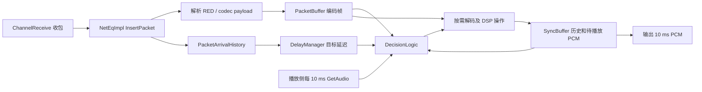
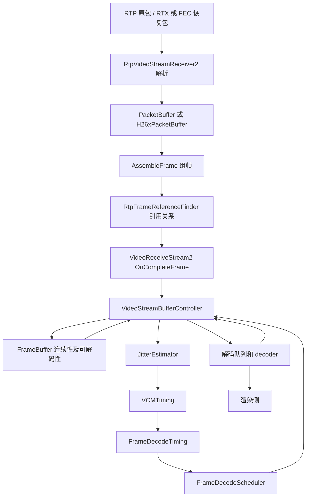

# WebRTC 音频 NetEq 与视频 Jitter Buffer 实现原理

> 源码基线：当前工作区 `src`，Git commit `6655e210cf9fe602fb7c60a36af505f6b2ede03f`，提交日期 2025-06-26。整理日期：2026-10-22。
>
> 本文的“当前”指上述检出版本，不指上游最新版本。分析对象是默认 NetEq controller 和 `VideoReceiveStream2` 接收主链路；自定义 controller、Field Trial、codec、应用播放延迟配置可能改变具体行为。所有默认值均以此版本为准。
>
> 本文基于实现及相关单元测试的静态阅读，不包含运行时性能测量或完整构建验证。公式中的毫秒、采样点和 RTP tick 会明确区分；简化伪代码用于解释控制逻辑，不替代边界处理完整的源码。

## 目录

1. [问题模型与整体差异](#1-问题模型与整体差异)
2. [当前源码的模块边界](#2-当前源码的模块边界)
3. [NetEq 的收包与缓冲](#3-neteq-的收包与缓冲)
4. [NetEq 如何估计目标延迟](#4-neteq-如何估计目标延迟)
5. [NetEq 如何每 10-ms 选择播放操作](#5-neteq-如何每-10-ms-选择播放操作)
6. [NetEq 的信号处理原理](#6-neteq-的信号处理原理)
7. [NetEq 的恢复、冗余和反馈](#7-neteq-的恢复冗余和反馈)
8. [视频从 RTP 包到帧依赖图](#8-视频从-rtp-包到帧依赖图)
9. [FrameBuffer 的连续性与可解码性](#9-framebuffer-的连续性与可解码性)
10. [视频如何估计抖动](#10-视频如何估计抖动)
11. [视频如何计算解码与渲染时间](#11-视频如何计算解码与渲染时间)
12. [视频的调度、丢帧与恢复闭环](#12-视频的调度丢帧与恢复闭环)
13. [用时序例子贯通机制](#13-用时序例子贯通机制)
14. [指标、定位方法与常见误解](#14-指标定位方法与常见误解)
15. [默认参数与源码阅读索引](#15-默认参数与源码阅读索引)

## 1. 问题模型与整体差异

发送端按媒体时钟产生数据，接收端按本地播放时钟消费数据。网络使数据的到达间隔不再等于媒体时间间隔，还会产生乱序、重复和丢失。接收端必须同时回答三个问题：

- **数据是否已具备？** 音频的下一段编码数据是否可用；视频的一帧是否组装好、参考帧是否满足。
- **应该什么时候使用？** 立即播放会放大网络抖动；等待过久又会累积交互延迟。
- **等不到时怎么办？** 音频仍须输出连续采样；视频须避免把不可解码的依赖链直接交给解码器。

Jitter buffer 的本质是围绕媒体时间轴建立一段可调的等待余量，而不是简单的 FIFO。增加余量使迟到数据更可能赶上播放，但增加交互延迟；降低余量则相反。单纯增加内存容量并不等于增加合理的播放余量。

| 维度 | 音频 NetEq | 视频接收缓冲链路 |
|---|---|---|
| 最终消费单位 | 每次 10 ms PCM | 可解码 temporal unit，通常是一帧，也可能含多个空间层 |
| 输入排序 | 时间戳、序列号，再到主数据/冗余优先级 | 包层按序列号；帧层按 frame ID 和引用关系 |
| 编码依赖处理 | 由具体 decoder 处理 codec 状态；NetEq 按音频时间推进 | 显式维护跨帧、跨空间层引用 |
| 延迟估计 | 相对到达延迟的分布、欠载分位数和乱序代价 | 帧完成时间变化、帧大小变化模型和随机噪声 |
| 延迟执行器 | PCM 加速、预扩展、PLC/CNG、恢复拼接 | 延后释放、到点解码、丢弃过晚且可跳过的帧 |
| 缺数据 | decoder PLC 或 NetEq Expand 保持输出 | 等待恢复；依赖无法满足时可能持续冻结并请求关键帧 |
| 驱动方式 | 收包 push，播放侧按 10 ms pull | 收包/依赖变化、解码就绪及定时任务共同驱动 |

音频不要求“一个 RTP 包对应一次播放”，视频也不要求“一个组装好的帧立即解码”。理解这两点，才能区分存储、网络估计和播放控制三个层次。

## 2. 当前源码的模块边界

### 2.1 音频：NetEq 同时包含编码包缓冲与 PCM 处理

默认工厂创建 `DecisionLogic` 作为 `NetEqController`。[默认 controller 工厂][A00]



实际入口是 `ChannelReceive::OnReceivedPayloadData()` 调用 `neteq_->InsertPacket()`，播放侧 `GetAudioFrameWithInfo()` 调用 `neteq_->GetAudio()`。这一版本应直接沿这条路径阅读，不能套用其他版本的 ACM 包装层。[音频收包入口][A01]、[音频播放入口][A02]

### 2.2 视频：jitter buffer 是多个模块合作的行为



`VideoReceiveStream2` 构造 `VideoStreamBufferController`，后者构造 `api/video/frame_buffer.*` 中的 `FrameBuffer`。定时器默认是 `TaskQueueFrameDecodeScheduler`；若注入 `DecodeSynchronizer`，则改用其提供的同步 scheduler。[构造入口][V00]、[控制器构造][V01]

仓库里同时存在 `modules/video_coding/deprecated/jitter_buffer.*`、旧 `frame_buffer.*` 和旧接收路径。它们不能代表本文所分析的 `VideoReceiveStream2` 主路径。测试名中的 `FrameBuffer3Test` 对应本文的 `api/video/frame_buffer.cc`，不意味着应寻找另一个同名实现文件。

## 3. NetEq 的收包与缓冲

### 3.1 三类缓冲各自解决什么问题

| 对象 | 保存内容 | 核心职责 |
|---|---|---|
| `PacketBuffer` | 未解码的 `Packet`，其中可包含 `EncodedAudioFrame` | 按时间轴等待、去重、优先选主数据、支持乱序 |
| `algorithm_buffer_` | 本轮算法产生的 PCM | 承接 Normal、Merge、时域伸缩等输出 |
| `SyncBuffer` | PCM 历史和尚未播放的 PCM | 向外稳定提供 10 ms，同时给 PLC、相关性搜索和拼接提供历史 |

`SyncBuffer` 有 `next_index_`：前面是历史，后面是 future；`FutureLength() = Size() - next_index_`。追加数据时从头部移除同等长度并调整索引，使总容量保持不变。`end_timestamp_` 跟踪媒体时间边界，不是本地墙钟时间。PLC、CNG 和时域伸缩使“存储了多少 PCM”与“媒体时间走到了哪里”不能简单等同。[SyncBuffer 数据结构][A03]、[SyncBuffer 实现][A04]

例如，20 ms 的 Opus 包可能只解码一次，解码结果分两次输出。已有足够 future PCM 时，NetEq 可以本轮完全不取新编码包。

### 3.2 InsertPacketInternal 的实际步骤

`InsertPacket()` 与 `GetAudio()` 均由 NetEq 内部 mutex 保护。主要解码及 DSP 发生在播放拉取路径；收包侧会调用 decoder 的 payload 解析接口，但这不等于将音频解码成 PCM。[线程保护和 API][A05]

`InsertPacketInternal()` 的主流程如下：[收包实现][A06]

1. 保存 RTP payload type、sequence number、timestamp 和 payload。
2. 必要时由 `TimestampScaler` 转换到 NetEq 内部采样时间域。**RTP 时钟频率不应无条件视为最终 PCM 采样率。**
3. 首包/重新初始化时清理状态并建立时间轴；启用 NACK 时更新收包序列信息。
4. RED payload 拆成多个具有各自时间戳和优先级的逻辑包。
5. 将 DTMF 事件抽出放入 `DtmfBuffer`，CNG 包走相应专用路径。
6. 普通媒体调用 `AudioDecoder::ParsePayload()`。一个网络包可以产生多个 `ParseResult`，每个结果都有 timestamp、priority 和可延后解码的 frame。
7. 将逻辑包插入 `PacketBuffer`，并通知 controller `PacketArrived()`。
8. codec 改变、缓冲 flush 或采样格式改变时，安排状态重建。

因此，`PacketBuffer` 中的“packet 数量”不必等于网络 RTP 包数量；按包数推断毫秒必须考虑拆包、冗余以及 codec 帧长。

### 3.3 排序、去重和溢出

`PacketBuffer` 底层是有序链表，通常从尾部向前查找插入位置，因为新包大多靠近队尾。`Packet::operator<` 先比较 timestamp，再比较 sequence number，只有两者都相同时才比较 redundancy priority；时间戳和序列号比较都考虑回绕。[编码包插入][A07]、[Packet 比较规则][A33]

插入处按 timestamp 去重，保留上述排序中更靠前的候选：新候选排在已有同 timestamp 候选后面时丢弃，排在前面时替换旧候选。priority 先比较 codec level，再比较 RED level，数值更小者优先，`{0, 0}` 最高。这使正常主包/冗余映射下优先使用原始数据，但不能概括成“无论 sequence number 如何，只要 timestamp 相同就仅比较 priority”。

达到 `max_number_of_packets_` 时，此实现先 **flush 整个编码包缓冲**，再继续处理当前包，并向上报告 `kFlushed`。`NetEqImpl` 随后重设 DSP 时间轴/codec 相关状态。它不是固定“丢最老一个包”的有界 FIFO。

过旧包清理主要可见于 `GetDecision()` 和 `ExtractPackets()`：前者根据同步缓冲末端及时间窗口清理，后者在实际提取解码数据后进一步清理落后的时间戳。不能简单描述成“所有迟到包都在 InsertPacket 入口立即判定并丢弃”。

### 3.4 三种缓冲量不能混用

`DecisionLogic` 得到的 `PacketBufferInfo` 同时包含以下信息：[构造 NetEqStatus][A08]、[缓冲量计算][A09]

- `num_samples`：实际包时长的累加，统计时跳过非主优先级的数据。
- `span_samples`：最晚和最早时间戳之差，加末包时长；中间有缺口也计入跨度。
- `span_samples_wait_time`：时间戳跨度加上末包已经等待的时间。

举例：缓冲中只有媒体时间 0–20 ms 和 100–120 ms 的两个主帧，实际内容约 40 ms，但覆盖的时间跨度约 120 ms。两者对“还剩多少声音”和“媒体时间轴滞后多少”的回答不同。

`FilteredCurrentDelayMs()` 又是“滤波后的包缓冲 level + SyncBuffer future”的毫秒值；它不是后文伸缩判决用的 `GetPlayoutDelayMs()`。这一差别会直接影响日志解读。[对外延迟统计][A24]

## 4. NetEq 如何估计目标延迟

### 4.1 先从绝对网络延迟中分离出相对变化

假设某包的媒体时间为 `S_i`，接收播放时钟上的到达时间为 `A_i`，都已换算为毫秒：

```text
transit_i = A_i - S_i
relative_delay_i ≈ max(0, transit_i - min(transit_reference))
```

两端时钟偏移未知，所以 `A_i - S_i` 不是可直接解释的单向网络延迟。但相减后的相对变化消除了固定偏移；网络排队、突发延迟以及收发时钟速率偏差会体现为变化。

实际 `PacketArrivalHistory` 使用解包后的 RTP timestamp，并通过单调队列维护候选到达记录的最小/最大 `arrival_timestamp - rtp_timestamp`。历史窗口默认 **2000 ms 媒体时间**。**乱序包会进入历史用于判断，但不更新维护极值的单调队列**，因此普通到达抖动的基线与乱序代价分开处理。[到达历史][A10]

还有一个重要实现细节：此处到达时钟来自 `TickTimer`，而 `tick_timer_->Increment()` 在每次 `GetAudioInternal()` 开头执行。它以音频拉取的 10 ms 节奏推进，不直接使用 `RtpPacketInfo::receive_time()` 作为该估计器的输入。后者仍用于其他统计。这样估计相对于接收播放进度建立，也意味着调试时必须检查播放拉取节奏。

仅有一个有效历史包时无法得到有意义的变化估计。重复、已覆盖或过旧记录会被过滤；CNG/DTMF 和不适合更新统计的 flush/codec 过渡样本也不会直接训练普通延迟模型。[PacketArrived][A11]

### 4.2 UnderrunOptimizer：用高分位数为迟到预留余量

目标是降低播放端耗尽有效数据的概率，而不是求平均网络延迟。

当前默认配置：[DelayManager 配置][A12]

| 配置 | 默认值 | 含义 |
|---|---:|---|
| `quantile` | 0.95 | 选择延迟分布的第 95 百分位 |
| `forget_factor` | 0.983 | 历史概率逐渐衰减 |
| `start_forget_weight` | 2 | 启动期加快适应 |
| `resample_interval_ms` | 500 ms | 以一段时间内最大延迟作为样本 |

具体实现是 100 个桶，每桶 20 ms。默认不把每一个包单独计入直方图，而是在到达更新时检查重采样计时器；当时间超过设定间隔，将上一段记录到的最大延迟入桶。没有新包到达就不会仅因计时到点自动更新。这里的 95% 因而是**重采样区间最大相对延迟的分布**，不能直接解释成“恰好容忍 5% 网络包迟到”。[欠载优化器][A13]

概率直方图可近似写为：

```text
h_j <- α × h_j + (1 - α) × indicator(j == observed_bucket)
bucket = smallest j with CDF(j) >= 0.95
D_underrun = (bucket + 1) × 20 ms
```

代码使用 Q15/Q30 定点数并修正概率和；启动期的 α 从更小的值逐步接近稳态值。目标取桶上边界。例如落在 40–59 ms 桶的分位数给出 60 ms 目标。达到 2000 ms 及以上、超出直方图范围的观测不会直接入桶；这不是允许无限增长的估计器。[Histogram][A14]

### 4.3 ReorderOptimizer：权衡多等一点和丢掉迟到包

默认启用独立乱序优化器。对顺序包加入第 0 桶；对乱序包按它的相对迟到量入桶，形成“若多等一段时间，可挽回多少乱序”的统计。[乱序优化器][A15]

对候选桶 `i`，代码计算：

```text
P_tail(i) = 1 - Σ h[0..i]
extra_delay(i) = max(0, i × 20 ms - D_underrun)
cost(i) = extra_delay(i) + 100 × ms_per_loss_percent × P_tail(i)
```

默认 `ms_per_loss_percent = 20`。若尾部概率是 1%，概率成本相当于 20 ms；已经由欠载缓冲承担的时间不再重复计费。选择最小 cost 的桶后，输出 `(i + 1) × 20 ms`。

这解释了两类行为：偶尔极晚的乱序包不一定值得全流长期等待；经常发生的中等乱序则可能值得增大缓冲。算法是带遗忘的离散代价优化，不是“见到一个晚包就把目标设成它的等待时间”。

### 4.4 合并和约束

`DelayManager::Update()` 的输出是：[目标合并][A16]

```text
D_raw = max(D_underrun, D_reorder)
```

尚无有效欠载结果时使用 80 ms 起始值。它是**估计器初始目标**，不是首包必须先静等 80 ms 的硬门槛。

真正给决策使用的 `TargetLevelMs()` 还会经过 `DelayConstraints`：[约束实现][A17]

```text
D <- max(D_raw, effective_minimum_delay)
若配置 maximum_delay > 0：D <- min(D, maximum_delay)
若已知 packet_len：D <- min(D, 3/4 × max_packets × packet_len)
```

有效最小值综合外部 minimum 和 base minimum；base minimum 会先被可用上界约束。最大延迟配置为 0 表示未设置该上限。这些约束控制的是目标，不保证正在播放的实际延迟瞬间变为该值，也不保证已丢失的数据能恢复。

### 4.5 BufferLevelFilter 在当前版本中的角色

`BufferLevelFilter` 对包缓冲跨度做 IIR 滤波，并补偿已执行时域伸缩造成的采样数变化；flush 时可直接重设 level。在 PLC/CNG 阶段，普通缓冲 level 滤波会暂缓更新。[level 滤波][A18]

但当前 `ExpectedPacketAvailable()` 的伸缩阈值判决使用的是**到达历史推导的播放延迟**，不是直接把 filtered level 与目标相比。旧说明文档和旧版本常把两者简写在一起；分析当前代码时必须分开。

## 5. NetEq 如何每 10 ms 选择播放操作

### 5.1 外层流程：先决策，再按需解码，再保证输出

`GetAudioInternal()` 的关键顺序为：[音频拉取主流程][A19]

```text
推进 TickTimer
构造 NetEqStatus，并选择 operation
按 operation 和已缓存 PCM 决定需要取多少编码帧
Decode：只解码本轮需要的数据
执行 Normal / Accelerate / PreemptiveExpand / Expand / Merge / CNG / DTMF
将产生的 PCM 写入 SyncBuffer
从 SyncBuffer 读出固定 10 ms PCM
维护播放时间戳、模式与统计
```

controller 的建议还会被 `NetEqImpl::GetDecision()` 修正。例如：

- SyncBuffer 已够 10 ms，且不需要 Merge/伸缩时，可直接 Normal 并不取编码包。
- DTX 包会禁止某些 Merge/伸缩选择，避免用过时的 level 估计处理静音期。
- Accelerate 需要约 30 ms 的 PCM 分析窗口；不足时可能先正常解码积累数据。
- codec/时间轴重建时，会 SoftReset 并重新对齐可用包的 timestamp。

因此 `Operation` 是控制器请求，`Mode` 是算法实际执行结果。请求 Accelerate 后可能得到 `NoStretch` 对应模式，不能把请求次数等同于成功压缩次数。

### 5.2 正常时间轴上的延迟闭环

当包头 timestamp 正好等于 `status.target_timestamp`，也就是下一段媒体数据连续可用时，进入 `ExpectedPacketAvailable()`。[核心决策][A20]

其播放位置与延迟为：

```text
playout_timestamp = target_timestamp - sync_buffer_samples
D_playout = PacketArrivalHistory.GetDelayMs(playout_timestamp)
L = TargetLevelMs()
H = L + PacketArrivalHistory.GetMaxDelayMs() + 20 ms
```

其中 `target_timestamp` 是 SyncBuffer 的末端媒体时间；减去 future PCM，近似得到即将播放的媒体位置。用当前 TickTimer 时间与历史网络基线比较，即得到“当前播放比基线晚了多少”。

在允许伸缩、上一模式不是 NetEq `kExpand`、且不播放 DTMF 时：

| 条件 | 操作建议 | 对延迟的影响 |
|---|---|---|
| `D_playout >= 4 × H` | `kFastAccelerate` | 更积极地消除积压 |
| 普通伸缩冷却期结束，且 `D_playout >= H` | `kAccelerate` | 压缩 PCM 时间，消费更多媒体时间 |
| 普通伸缩冷却期结束，且 `D_playout < L` | `kPreemptiveExpand` | 延长 PCM 时间，累积等待余量 |
| 其他 | `kNormal` | 正常消费 |

高低阈值之间保留一个窗口，避免小幅抖动引发加速/减速反复切换。高阈值含历史最大正常到达延迟，意在容忍突发到达变化。普通成功伸缩后设置 5 tick 的冷却计数；快速加速分支在这个检查之前。

`kFastAccelerate` 只是请求；真正 DSP 是否使用 fast mode 还取决于 `enable_fast_accelerate`，其 `NetEq::Config` 默认值为 false。[公开配置][A25]

### 5.3 没有包与只有未来包不是一回事

没有下一包时，`NoPacket()` 依据此前模式决定继续 RFC3389 CNG、codec 内部 CNG、DTMF 或 Expand。codec 内部 CNG 在生成噪声超过 1000 ms 后转入 Expand。

若缓冲中有更晚时间戳的包，则进入 `FuturePacketAvailable()`。设：

```text
timestamp_leap = next_packet.timestamp - target_timestamp
```

若 `timestamp_leap > generated_noise_samples`，说明当前合成的时间还没覆盖到该未来包；通常继续 concealment/CNG。只有当含等待时间的缓冲跨度超过 `TargetLevelMs() + 50 ms`，才允许为避免继续积压而提前推进。

决定接回真实数据时：

- 上一模式为 NetEq Expand：选择 Merge，把合成声音和新解码声音拼接。
- 上一模式为 codec PLC 或 CNG：选择 Normal，由正常路径/codec 处理恢复过渡。
- 尚未进入 concealment 的其他情形：先 Expand，不直接跨越缺口播放未来数据。

这说明 NetEq 会区分“包缺失”“包暂时迟到”和“媒体时间轴上的空洞”，但并没有在网络层准确知道某包最终是否永远丢失；它只能根据时间轴和已有信息作播放决定。

### 5.4 为什么恢复时有包也会继续 PLC/CNG

`PostponeDecode()` 保护恢复阶段：若 `span_samples_wait_time` 还不足目标的 50%，且缓冲没有 DTX/CNG 特殊包，则：

- CNG 后继续 CNG；
- Expand/codec PLC 后，仅当 concealment 的 mute factor 已低于 0.5 时才继续等待。

其目的是避免刚恢复几个采样就再次耗尽，造成连续短断裂。这也说明“缓冲非空但仍 concealment”可能是主动控制行为，而不一定是 decoder 故障。

## 6. NetEq 的信号处理原理

### 6.1 Accelerate：压缩内容时长，同时尽量保持音高

NetEq 不是改变声卡采样率，也不是简单按固定步长丢采样。`TimeStretch::Process()` 先分析波形，再找适合拼接的位置：[时域分析][A21]、[Accelerate][A22]

1. 多声道时用参考通道分析，得到的时间变化应用到各通道。
2. 将分析信号降采样到 4 kHz，做自相关，搜索主相关峰，估计适合重叠的周期长度 `p`。
3. 在约 15 ms 附近提取两段相隔 `p` 的波形，计算能量和归一化互相关。
4. 根据背景噪声能量做简单活动语音判别。活动语音要求足够相关；低能量片段可放宽。
5. 通过 overlap-add/cross-fade 将两段相似波形叠合，减少一段时间，保留大部分周期结构。

设输入包含 `N` 个每通道采样，普通成功压缩后可理解为约 `N - p` 个。外部仍每次只读 10 ms，但同样的真实媒体内容更快被消费，播放延迟下降。相关性不足则保留原信号，不强行伸缩。

fast mode 降低相关门槛，并尝试在约 15 ms 范围内压缩更多周期倍数，所以它在降低积压和保护波形之间选择更激进的折中。不能把源码注释中的“15 ms 粒度”理解成每次必然且精确压缩 15 ms；实际变化取决于周期、能量、模式和算法是否成功。

### 6.2 PreemptiveExpand：在缺包前主动放慢媒体时间

PreemptiveExpand 也使用相关性分析，但通过复制适当的周期片段并交叉淡化，把 `N` 个输入采样扩成约 `N + p` 个。它还保护之前已经存在的 old-data 区域，限制可修改的范围。[PreemptiveExpand][A23]

这时有真实音频可用，算法主动延长它，为后续网络包多争取一些到达时间。它与 Expand 的用途不同：

- **PreemptiveExpand**：已有真实 PCM，目标是调节延迟。
- **Expand**：需要的真实数据不可用，目标是保持听感连续。

两者都会增加输出可用采样，但不能合并解释成“丢包补偿”。

### 6.3 Expand：用历史构造丢失区间的替代声音

选择 `kExpand` 后，`NetEqImpl` 先尝试活动 decoder 的 `GeneratePlc()`；只要 codec 产生了所需的 concealment PCM，就进入 `kCodecPlc`。不支持或没有产生数据时，再运行 NetEq 自身 `Expand`。[PLC 入口][A26]

NetEq `Expand` 的主要机制是：[Expand 算法][A27]

1. 从 SyncBuffer 历史分析周期性、相关峰和失真，确定适合外推的波形周期。
2. 构造 voiced 部分：从历史周期延拓，使用平滑过渡减少边界突变。
3. 构造 unvoiced 部分：估计 AR/LPC 滤波器，以随机激励产生具有相近谱形的噪声。
4. 根据信号特征混合 voiced/unvoiced，并随连续 concealment 推进调整混合比例。
5. 逐渐衰减语音部分，加入估计的背景噪声；长期缺失最终进入很低能量或静音状态。

这样做不能恢复丢失的真实信息，但比机械重复一个采样块更能减少点击声、周期性蜂鸣和长时间错误语音。每轮按需生成，直到 SyncBuffer 可供本次 10 ms 输出。

### 6.4 Merge：让真实声音平滑接回

丢包恢复后，历史合成的波形与新解码数据即使属于相邻媒体时间，也未必在相位、振幅上连续。直接相接可能产生明显爆音。

`Merge` 生成/获取扩展片段，对扩展信号与新 PCM 做降采样、互相关和峰值搜索，选择较合适的对齐位置；必要时调整新信号增益并逐渐恢复，再交叉淡化，最后接上正常解码部分。[Merge 算法][A28]

Merge 是恢复接口的信号处理，不是网络重排，也不是将两个编码包简单拼接。

### 6.5 CNG 和 DTMF

RFC3389 CNG 保存噪声参数，在没有新 SID 时继续生成舒适噪声；codec 内部 DTX/CNG 由对应 codec 路径处理。静音不持续发送语音包是正常行为，不能把每个静音间隔都判为媒体丢失。

CNG 决策使用 timestamp 与已生成噪声量判断是否应该使用新的 SID；若等待明显超过目标，还可以 fast-forward 噪声时间。DTMF 事件则被单独缓冲、生成音调，并可与媒体输出叠加。这些分支解释了为何 NetEq 不能只用“有包正常播、没包 PLC”概括。

## 7. NetEq 的恢复、冗余和反馈

### 7.1 Opus FEC 是通过可选择的冗余 frame 接入的

`AudioDecoderOpusImpl::ParsePayload()` 发现包内 FEC 时，产生 timestamp 为 `当前 timestamp - redundant duration`、priority 为 1 的恢复帧，同时产生当前 timestamp、priority 为 0 的主帧。[Opus payload 解析][A29]

因此，若前一包丢失、后一包及时到达，PacketBuffer 能在前一媒体时间位置提供 FEC frame；主包若仍及时到达，则同 timestamp 的优先级规则倾向主数据。FEC 数据到达时播放时间若已越过其用途范围，也不能无条件回放过去的声音。

### 7.2 NACK 是恢复机会，不是播放输出的阻塞条件

NetEq 的 `NackTracker` 根据 sequence number 跳变建立缺包记录，推算 timestamp 和 time-to-play；实际反馈由 `ChannelReceive` 取 `GetNackList(rtt)` 后发出。[NACK tracker][A30]、[反馈调用][A01]

当前请求条件不只是“剩余播放时间大于 RTT”。还存在基于估计丢包率的额外等待成本分支：

```text
time_to_play > RTT
或者 time_since_packet + RTT < max_wait(loss_rate)
```

并受有效 RTT、最大丢包率、列表长度和重复请求配置约束。请求发出后 NetEq 仍须每 10 ms 输出；到点缺失时继续走 PLC/CNG 等路径。NACK、FEC、缓冲和 concealment 共同决定质量，而非彼此替代。

### 7.3 时间异常和容量异常的处理

codec 改变、缓冲 flush 或时间轴异常可能触发 `new_codec_`、时间戳重对齐和 `SoftReset()`。后者重置到达历史、目标估计、level filter 和伸缩记忆等控制状态，避免沿用上一段流的延迟模型。

对于非常久远的时间戳，源码还有 horizon 判断和错误保护；这不是任意顺序数据都可无条件插回的无限历史播放器。调试时应同时检查 timestamp wrap、codec 切换、flush 和实际包时长，而不能只观察网络 RTT。

## 8. 视频从 RTP 包到帧依赖图

### 8.1 包缓冲先解决“是否能组出帧”

`RtpVideoStreamReceiver2` 解析 RTP 头扩展和 codec payload，得到帧首/帧尾标识、帧类型、时间戳及可用的 dependency descriptor 等信息，再进入包缓冲。[包缓冲入口][V02]

通用 `video_coding::PacketBuffer` 使用环形槽位：

```text
index = sequence_number % buffer_size
```

初始容量 512，默认最大容量 2048，大小为 2 的幂。槽位冲突且不是重复包时尝试翻倍扩容；最大容量仍冲突则清空，并通过 `buffer_cleared` 触发关键帧请求。已明确 `ClearTo()` 越过的旧包会被忽略。[视频包插入与扩容][V03]

它以序列连续性和帧边界寻找完整片段：从新到的包向后传播 `continuous`，到帧尾后向前查找帧首，返回按顺序排列的一组 packet。中间缺一个分片，后续分片即使都收到，也不一定能组成可交付的帧；补齐空洞可能一次释放多个帧。Padding 同样参与序列连续性维护。

### 8.2 H.264/H.265 的例外必须单独看

不能把“所有视频包必须有可靠帧首标记”当作统一规则。通用 PacketBuffer 的无 generic descriptor H.264 路径会沿相同 timestamp 向前搜索，并依据 SPS/PPS/IDR 判断关键帧；源码明确说明这条传统路径可能交出不完整帧。[H.264 特殊组帧][V04]

此版本 `UseH26xPacketBuffer()` 对 H.265 返回 true；H.264 则由 `WebRTC-Video-H26xPacketBuffer` Field Trial 控制。专用 `H26xPacketBuffer` 使用固定 2048 槽，维护若干连续序列，并处理 H.264 参数集缓存/补齐等 codec 特殊性。[分支选择][V05]、[H26x 结构][V06]

因此，下文所说“帧已完整”指上游组帧逻辑认为可交付；不代表每种编码和每种配置下都能仅从 RTP 包序列证明码流完全正确。

### 8.3 OnInsertedPacket：把 packet 列表变成编码帧

收到包缓冲返回的 packet 列表后，`OnInsertedPacket()`：[组装实现][V07]

1. 按帧边界收集 payload 片段。
2. 记录第一/最后序列号、最早/最晚 receive time、最大 NACK 次数及 packet infos。
3. 调用对应 depacketizer 的 `AssembleFrame()` 生成连续编码 bitstream。
4. 构造 `RtpFrameObject` 并交给 `OnAssembledFrame()`。

后续可能先经过解密或 frame transformer，再进入引用关系处理。这里的最大 receive time 表示这帧所需包的完成到达时刻，是后面视频抖动估计的重要输入。

### 8.4 ReferenceFinder：把编码协议转换成统一的依赖表达

一个完整的 P 帧仍可能缺少参考帧，不能只靠 RTP timestamp 排序解码。

`RtpFrameReferenceFinder` 将不同 codec 的描述转换成统一的 frame ID 和 `references[]`：[引用关系分派][V08]

- 有 generic descriptor 时用其 frame ID 和依赖信息。
- VP8/VP9 根据 picture ID、temporal index、TL0 等信息选择专用引用恢复逻辑。
- 信息较少时退化为 frame ID 或 sequence number 推断策略。
- 某些 codec 策略会暂存还不能确定引用关系的帧，待后续信息补齐再释放。

这些 ID 处理回绕并可加 offset，使上层无需理解每一种 RTP 编码头。codec 改变时还会重建 finder，并加足够的 ID 偏移来避免新旧流混淆。

## 9. FrameBuffer 的连续性与可解码性

### 9.1 核心存储是一张按 frame ID 排序的依赖图

`FrameBuffer` 保存 `frame ID -> FrameInfo`，另有 `decoded_frame_history_`。引用必须指向更小的 ID，且不能重复；重复帧、已越过的旧帧以及不合法引用会被拒绝。[帧插入][V09]

控制器默认允许保存 800 个 frame，并保存 8192 个解码历史条目。注意 SVC 空间层也占 frame 条目；800 不是固定 800 个显示画面，更不是以毫秒计的目标延迟。

缓冲已满时，新来的关键帧可以清空并重新开始；普通增量帧会被拒绝。另有兼容旧 frame ID 跳变行为的 Field Trial，允许特定“时间戳更新但 ID 回退”的关键帧重建缓冲。

### 9.2 continuous：依赖链已经到齐

对帧 `F`，每个 reference 满足以下任一条件，就可以认为 F continuous：[连续性传播][V10]

- 已存在于 decoded history；
- 仍在 FrameBuffer 中，且该参考帧已经 continuous。

关键帧没有引用，自然是递归起点。`PropagateContinuity()` 从新插入位置向后扫描，使后续依赖它的帧也可能变为 continuous。

例如 `K0 -> P1 -> P2` 全部收到但尚未送解码时，三帧都可以 continuous。这表示引用链不再有接收空洞，不表示三帧都可以现在独立送解码。

### 9.3 temporal unit：一次提交的同一媒体时刻

同一 RTP timestamp 的多个空间层可以组成一个 temporal unit（TU）。`is_last_spatial_layer` 标记该 TU 的结束。单层视频中 TU 通常就是一个 frame；SVC 中则可能包含多个具有层间依赖的 frame。

`FindNextAndLastDecodableTemporalUnit()` 扫描到已连续的 TU 边界，并检查该 TU 每个引用是否：[TU 可解码判定][V11]

- 已在 decoded history 中；或
- 位于当前 TU 内部，能够一起提交。

若引用了另一个还未提交解码的 TU，则当前 TU 暂时不可解码。这是 **continuous 与 decodable 的核心区别**。

同样的 `K0 -> P1 -> P2`，开始通常只有 K0 可解码；提取 K0 后，P1 才满足引用历史，接着才轮到 P2。独立关键帧、可跳过的时域层等可能让多个不同 timestamp 的 TU 同时满足条件。

### 9.4 “decoded history”实际上在提取时更新

`ExtractNextDecodableTemporalUnit()` 在把 frame 交给下游之前，就执行 `InsertDecoded()`，不是等 decoder 成功回调后再写。[提取和历史更新][V12]

它表达的是缓冲层已经按依赖顺序提交的历史。真正解码失败由 `VideoReceiveStream2` 的结果处理和关键帧恢复状态处理。不能根据 history 里的存在性推断用户一定已经看到该帧。

### 9.5 丢弃如何影响依赖

`DropNextDecodableTemporalUnit()` 不仅删除该 TU，还删除它之前所有仍留在 map 中的条目；未被移走的 frame 会计入 dropped。直接丢弃的 TU **不会**被写入 decoded history。[丢帧实现][V13]

所以如果后续帧依赖被丢弃的帧，后续可解码集合必须重新计算，不能继续假装其参考已经成功解码。能够安全跳过的候选一般来自独立参考链、关键帧或允许丢弃的时域层，而不是任意 P 帧。

## 10. 视频如何估计抖动

### 10.1 输入是帧完成间隔减去媒体间隔

对相邻参与估计的 TU，令 `R_i` 为完成接收时刻，`T_i` 为 RTP timestamp，视频 RTP 时钟按 90 kHz 换算：

```text
Δarrival_i = R_i - R_(i-1)
Δmedia_i = (T_i - T_(i-1)) / 90     # timestamp tick 换成 ms
z_i = Δarrival_i - Δmedia_i
```

`InterFrameDelayVariationCalculator` 处理 timestamp unwrap，忽略更旧或非更新的 timestamp。第一个样本在此实现中返回 0。[帧间延迟变化][V14]

`z_i` 是两个帧相对传输延迟之差，不是单向绝对延迟。例如媒体间隔 33 ms，而帧完成到达间隔 53 ms，`z_i = 20 ms`，说明后帧相对更慢。

控制器在 **TU 被释放时** 更新估计，但输入使用保存的 receive timestamp，不使用“当前释放时刻”代替网络到达时刻。多空间层按合并大小及最晚完成时间处理。[释放时的估计更新][V15]

### 10.2 为什么要考虑帧大小

视频 I 帧和 P 帧大小可能相差很大。即便链路状态稳定，大帧也可能需要更长的发送、排队和接收完成时间。如果把所有变化都当成随机网络噪声，目标缓冲会被编码内容强烈扰动。

当前估计器采用两状态模型：[Kalman 实现][V16]

```text
Δsize_i = size_i - size_(i-1)
z_i ≈ θ0 × Δsize_i + θ1 + noise_i
```

- `θ0` 的单位近似 ms/byte，表示帧大小变化对完成时间变化的影响，可理解为有效传输速率的倒数。
- `θ1` 是模型中的链路排队延迟变化偏置，单位 ms；它不是绝对网络排队延迟。
- `noise_i` 是当前模型不能解释的随机残差。

观测向量 `H = [Δsize, 1]`，状态 `x = [θ0, θ1]`。状态转移矩阵为单位阵，预测阶段主要增加协方差；随后根据残差和 Kalman gain 更新参数。

```text
innovation = z - Hx
K = P Hᵀ / innovation_variance
x <- x + K × innovation
P <- (I - K H) P
```

这是对源码控制思想的概括。实际 observation-noise 权重依赖帧大小变化和噪声方差，代码还有下界、异常值保护及关于量纲的 TODO，不能将其等同为未经调整的教科书 Kalman 参数化，更不能把 θ0 当作精确可用带宽测量。

### 10.3 残差、异常样本与大帧后的排队效应

`JitterEstimator::UpdateEstimate()` 同时维护平均帧大小、最大帧大小和随机噪声方差：[JitterEstimator 更新][V17]

- 平均帧大小用平滑滤波，过大的样本不直接拉高平均值。
- 最大帧大小默认使用缓慢衰减的最大值；Field Trial 可改用分位数，平均值也可改用中位数。
- delay 样本先按当前噪声标准差限制幅度，再判断残差是否异常。
- 大关键帧可能把后续小帧挤在一起到达，造成很大的负 `Δsize` 和特殊延迟样本；默认通过拥塞拒绝条件避免这类样本直接更新 Kalman 模型。
- 随机残差的平滑权重会按帧率调整，避免低帧率流适应过慢。

这些保护使估计器不会对单个极端样本完全失去控制，但也意味着估计值有记忆、启动过程和适应时间。

### 10.4 从模型得到 jitter delay

核心计算可写为：[估计输出][V18]

```text
size_margin = θ0 × (filtered_max_size - filtered_average_size)
noise_margin = max(1 ms, 2.33 × sqrt(noise_variance) - 30 ms)
J_base = size_margin + noise_margin
```

`J_base` 太小则沿用前次有效值或最小 1 ms，过大限制在 10 秒。最终 `GetJitterEstimate()` 还会增加 10 ms 的系统抖动余量，并与保存的后处理估计比较。

注意两个细节：

1. 输出不是简单的 `2.33σ`，还包括大小项、`-30 ms`、下界与其他后处理。
2. θ1 参与模型拟合和残差估计，但 `CalculateEstimate()` 的大小裕量使用 θ0，不直接把 θ1 加到最终缓冲余量中。

2.33 只是启发式安全裕量的一部分，不能据此宣称该实现对所有网络都严格达到某个概率保证。

### 10.5 重传单独对待，并按条件增加 RTT 余量

TU 中任意一层被标记为重传延迟，就不走普通 `UpdateEstimate()`，而是 `FrameNacked()`；这样避免把重传耗时训练成普通网络 jitter。输入时间戳外推器的更新也会排除标记为重传延迟的帧。[控制器估计分支][V15]

默认累计到 3 次 NACK 标记帧后，`GetJitterEstimate()` 可添加 RTT 余量；60 秒没有新的此类标记会清计数。当前控制器传入：

```text
RTT_addition = min(0.9 × filtered_RTT, 200 ms)
```

这不是“开启 NACK 就恒定多缓存一个 RTT”，也不是每次重传都会立即提高缓冲；它是有计数与超时条件的反馈。

最终还按估计帧率处理：非零且低于 5 fps 时返回 0；5–10 fps 线性缩放；尚不能估计帧率、返回 0 Hz 的启动情况保留当前非负估计。低帧率内容本身画面间隔很长，代码采用不同的平滑折中。

## 11. 视频如何计算解码与渲染时间

### 11.1 TimestampExtrapolator 建立 RTP 与本地时钟的映射

`VCMTiming::IncomingTimestamp()` 把 RTP timestamp 与本地接收完成时间交给 `TimestampExtrapolator`。外推器通过递归最小二乘方式拟合：[时间戳映射][V19]

```text
unwrapped_RTP - first_RTP ≈ w0 × local_elapsed_ms + w1
```

初始 `w0 = 90 tick/ms`，之后可跟踪两端时钟速率差和偏移；检测到延迟突变时提高不确定度以加快偏移适应；长时间无数据时重置。乱序帧不会按普通更新路径污染拟合。

反解该关系得到 `estimated_complete_time(T)`，即该媒体时刻在接收端基准上的预测完成时间。它**不是发送端绝对采集时刻**。A/V sync 还有独立的 RTP/NTP 映射和同步延迟控制，不能与这个局部外推器混同。

### 11.2 目标视频延迟由三部分组成

普通渲染模式下，`VCMTiming` 的内部目标是：[Timing 目标][V20]

```text
D_target = max(min_playout_delay,
               jitter_delay + estimated_decode_time + render_delay)
```

其中：

- `jitter_delay`：网络/组帧波动和相关保护余量。
- `estimated_decode_time`：给解码器预留的时间。
- `render_delay`：给渲染环节预留的时间，由配置传入。
- `min_playout_delay`：上层、同步或 RTP playout-delay 提示施加的下界。

解码耗时估计不是当前一帧的实际耗时，也不是历史最大值。`DecodeTimePercentileFilter` 跳过前 5 个样本，维护最近 10 秒的第 95 百分位；实际解码完成回调通过 `StopDecodeTimer()` 更新它。[解码耗时滤波][V21]、[解码回调反馈][V22]

### 11.3 render time 和 latest decode time

`RenderTimeInternal()` 的普通路径计算：[渲染与等待时间][V23]

```text
actual_delay = clamp(current_delay, min_playout_delay, max_playout_delay)
render_time = estimated_complete_time(RTP timestamp) + actual_delay
wait = render_time - now - estimated_decode_time - render_delay
```

因此 jitter buffer 调度的是**最迟应当开始解码的时刻**，不是一直把编码帧留到 render time 才交给 decoder。如果等到渲染时刻才开始解码，解码和渲染耗时就会额外导致晚点。

`TargetVideoDelay()`、`current_delay_` 和最终 clamp 后的 actual delay 是不同量。`D_target` 内部计算不直接按 maximum 截断；真正计算 render time 时才 clamp。所以配置了最大延迟，也可能观察到目标估计高于该上限。

### 11.4 当前主路径如何更新 current delay

此版本 `VideoStreamBufferController::OnFrameReady()` 调用的是：

```cpp
VCMTiming::UpdateCurrentDelay(Timestamp render_time,
                             Timestamp actual_decode_time)
```

它计算：

```text
late = actual_decode_time - render_time + decode_estimate + render_delay
若 late.ms() < 0：返回
否则 current_delay = min(current_delay + late, target_delay)
```

这里的 `actual_decode_time` 是准备释放帧时的当前时间，不是 decoder 完成时间。若释放比理想解码起点更晚，算法可补充 current delay，但受目标约束；目标降低时，这个 min 也可能使当前值下降。[当前延迟更新][V24]

源码另外保留 `UpdateCurrentDelay(uint32_t frame_timestamp)`，其中有“每秒最多调整 100 ms”的逻辑。它在旧 `deprecated/receiver.cc` 路径使用，**不能直接作为当前控制器的更新公式**。[旧重载][V25]

同样，`SetJitterDelay()` 在 current delay 尚为 0 时先用 jitter delay 初始化它。目标的组成、初始化、释放时反馈和渲染 clamp 是多处逻辑协作，而非一个每帧立即赋值 `current = target` 的步骤。

### 11.5 低延迟路径

当 `min_playout_delay == 0` 且 `max_playout_delay <= 500 ms` 时，`UseLowLatencyRendering()` 返回 true，`RenderTime()` 返回特殊值 0，表示尽快解码/低延迟渲染。[低延迟判定][V26]

这不意味着完全不做调度：若 max delay 仍大于 0，默认用 8 ms 的最小解码提交间隔防止突发压垮 decoder；控制器中缓冲 frame 数超过默认 8 时可绕过 pacing 尽快送出。若 min/max 都为 0，则不走这个正 max-delay pacing 分支。

缓冲数量阈值来自 FrameBuffer 的条目数，不是直接测量硬件 decoder 内部队列长度。低延迟渲染模式中后续 renderer 也可能承担额外 composition 调度，不能拿 render_time=0 推断端到端时延为零。

## 12. 视频的调度、丢帧与恢复闭环

### 12.1 两个触发条件：有可解码数据，且消费侧可接收

`MaybeScheduleFrameForRelease()` 必须同时满足：[释放调度][V27]

```text
decoder_ready_for_new_frame_ == true
FrameBuffer 存在 decodable TU
```

新帧使 continuous TU 增加时会尝试调度；`StartNextDecode()` 也会尝试调度，因此不会因为“帧早已到达，但 decoder 刚就绪”而错失处理。

已经为同一 timestamp 排定任务时不重复安排。换候选帧时取消旧任务，再为新的候选设定时间。

### 12.2 过晚帧的 fast-forward 规则

`FrameDecodeTiming::OnFrameBufferUpdated()` 取得 `wait` 后：[过晚帧决策][V28]

```text
若 wait <= -5 ms 且 next_decodable_timestamp != last_decodable_timestamp：
    返回无 schedule，控制器丢弃当前 TU 并重试
否则：
    wait = clamp(wait, 0, max_wait_for_frame)
    latest_decode_time = now + wait
```

这里“还有下一帧”严格指**存在另一个当前已经满足可解码条件的 TU**。仅仅缓冲里还有几百帧并不够；如果它们都依赖当前帧，就不能据此直接跳过参考链。

若只剩当前这一个可解码候选，即使很晚也会选择尽快解码，而不是为了追时间把最后的画面机会也丢弃。丢掉候选后 FrameBuffer 会重新计算依赖可用性。

控制器还将最大等待限制在超时剩余时间减去 1 ms 以内，降低释放任务与等待超时竞争的可能性。

### 12.3 定时器释放、合并和解码队列

默认 task-queue scheduler 用高精度延时任务，在 `latest_decode_time` 附近回调。它一次保存一个 scheduled RTP timestamp；取消后旧任务看到 timestamp 不匹配即不再释放。[调度器实现][V29]

到点后控制器重新检查可解码信息，提取下一 TU，运行 `OnFrameReady()`：

1. 更新等待超时跟踪。
2. 验证 render timing；异常时重置 timing/jitter 模型。
3. 给各空间层赋相同 render time，汇总包接收时间、帧大小和重传标记。
4. 对普通样本更新抖动估计与 current delay，或记录 NACK。
5. 更新缓冲统计，将空间层合并为一个编码提交对象。
6. 记录本次调度时间，清除 decoder-ready 标记，调用 `OnEncodedFrame()`。

`CombineAndDeleteFrames()` 会拼合空间层 bitstream 并保留层大小等信息，不是把不同显示时刻的视频帧合成一个画面。[空间层合并][V30]

`VideoReceiveStream2::OnEncodedFrame()` 把工作投递到 decode queue，处理返回结果，再回到 worker 调用 `StartNextDecode()`。[解码闭环][V31]

这里的“ready”主要限制上层提交链路。对异步硬件 decoder，`Decode()` 返回不一定意味着画面已经解码并显示；真正解码耗时和渲染反馈还在完成回调中。因此它不是硬件内部严格只有一帧在途的保证。

### 12.4 丢包、NACK、关键帧与超时

包层缺口由 `NackRequester` 等恢复机制处理，恢复包重新进入组帧流程。FrameBuffer 主要负责依赖和可解码性，不直接承担 RTP 重传发送。

关键帧恢复存在多个入口：

- 包缓冲溢出清空时请求关键帧。
- 尚未收到起始关键帧却收到增量帧时请求。
- decoder 返回失败或要求关键帧时，更新 `keyframe_required_`。
- 长时间没有可解码帧，且流仍活跃等条件满足时请求。

等待关键帧状态下，控制器找到完整可解码关键帧会优先立即释放给 decoder，而不是继续按普通等待策略延后。[关键帧释放][V32]

`OnDecodableFrameTimeout()` 还会检查最近 5 秒是否收到包、是否正在接收关键帧、加密流是否可解密，避免对已不活跃的流不断发送请求。[超时处理][V33]

### 12.5 A/V sync 和应用延迟约束如何进入

`VideoReceiveStream2::UpdatePlayoutDelays()` 综合 frame playout-delay、base minimum 和同步 minimum，取可用最小延迟需求中的最大值；若 RTP frame 携带的 maximum 更小，则 maximum 优先，进一步压低 minimum。[播放约束合并][V34]

音频也可以通过 minimum/base minimum 调整 NetEq 目标下界。由此可见，网络 jitter 只是最终播放延迟的一个来源；A/V sync、应用偏好、解码和渲染预算都会影响最终行为。

## 13. 用时序例子贯通机制

以下数值只用于展示源码分支，不是实测结果，也不保证所有配置都产生相同听感或时延。

### 13.1 音频顺序到达但偶尔变慢

假设每包 20 ms，前几个包的媒体时间和到达时间为：

| 包 | 媒体时间 S | 到达 A | A−S | 相对最小基线的延迟 |
|---|---:|---:|---:|---:|
| P0 | 0 | 100 | 100 | 0 |
| P1 | 20 | 120 | 100 | 0 |
| P2 | 40 | 155 | 115 | 15 |
| P3 | 60 | 170 | 110 | 10 |

15 ms 的变化会参与该重采样区间的最大值统计，后续通过直方图影响目标。不能拿这个四包例子直接断言最终目标就是 20 ms，因为直方图有初始分布、历史权重、500 ms 重采样周期及乱序/外部约束。

若最终目标 `L=60 ms`，历史最大延迟 `20 ms`，则高阈值 `H=100 ms`：

- 播放延迟 45 ms：若时机和 PCM 条件允许，尝试 PreemptiveExpand。
- 播放延迟 80 ms：正常消费。
- 播放延迟 110 ms：普通冷却结束后尝试 Accelerate。
- 播放延迟 410 ms：提出 FastAccelerate 请求，实际 fast DSP 仍受配置控制。

### 13.2 音频 P1 没到，P2 先到

```text
媒体：P0 [0..20) | P1 [20..40) | P2 [40..60)
到达：P0 -> P2 -> P1（可能仍可挽回，也可能已过时）
```

如果 SyncBuffer 还有 10 ms 可播，NetEq 可先消费已有 PCM，留出自然等待窗口。需要 20 ms 位置而包缓冲只有 40 ms 位置时，FuturePacketAvailable 不能把 P2 立即当 P1 播；会结合 generated-noise 时间和积压决定继续 Expand 还是接回数据。

若 P2 带有 P1 的 Opus FEC 且赶得上，解析后可能已经提供 20 ms 位置的冗余 frame，因而不必进入同样的 PLC 路径。若已发生 NetEq Expand，恢复时通过 Merge 平滑接回；若到来的 P1 已落后于实际提取/解码时间轴，则会被旧包逻辑清理。

### 13.3 视频帧完整，但依赖不完整


P2/P3 的组帧完成不代表它们可解码。P1 的缺口先阻止组帧，随后使依赖链无法传播连续性。NACK 恢复缺片后，P1 组出并进入 FrameBuffer，P2/P3 可以变 continuous；它们仍需按引用顺序逐次提交。

若 P1 最终无法恢复，继续增加 P2/P3 的缓冲条目不会修复参考关系。后来的独立关键帧可建立新的起点；超时与 decoder 状态也可能触发关键帧请求。

### 13.4 视频可解码帧应该何时释放

设本地预测完成时间为 1000 ms，当前附加延迟为 80 ms，解码预算 12 ms，渲染预算 10 ms：

```text
render_time = 1000 + 80 = 1080 ms
latest_decode_time = 1080 - 12 - 10 = 1058 ms
```

- 当前 1040 ms：可以等待约 18 ms 再提交解码。
- 当前 1060 ms：已经晚 2 ms，直接解码。
- 当前 1070 ms：已经晚 12 ms；若另一个 TU 已经可独立解码，可以跳过当前 TU 再评估。
- 当前 1070 ms，但后面所有帧都依赖当前帧：没有另一个 decodable TU，通常仍提交当前帧，不能仅因“后面有包”就跳帧。

### 13.5 为什么 RTT 变大不一定立刻让视频缓冲同量增长

普通 jitter 模型只使用未被标记为重传延迟的 TU；RTT 附加又有 NACK 计数条件、0.9 倍系数和 200 ms 上限。加上当前延迟更新、min/max 播放约束及低帧率处理，RTT 到最终呈现延迟不是一个线性恒等关系。

## 14. 指标、定位方法与常见误解

### 14.1 指标必须先确定采样位置与分母

音频 `CurrentNetworkStatisticsInternal()` 的当前缓冲时长来自“主包实际时长累加 + SyncBuffer future”；preferred buffer size 来自 controller 的受约束目标。`FilteredCurrentDelayMs()` 又使用滤波后的包跨度，三者不应互换。[音频指标入口][A24]

音频 `ExtractPackets()` 在提取编码帧时记录 packet waiting time，按 packet duration 累加 jitter buffer delay、target delay 和 unlimited target delay 等统计。[音频统计记录点][A31]、[统计累加实现][A32]

视频控制器明确把 jitter-buffer ingest 定义为首个包被 `RtpVideoStreamReceiver2` 收到的时刻，把 emit 定义为可解码帧从控制器释放的时刻：[视频统计边界][V35]

```text
video_jitter_buffer_delay = max(0, frame_release_time - earliest_packet_receive_time)
```

所以它覆盖组帧等待、依赖等待和释放调度等待，不能仅理解为 FrameBuffer map 中的停留时间。它不等于网络单向延迟，也不包含释放后的全部解码/显示耗时。

`VCMTiming::GetTimings().target_delay` 使用统计口径：从内部 target 中减去解码和渲染预算，并限制为非负值。这与 `TargetVideoDelay()` 的总目标不同。[统计目标换算][V36]

对上层导出的累计值，应按对应 emitted count 的增量求区间平均；音频的样本计数和视频的帧/TU 统计口径不同，不能把两者原始累加值直接对比。

### 14.2 推荐的源码定位顺序

| 现象 | 先看什么 | 能区分什么 |
|---|---|---|
| 音频持续 PLC | `next_packet.timestamp`、`target_timestamp`、future PCM、last mode | 真缺数据、未来包、恢复等待或解码问题 |
| 音频延迟越来越大 | `D_playout`、TargetLevel、history max、operation 与执行 mode | 目标增大、禁止伸缩、PCM 不足或相关性不允许压缩 |
| 有音频包却不恢复 | `PostponeDecode`、mute factor、span_wait、DTX/CNG | 主动恢复等待与其他故障 |
| 视频有大量包却冻结 | PacketBuffer 完整性、reference finder、continuous/decodable | 缺分片、依赖未定、参考缺失 |
| 视频有可解码帧却不送解码 | decoder-ready、scheduled RTP、wait、timeout | 消费侧节流、定时等待或调度状态 |
| 视频延迟高但 jitter 小 | min/max、sync minimum、decode percentile、render delay | 非网络延迟来源 |
| 视频频繁丢帧 | `wait <= -5 ms`、其他 decodable TU、容量和 codec 返回值 | 追赶时钟、溢出、过时帧或解码失败 |
| 重传改善不明显 | 恢复到达时刻相对播放时间、参考链、RTT 余量 | 修复包是否赶上使用时机 |

需要关注控制器的输入、决策、执行结果三个层次。只看“buffer size”或单一 jitter 指标，通常无法解释异常。

### 14.3 容易误读的结论

| 常见说法 | 当前源码更准确的解释 |
|---|---|
| NetEq 就是一个 RTP 队列 | 它包含包缓冲、延迟控制、decoder 调用、PCM 历史和多种 DSP 算法 |
| NetEq 伸缩直接比较滤波后的 buffer level | 当前正常包分支主要比较到达历史推导的 playout delay |
| 80 ms 是固定首播等待 | 它是 DelayManager 初始目标；首播和后续调整另有状态逻辑 |
| Expand 和 PreemptiveExpand 都是缺包补偿 | 前者 concealment，后者对真实 PCM 做预防性时域延长 |
| RTP jitter 指标乘一个系数就是目标缓冲 | 音频和视频都有独立模型，不能直接用一个 RTP jitter 数值代替 |
| 视频 FrameBuffer 收齐帧就解码 | 还要满足引用依赖、消费侧就绪与时间调度 |
| continuous 就等于 decodable | continuous 可包含未提交的完整参考链；decodable 还要求外部参考已提交 |
| decoded history 表示 decoder 已成功完成 | 此实现提取 TU 时就更新该历史，真实失败由上层恢复逻辑处理 |
| 视频任意晚帧都可以丢 | 当前调度要求还有另一个可解码 TU；丢弃后还要重算依赖 |
| 视频 current delay 每秒最多变化 100 ms | 该逻辑在另一重载中，当前控制器调用的是释放晚点补偿重载 |
| 用更大 PacketBuffer 必然更平滑 | 它只改变容量，不能修复永久丢包、引用缺失或不合理目标 |
| render_time 为 0 表示没有延迟 | 它是低延迟模式的调度信号，组帧、解码和显示仍需时间 |

## 15. 默认参数与源码阅读索引

### 15.1 参数速查

下表是基线版本的类/配置默认值，不保证应用未覆盖，也不代表建议调参值。

| 模块 | 参数 | 默认值/条件 |
|---|---|---|
| NetEq | 输出粒度 | 10 ms |
| NetEq Config | `max_packets_in_buffer` | 200 个逻辑 packet |
| NetEq Config | `enable_fast_accelerate` | false |
| PacketArrivalHistory | 时间窗口 | 2000 ms 媒体时间 |
| DelayManager | 初始目标 | 80 ms |
| UnderrunOptimizer | 分位数 / 重采样周期 | 0.95 / 500 ms，包到达时检查 |
| 两个 delay optimizer | 直方图 | 100 桶 × 20 ms |
| ReorderOptimizer | 遗忘因子 / 代价参数 | 0.9993 / 每 1% 尾部概率折合 20 ms |
| DelayConstraints | 容量目标上界 | 最大包数 × 包时长 × 75% |
| DecisionLogic | 普通伸缩冷却 | 5 tick |
| DecisionLogic | 恢复积累阈值 | 目标的 50%，附带模式条件 |
| 通用视频 PacketBuffer | 初始 / 最大容量 | 512 / 2048 槽 |
| FrameBuffer | 最大 frame / 历史条目 | 800 / 8192 |
| FrameDecodeTiming | 过晚判断 | `wait <= -5 ms` 且还有另一可解码 TU |
| DecodeTimePercentileFilter | 启动忽略 / 时间窗 / 分位数 | 5 样本 / 10 s / 0.95 |
| JitterEstimator | 系统余量 | 10 ms |
| JitterEstimator | 默认 NACK 激活 / 失效 | 3 次标记 / 60 s 无新标记 |
| 当前视频控制器 | RTT 附加 | `min(0.9 × filtered RTT, 200 ms)`，需满足激活条件 |
| VCMTiming | 低延迟路径 | min=0，max≤500 ms |
| 低延迟调度 | pacing / 缓冲数量阈值 | 8 ms / 大于 8 个 frame 时可绕过 |

### 15.2 建议的阅读路线

**先读行为入口，再读估计器，最后读信号处理/依赖细节：**

| 阅读阶段 | 音频 | 视频 |
|---|---|---|
| 入口与生命周期 | [ChannelReceive][A01] → [GetAudioInternal][A19] | [VideoReceiveStream2 构造][V00] → [控制器调度][V27] |
| 数据结构 | [PacketBuffer][A07] → [SyncBuffer][A03] | [PacketBuffer][V03] → [FrameBuffer][V09] |
| 核心判断 | [DecisionLogic][A20] | [连续性][V10] → [TU 可解码性][V11] → [FrameDecodeTiming][V28] |
| 网络目标 | [到达历史][A10] → [DelayManager][A16] → [两个优化器][A13] | [帧间变化][V14] → [Kalman][V16] → [JitterEstimator][V17] |
| 执行机制 | [TimeStretch][A21] → [Expand][A27] → [Merge][A28] | [VCMTiming][V23] → [scheduler][V29] → [decode queue][V31] |
| 恢复与约束 | [FEC][A29]、[NACK][A30]、[DelayConstraints][A17] | [关键帧恢复][V32]、[超时][V33]、[播放约束][V34] |

### 15.3 用已有单元测试核对边界

以下测试已用于静态交叉核对；本文没有声称执行过这些测试。

| 源码测试 | 可核对的设计事实 |
|---|---|
| [DecisionLogicTest][T01] | Normal、Accelerate、FastAccelerate、PreemptiveExpand，以及 Expand 后积累到 50% 目标的恢复分支 |
| [PacketArrivalHistoryTest][T02] | 相对延迟、乱序、历史窗口、回绕、重复和覆盖记录 |
| [UnderrunOptimizerTest][T03] | 重采样区间最大延迟的行为 |
| [ReorderOptimizerTest][T04] | 低概率乱序不值得增加延迟、已存在 base delay 从成本中扣除 |
| [FrameBuffer3Test][T05] | 连续性、依赖提取顺序、空间层 TU、丢弃和容量处理 |
| [FrameDecodeTimingTest][T06] | 过晚快进、仅剩一个可解码候选时保留、等待时间上限 |

### 15.4 源码链接说明

下方引用指向本工作区的源码绝对路径和核对过的行号，便于直接跳转。复制文档到其他机器时，可将统一前缀 `/Users/bytedance/code/other/webrtc-checkout/src/` 替换为自己的 WebRTC 根目录；跨版本阅读应优先按函数名定位，并重新核对调用路径。

<!-- SOURCE_REFERENCES -->

[A00]: /Users/bytedance/code/other/webrtc-checkout/src/api/neteq/default_neteq_controller_factory.cc:24
[A01]: /Users/bytedance/code/other/webrtc-checkout/src/audio/channel_receive.cc:339
[A02]: /Users/bytedance/code/other/webrtc-checkout/src/audio/channel_receive.cc:404
[A03]: /Users/bytedance/code/other/webrtc-checkout/src/modules/audio_coding/neteq/sync_buffer.h:26
[A04]: /Users/bytedance/code/other/webrtc-checkout/src/modules/audio_coding/neteq/sync_buffer.cc:24
[A05]: /Users/bytedance/code/other/webrtc-checkout/src/modules/audio_coding/neteq/neteq_impl.cc:187
[A06]: /Users/bytedance/code/other/webrtc-checkout/src/modules/audio_coding/neteq/neteq_impl.cc:462
[A07]: /Users/bytedance/code/other/webrtc-checkout/src/modules/audio_coding/neteq/packet_buffer.cc:75
[A08]: /Users/bytedance/code/other/webrtc-checkout/src/modules/audio_coding/neteq/neteq_impl.cc:985
[A09]: /Users/bytedance/code/other/webrtc-checkout/src/modules/audio_coding/neteq/packet_buffer.cc:212
[A10]: /Users/bytedance/code/other/webrtc-checkout/src/modules/audio_coding/neteq/packet_arrival_history.cc:25
[A11]: /Users/bytedance/code/other/webrtc-checkout/src/modules/audio_coding/neteq/decision_logic.cc:176
[A12]: /Users/bytedance/code/other/webrtc-checkout/src/modules/audio_coding/neteq/delay_manager.h:26
[A13]: /Users/bytedance/code/other/webrtc-checkout/src/modules/audio_coding/neteq/underrun_optimizer.cc:37
[A14]: /Users/bytedance/code/other/webrtc-checkout/src/modules/audio_coding/neteq/histogram.cc:48
[A15]: /Users/bytedance/code/other/webrtc-checkout/src/modules/audio_coding/neteq/reorder_optimizer.cc:51
[A16]: /Users/bytedance/code/other/webrtc-checkout/src/modules/audio_coding/neteq/delay_manager.cc:77
[A17]: /Users/bytedance/code/other/webrtc-checkout/src/modules/audio_coding/neteq/delay_constraints.cc:31
[A18]: /Users/bytedance/code/other/webrtc-checkout/src/modules/audio_coding/neteq/buffer_level_filter.cc:30
[A19]: /Users/bytedance/code/other/webrtc-checkout/src/modules/audio_coding/neteq/neteq_impl.cc:749
[A20]: /Users/bytedance/code/other/webrtc-checkout/src/modules/audio_coding/neteq/decision_logic.cc:270
[A21]: /Users/bytedance/code/other/webrtc-checkout/src/modules/audio_coding/neteq/time_stretch.cc:29
[A22]: /Users/bytedance/code/other/webrtc-checkout/src/modules/audio_coding/neteq/accelerate.cc:49
[A23]: /Users/bytedance/code/other/webrtc-checkout/src/modules/audio_coding/neteq/preemptive_expand.cc:60
[A24]: /Users/bytedance/code/other/webrtc-checkout/src/modules/audio_coding/neteq/neteq_impl.cc:314
[A25]: /Users/bytedance/code/other/webrtc-checkout/src/api/neteq/neteq.h:133
[A26]: /Users/bytedance/code/other/webrtc-checkout/src/modules/audio_coding/neteq/neteq_impl.cc:1526
[A27]: /Users/bytedance/code/other/webrtc-checkout/src/modules/audio_coding/neteq/expand.cc:74
[A28]: /Users/bytedance/code/other/webrtc-checkout/src/modules/audio_coding/neteq/merge.cc:50
[A29]: /Users/bytedance/code/other/webrtc-checkout/src/modules/audio_coding/codecs/opus/audio_decoder_opus.cc:47
[A30]: /Users/bytedance/code/other/webrtc-checkout/src/modules/audio_coding/neteq/nack_tracker.cc:208
[A31]: /Users/bytedance/code/other/webrtc-checkout/src/modules/audio_coding/neteq/neteq_impl.cc:1896
[A32]: /Users/bytedance/code/other/webrtc-checkout/src/modules/audio_coding/neteq/statistics_calculator.cc:312
[A33]: /Users/bytedance/code/other/webrtc-checkout/src/modules/audio_coding/neteq/packet.h:105
[V00]: /Users/bytedance/code/other/webrtc-checkout/src/video/video_receive_stream2.cc:292
[V01]: /Users/bytedance/code/other/webrtc-checkout/src/video/video_stream_buffer_controller.cc:94
[V02]: /Users/bytedance/code/other/webrtc-checkout/src/video/rtp_video_stream_receiver2.cc:566
[V03]: /Users/bytedance/code/other/webrtc-checkout/src/modules/video_coding/packet_buffer.cc:67
[V04]: /Users/bytedance/code/other/webrtc-checkout/src/modules/video_coding/packet_buffer.cc:240
[V05]: /Users/bytedance/code/other/webrtc-checkout/src/video/rtp_video_stream_receiver2.cc:1190
[V06]: /Users/bytedance/code/other/webrtc-checkout/src/modules/video_coding/h26x_packet_buffer.h:27
[V07]: /Users/bytedance/code/other/webrtc-checkout/src/video/rtp_video_stream_receiver2.cc:855
[V08]: /Users/bytedance/code/other/webrtc-checkout/src/modules/video_coding/rtp_frame_reference_finder.cc:56
[V09]: /Users/bytedance/code/other/webrtc-checkout/src/api/video/frame_buffer.cc:79
[V10]: /Users/bytedance/code/other/webrtc-checkout/src/api/video/frame_buffer.cc:184
[V11]: /Users/bytedance/code/other/webrtc-checkout/src/api/video/frame_buffer.cc:221
[V12]: /Users/bytedance/code/other/webrtc-checkout/src/api/video/frame_buffer.cc:129
[V13]: /Users/bytedance/code/other/webrtc-checkout/src/api/video/frame_buffer.cc:146
[V14]: /Users/bytedance/code/other/webrtc-checkout/src/modules/video_coding/timing/inter_frame_delay_variation_calculator.cc:36
[V15]: /Users/bytedance/code/other/webrtc-checkout/src/video/video_stream_buffer_controller.cc:208
[V16]: /Users/bytedance/code/other/webrtc-checkout/src/modules/video_coding/timing/frame_delay_variation_kalman_filter.cc:39
[V17]: /Users/bytedance/code/other/webrtc-checkout/src/modules/video_coding/timing/jitter_estimator.cc:189
[V18]: /Users/bytedance/code/other/webrtc-checkout/src/modules/video_coding/timing/jitter_estimator.cc:400
[V19]: /Users/bytedance/code/other/webrtc-checkout/src/modules/video_coding/timing/timestamp_extrapolator.cc:106
[V20]: /Users/bytedance/code/other/webrtc-checkout/src/modules/video_coding/timing/timing.cc:264
[V21]: /Users/bytedance/code/other/webrtc-checkout/src/modules/video_coding/timing/decode_time_percentile_filter.cc:32
[V22]: /Users/bytedance/code/other/webrtc-checkout/src/modules/video_coding/generic_decoder.cc:177
[V23]: /Users/bytedance/code/other/webrtc-checkout/src/modules/video_coding/timing/timing.cc:206
[V24]: /Users/bytedance/code/other/webrtc-checkout/src/modules/video_coding/timing/timing.cc:165
[V25]: /Users/bytedance/code/other/webrtc-checkout/src/modules/video_coding/timing/timing.cc:124
[V26]: /Users/bytedance/code/other/webrtc-checkout/src/modules/video_coding/timing/timing.cc:282
[V27]: /Users/bytedance/code/other/webrtc-checkout/src/video/video_stream_buffer_controller.cc:392
[V28]: /Users/bytedance/code/other/webrtc-checkout/src/video/frame_decode_timing.cc:32
[V29]: /Users/bytedance/code/other/webrtc-checkout/src/video/task_queue_frame_decode_scheduler.cc:42
[V30]: /Users/bytedance/code/other/webrtc-checkout/src/modules/video_coding/frame_helpers.cc:63
[V31]: /Users/bytedance/code/other/webrtc-checkout/src/video/video_receive_stream2.cc:813
[V32]: /Users/bytedance/code/other/webrtc-checkout/src/video/video_stream_buffer_controller.cc:370
[V33]: /Users/bytedance/code/other/webrtc-checkout/src/video/video_receive_stream2.cc:864
[V34]: /Users/bytedance/code/other/webrtc-checkout/src/video/video_receive_stream2.cc:1069
[V35]: /Users/bytedance/code/other/webrtc-checkout/src/video/video_stream_buffer_controller.cc:332
[V36]: /Users/bytedance/code/other/webrtc-checkout/src/modules/video_coding/timing/timing.cc:270
[T01]: /Users/bytedance/code/other/webrtc-checkout/src/modules/audio_coding/neteq/decision_logic_unittest.cc:91
[T02]: /Users/bytedance/code/other/webrtc-checkout/src/modules/audio_coding/neteq/packet_arrival_history_unittest.cc:53
[T03]: /Users/bytedance/code/other/webrtc-checkout/src/modules/audio_coding/neteq/underrun_optimizer_unittest.cc:27
[T04]: /Users/bytedance/code/other/webrtc-checkout/src/modules/audio_coding/neteq/reorder_optimizer_unittest.cc:25
[T05]: /Users/bytedance/code/other/webrtc-checkout/src/api/video/frame_buffer_unittest.cc:32
[T06]: /Users/bytedance/code/other/webrtc-checkout/src/video/frame_decode_timing_unittest.cc:84
