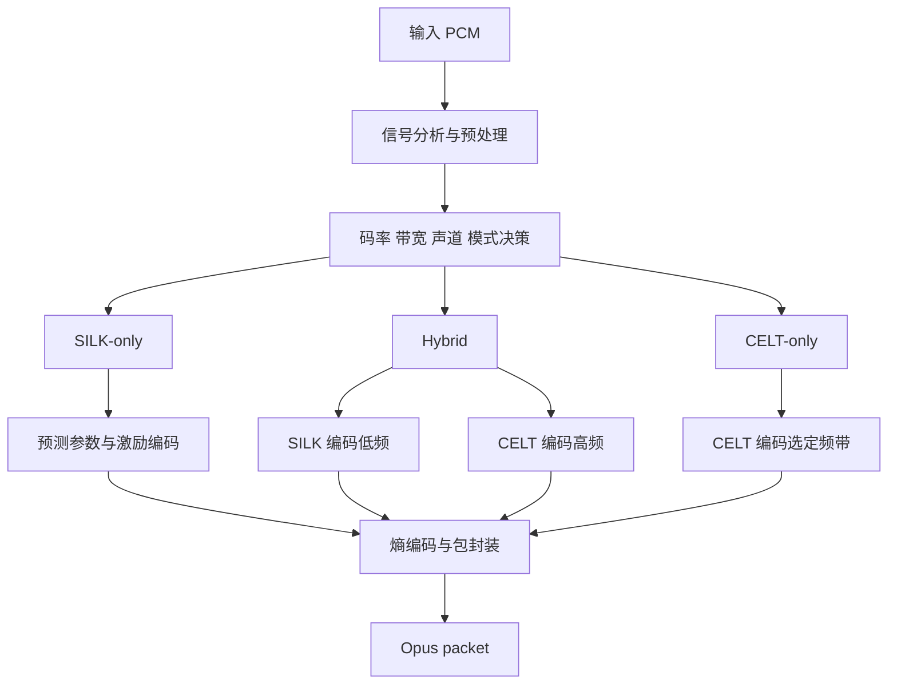
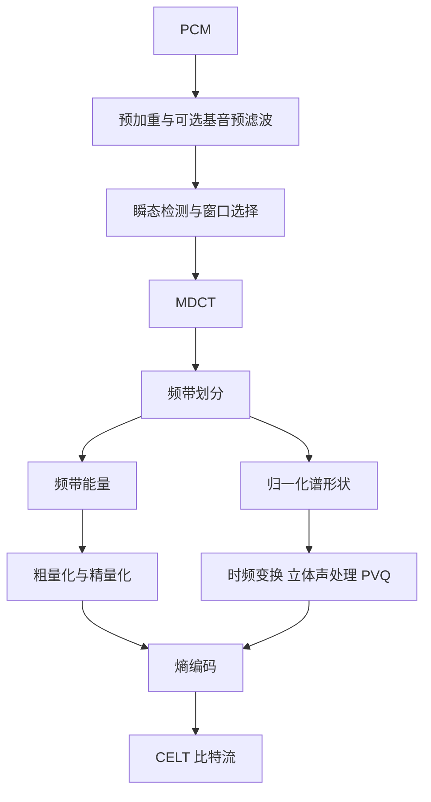
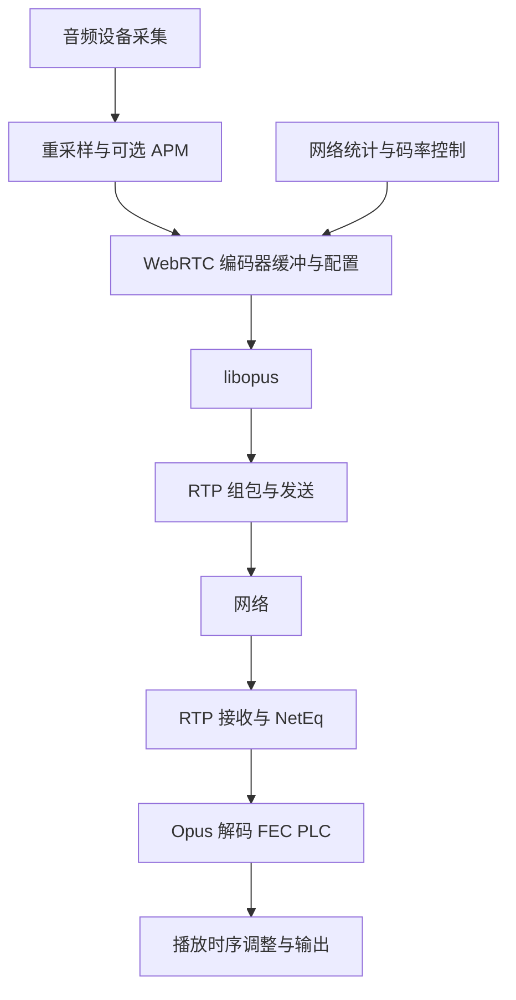

# Opus 音频编解码器技术原理详解

> 面向音视频开发、实时通信和音频算法工程师的技术文档。以经典 Opus 的 SILK、CELT、Hybrid 架构为主体，结合本地 libopus 和 WebRTC 实现解释算法与工程行为。整理日期：2026-10-22。

## 阅读范围与证据约定

本文分清三个层次：**码流规定了什么、参考实现如何实现、实时系统如何使用**。编码器的模式选择阈值、复杂度策略和音质优化可以演进；不能把某个版本的编码策略当成解码器必须遵守的标准。

标准入口为 [RFC 6716](https://www.rfc-editor.org/rfc/rfc6716.html)，其规范性解码实现由 [RFC 8251](https://www.rfc-editor.org/rfc/rfc8251.html) 修订。需要逐位实现兼容解码器时，应同时检查 [RFC 6716 勘误状态](https://www.rfc-editor.org/errata/rfc6716)，区分已验证勘误和仅被报告的问题。

算法主体还依据工作区中的完整参考实现进行独立梳理。本文公式中标明“概念模型”的部分用于解释原理，不是可直接替换定点运算、量化表和状态更新的逐位规范。

本次源码快照：

| 对象 | 标识 | 说明 |
|---|---|---|
| WebRTC 仓库 | `6655e210cf` | 当前工作区提交的短 SHA |
| 本地 Opus 子仓库 | `b73e151ccacd2de2fdeae62f9e79926f0576d97e` | 实际检出的提交 |
| Chromium Opus 元数据中的上游 Revision | `55513e81d8f606bd75d0ff773d2144e5f2a732f5` | 来自 `README.chromium`；与本地子仓库提交不是同一标识 |

本文不将该快照称为最新发行版，也不假定目录中存在的可选算法已经编译进当前应用。

## 目录

1. [Opus 解决什么问题](#s1)
2. [采样率、带宽、帧和包](#s2)
3. [整体架构与三种模式](#s3)
4. [SILK：预测编码](#s4)
5. [CELT：低延迟变换编码](#s5)
6. [Hybrid：低频预测与高频变换的结合](#s6)
7. [统一熵编码与比特预算](#s7)
8. [码流结构与 TOC](#s8)
9. [码率、模式和复杂度控制](#s9)
10. [算法延迟与端到端延迟](#s10)
11. [PLC、FEC、DTX 与抗丢包](#s11)
12. [立体声与多声道](#s12)
13. [RTP、SDP 与容器](#s13)
14. [libopus C API 示例](#s14)
15. [WebRTC 集成与源码阅读](#s15)
16. [场景参数与工程取舍](#s16)
17. [音质和性能验证](#s17)
18. [神经网络增强与版本边界](#s18)
19. [常见误解](#s19)
20. [术语表与参考资料](#s20)

<a id="s1"></a>
## 1. Opus 解决什么问题

Opus 是面向交互式音频的有损编解码器。它需要在低延迟条件下处理非常不同的信号：单人讲话、多人讲话、环境声音、打击乐、持续音和立体声音乐，还要适应不断变化的网络预算。

常见的设计能力描述是约 6–510 kbit/s，覆盖低码率语音到高质量双声道音频；这不是所有 API 配置的硬性合法区间。当前本地 `OPUS_SET_BITRATE` 文档还描述了 500–512000 bit/s 的设置范围。合法设置、可用音质与实际输出码率是三个不同概念，极低设置并不意味着还能保持可懂的语音。

未压缩 PCM 的码率为：

$$
R_{PCM}=f_s\times C\times B
$$

其中，$f_s$ 为采样率，$C$ 为声道数，$B$ 为每个样本的位数。例如，48 kHz、双声道、16 bit PCM 的码率为：

$$
48000\times2\times16=1{,}536{,}000\ \text{bit/s}
$$

如果使用总计 96 kbit/s 的 Opus 编码，单看编码负载，相对 PCM 的压缩比约为 16:1；RTP、UDP、IP、加密和链路层开销尚未计入。

压缩所利用的信息主要有三类：

| 信息特征 | 可利用的规律 | Opus 中的主要技术 |
|---|---|---|
| 时间相关性 | 相邻样本、相邻基音周期具有相关性 | SILK 的 LPC、LTP |
| 频谱结构 | 能量集中在部分频带，频谱包络比细节更稳定 | CELT 的分带、能量编码、PVQ |
| 感知冗余 | 不同位置、时间和频率的失真具有不同可闻性 | 噪声整形、动态比特分配、瞬态处理、立体声耦合 |

工程上的核心目标不是使每个 PCM 样本都最接近原始值，而是在带宽、计算量和延迟约束下，保留对听感和内容辨识最重要的信息。

这可以用一般性的率失真目标表示：

$$
\min_{\theta}\ D_{perceptual}(x,\hat{x};\theta)+\lambda R(\theta)
$$

其中 $\theta$ 代表模式、量化精度、带宽、声道策略等决策。该表达式是理解编码器的概念模型，并不意味着整个 libopus 通过单个全局优化器求解。

<a id="s2"></a>
## 2. 采样率、带宽、帧和包

### 2.1 PCM 采样率不等于编码音频带宽

常用 libopus PCM 接口支持 8、12、16、24、48 kHz。44.1 kHz 输入通常需要先重采样到受支持的采样率。接口接收 48 kHz PCM，不代表一定编码完整高频；编码器可以根据预算只保留窄带或宽带内容。

| 名称 | 缩写 | 约定的音频带宽上限 | 与之对应的名义采样率 |
|---|---|---:|---:|
| 窄带 | NB | 4 kHz | 8 kHz |
| 中带 | MB | 6 kHz | 12 kHz |
| 宽带 | WB | 8 kHz | 16 kHz |
| 超宽带 | SWB | 12 kHz | 24 kHz |
| 全带 | FB | 20 kHz | 48 kHz |

“对应采样率”帮助理解频谱范围，不要求应用必须按该采样率调用 API。实际滤波器存在过渡带，表中上限不是理想砖墙响应；FB 也不是把 48 kHz 的 Nyquist 上限 24 kHz 全部编码进去。

本地接口与实现依据：[opus.h](/Users/bytedance/code/other/webrtc-checkout/src/third_party/opus/src/include/opus.h)、[opus_defines.h](/Users/bytedance/code/other/webrtc-checkout/src/third_party/opus/src/include/opus_defines.h)、[opus_encoder.c](/Users/bytedance/code/other/webrtc-checkout/src/third_party/opus/src/src/opus_encoder.c)。

### 2.2 五种“长度”必须区分

| 层次 | 含义 | 例子 |
|---|---|---|
| 采集／处理块 | 音频设备或上层流水线一次提供的数据 | WebRTC 常见 10 ms 块 |
| API 输入时长 | 一次 `opus_encode()` 提交的音频时长 | 20 ms |
| Opus 编码帧 | TOC 配置描述的压缩单元 | CELT 的 20 ms 帧 |
| 算法子帧／短块 | 算法内部进一步划分的分析或变换单元 | SILK 常用 5 ms 子帧；CELT 瞬态短块 |
| Opus 包 | 一个或多个兼容编码帧的封装 | 两个 20 ms 帧组成 40 ms 包 |

一次 API 调用可能在内部拆成多个编码帧后组包。因此，API 支持某种输入时长，不等于所有模式都有同样时长的基本变换。

### 2.3 模式与基本帧长

| 编码模式 | 码流中的音频带宽 | 单个编码帧时长 |
|---|---|---|
| SILK-only | NB、MB、WB | 10、20、40、60 ms |
| Hybrid | SWB、FB | 10、20 ms |
| CELT-only | NB、WB、SWB、FB | 2.5、5、10、20 ms |

SILK 的 40／60 ms 编码帧在内部还包含多个较短的 SILK 处理帧。CELT 没有单独的 MB TOC 配置。

一个 Opus 包的总音频时长最多为 120 ms；同包各帧需要满足组包兼容性约束。当前本地 `frame_size_select()` 也接受 80、100、120 ms 输入，但包装层、旧版库和协商策略可能只暴露其中一部分，不能由此推导所有 WebRTC 集成都支持这些时长。

### 2.4 样本数按“每声道”计算

$$
N=f_s\times T
$$

48 kHz 下的常见值：

| 时长 | 每声道样本数 | 双声道交错 PCM 元素数 |
|---|---:|---:|
| 2.5 ms | 120 | 240 |
| 5 ms | 240 | 480 |
| 10 ms | 480 | 960 |
| 20 ms | 960 | 1920 |
| 40 ms | 1920 | 3840 |
| 60 ms | 2880 | 5760 |
| 120 ms | 5760 | 11520 |

`frame_size` 和解码返回值均按每声道计数。双声道下把 1920 作为 20 ms 的 `frame_size` 传入，是常见的时长和缓冲区错误。

<a id="s3"></a>
## 3. 整体架构与三种模式



### 3.1 SILK-only

SILK 主要利用语音生成过程中的结构：声道共振形成短时谱包络，声带周期振动形成基音周期。编码器发送预测模型和残余激励，使解码器重建波形。

这种方式适合低码率语音，但处理复杂音乐、密集瞬态和较宽频谱时，需要较多比特才能维持细节。

### 3.2 CELT-only

CELT 把信号转换到频域，按频带描述“有多大能量”和“能量如何分布”。它不要求输入服从单一语音源模型，适合音乐、高质量音频以及极低延迟应用。

CELT 也可以编码语音；“语音必然使用 SILK”并不成立。

### 3.3 Hybrid

Hybrid 将 SILK 的低码率语音效率和 CELT 的高频表现结合：SILK 负责大约 0–8 kHz，CELT 负责约 8 kHz 以上至 SWB 或 FB 上限的部分。

它是分频协作，**不是先用 SILK 编码整个信号，再让 CELT 编码全带宽误差**。这一差别决定了解码合成、码率分配和 FEC 恢复的行为。

三种模式共用 Opus 包格式。解码器根据码流中的配置选择路径，无需应用为每次内部模式变化重新建立音频流。

<a id="s4"></a>
## 4. SILK：预测编码

### 4.1 编码链路


本地浮点路径在 `silk_encode_frame_FLP()` 中依次调用基音分析、噪声整形分析、预测系数计算、增益处理、LBRR 生成和主激励量化。为满足目标大小，还可能调整增益并重新量化。

主要源码：[encode_frame_FLP.c](/Users/bytedance/code/other/webrtc-checkout/src/third_party/opus/src/silk/float/encode_frame_FLP.c:89)、[find_pred_coefs_FLP.c](/Users/bytedance/code/other/webrtc-checkout/src/third_party/opus/src/silk/float/find_pred_coefs_FLP.c:35)。

### 4.2 短时线性预测 LPC

语音在短时间内具有相对稳定的共振结构。可以用过去 $p$ 个样本预测当前样本：

$$
\tilde{x}[n]=\sum_{k=1}^{p}a_kx[n-k]
$$

预测残差为：

$$
e[n]=x[n]-\tilde{x}[n]
$$

如果预测模型捕捉到了主要谱包络，残差的相关性与动态范围通常更容易压缩。采用上述符号约定，对应的合成滤波器为：

$$
H(z)=\frac{1}{1-\sum_{k=1}^{p}a_kz^{-k}}
$$

LPC 系数描述谱包络，包括共振峰，而不是逐个发送频谱系数。典型 SILK 路径中 NB／MB 使用 10 阶预测，WB 使用 16 阶预测；不同分析阶段还可能使用其他阶数，不能把所有滤波器统一称为“16 阶 LPC”。

实际分析会涉及加权、稳定性限制、插值和增益约束。简单最小二乘公式只能说明为什么可以预测，不能代替参考实现。

### 4.3 为什么转换成 NLSF 再量化

直接粗量化 LPC 系数，可能让合成滤波器的极点越过单位圆，导致不稳定。线谱频率 LSF 将谱包络换成另一组更适合量化和插值的参数；SILK 使用归一化形式 NLSF。

处理流程可以概括为：

1. 从 LPC 系数得到 NLSF。
2. 使用码本和残差量化描述 NLSF。
3. 维持频率顺序和最小间隔等约束。
4. 解码后重建 LPC 系数，并在需要时进行跨帧插值。

NLSF 的意义既是减少参数比特，也是让谱包络在量化和时间变化后仍具有可控的稳定性。

相关实现：[process_NLSFs.c](/Users/bytedance/code/other/webrtc-checkout/src/third_party/opus/src/silk/process_NLSFs.c)、[NLSF_encode.c](/Users/bytedance/code/other/webrtc-checkout/src/third_party/opus/src/silk/NLSF_encode.c)。

### 4.4 长时预测 LTP

LPC 描述短时共振，但浊音仍然有明显的周期性。例如，基频为 200 Hz 的信号，其周期约为 5 ms；在 16 kHz 内部采样率下，对应约 80 个样本。

LTP 利用前一个或多个基音周期附近的已重建信号。用 LPC 残差上的概念模型表示：

$$
\tilde{e}[n]=\sum_{j=-2}^{2}b_j\hat{e}[n-T_0+j]
$$

$$
r[n]=e[n]-\tilde{e}[n]
$$

其中 $T_0$ 是基音周期，$b_j$ 是五抽头 LTP 系数，$\hat{e}$ 表示解码侧可重现的历史。多抽头允许模型描述周期之间的细微变化，而不是直接复制一个历史样本。

LPC 与 LTP 去除的是两种相关性：

| 预测工具 | 主要描述 | 对应听觉特征 |
|---|---|---|
| LPC | 短时谱包络 | 元音的共振峰、声道形状 |
| LTP | 跨基音周期重复性 | 浊音周期、持续音的谐波结构 |

参考编码器会联合安排分析流程，例如先利用初步 LPC 残差寻找基音，再通过 LTP 滤波构造最终 LPC 分析输入。不要把上面的概念级联误读为所有实现只能按一个固定顺序估计参数。

清音、爆破音等缺乏稳定周期的片段，不应强行使用高增益 LTP，否则容易把历史周期错误地延续为“嗡嗡声”。

### 4.5 闭环量化与噪声整形

残余信号最终必须量化。简单地最小化未加权的样本平方误差，会忽略听觉对不同频率和时间位置的敏感度。

噪声整形的概念目标是：

$$
D=\sum_n\left[W(z)\bigl(x[n]-\hat{x}[n]\bigr)\right]^2
$$

$W(z)$ 表示感知加权。实际 SILK 使用反馈、预测和整形滤波共同决定量化输入，让不可避免的量化误差以较不显著的方式分布。

闭环至关重要：编码器必须以**已量化、可被解码器重建的历史**更新预测状态。若编码器只使用原始历史、解码器只能使用失真历史，两端状态会逐步分离。

SILK 的 Noise Shaping Quantizer（NSQ）将激励表示为量化脉冲；较高复杂度路径可使用延迟判决，保留多个候选状态，观察后续若干样本后再选择代价较低的路径。这是一种局部搜索深度与计算开销的交换。

相关实现：[NSQ.c](/Users/bytedance/code/other/webrtc-checkout/src/third_party/opus/src/silk/NSQ.c)、[NSQ_del_dec.c](/Users/bytedance/code/other/webrtc-checkout/src/third_party/opus/src/silk/NSQ_del_dec.c)。

### 4.6 激励脉冲与 Shell 编码

SILK 不会把每个激励值都固定用同样多的比特发送。脉冲通常是稀疏的，较小幅度出现得更频繁，因此可以利用其概率分布。

Shell 编码可理解为分层描述一组脉冲的绝对值分布：

1. 先描述一组样本中的脉冲总量。
2. 再描述总量在左右子块间如何分配。
3. 递归细分，直到确定各位置的幅度。
4. 按需补充低位和符号信息。

这种“总量—分配”的表示比逐样本固定长度编码更适合大量零值和小幅度激励。具体概率表、缩放和符号条件由参考实现确定。

相关实现：[encode_pulses.c](/Users/bytedance/code/other/webrtc-checkout/src/third_party/opus/src/silk/encode_pulses.c)、[shell_coder.c](/Users/bytedance/code/other/webrtc-checkout/src/third_party/opus/src/silk/shell_coder.c)。

### 4.7 子帧、增益与码率控制

SILK 通常以 5 ms 子帧更新部分参数。20 ms 内部处理帧包含四个这样的子帧，10 ms 则包含两个。不同参数的更新时间粒度并不完全相同。

增益既描述信号幅度，也影响量化步长。在比特预算不足时，增大量化步长可以减少脉冲复杂度，降低码率，同时增加失真。编码器可在限次循环中尝试不同增益，直到得到可接受的比特数。

因此，“设置 20 kbit/s”并不是把每秒固定数量的 LPC 参数输出，而是对参数和残差的总编码成本进行控制。

### 4.8 解码过程

SILK 解码器大体执行：熵解码参数与脉冲 → 恢复增益及激励 → 长时预测合成 → LPC 合成 → 声道和采样率转换。

与编码器相比，解码器不需要重复基音搜索和量化候选搜索，只需要按收到的决策重建波形，因此经典解码路径通常比编码路径更轻。

相关实现：[decode_frame.c](/Users/bytedance/code/other/webrtc-checkout/src/third_party/opus/src/silk/decode_frame.c)、[decode_core.c](/Users/bytedance/code/other/webrtc-checkout/src/third_party/opus/src/silk/decode_core.c)。

<a id="s5"></a>
## 5. CELT：低延迟变换编码

### 5.1 编码链路



主要实现：[celt_encoder.c](/Users/bytedance/code/other/webrtc-checkout/src/third_party/opus/src/celt/celt_encoder.c)、[bands.c](/Users/bytedance/code/other/webrtc-checkout/src/third_party/opus/src/celt/bands.c)、[quant_bands.c](/Users/bytedance/code/other/webrtc-checkout/src/third_party/opus/src/celt/quant_bands.c)、[vq.c](/Users/bytedance/code/other/webrtc-checkout/src/third_party/opus/src/celt/vq.c)。

### 5.2 MDCT 为什么适合音频编码

修正离散余弦变换 MDCT 将重叠窗口内的时域信号映射为频域系数。标准数学形式可写为：

$$
X[k]=\sum_{n=0}^{2N-1}x[n]w[n]
\cos\left[\frac{\pi}{N}\left(n+\frac12+\frac N2\right)\left(k+\frac12\right)\right],
\quad 0\leq k<N
$$

这里的公式说明变换基底和重叠关系；CELT 的低重叠窗口、移位、缩放和计算实现需以源码为准，不能直接由通用公式推导它必须有一个完整帧的额外前视。

MDCT 的几个作用：

- 把稳定音调的能量集中到较少的频域系数附近。
- 让编码器按频带控制失真和比特分配。
- 配合匹配窗口与重叠相加，消除变换引入的时域混叠。

变换本身不产生有损压缩；真正的信息损失来自后续量化和部分谱细节省略。

### 5.3 低重叠窗口与低延迟

CELT 使用短重叠的窗口设计，额外变换前视约为 2.5 ms。长帧可以保留较好的频率分辨率，同时避免让重叠部分随帧长按比例变大。

低延迟不是免费的：较短的分析时间减少了跨时间利用信息的机会，短包还提高了每秒包数和固定开销。CELT 的能量约束、谱形状量化和感知处理共同补偿这一限制。

### 5.4 频带能量与谱形状分离

将频域系数按感知相关的频带分组。对频带 $b$，定义：

$$
E_b=\sum_{k\in b}X[k]^2,\qquad g_b=\sqrt{E_b}
$$

对非零能量频带归一化：

$$
u_b[k]=\frac{X[k]}{g_b},\qquad \sum_{k\in b}u_b[k]^2=1
$$

随后分别编码增益 $g_b$ 和单位向量 $u_b$。解码重建为：

$$
\hat{X}[k]=\hat{g}_b\hat{u}_b[k]
$$

零能量和极小能量频带在实现中需要专门的数值处理。

这样做的直接收益是：即使谱形状量化较粗，也能让每个频带的总能量保持接近目标，减少“某个频带突然塌掉”的音色变化。

### 5.5 能量的粗量化、精量化与最终修正

频带增益适合在对数域表示。概念上：

$$
\ell_b=\log_2(g_b+\epsilon)
$$

粗量化先给出能量的大致位置，可能利用前帧或相邻频带的信息做预测；精量化再根据预算补充细节，最后用剩余比特改善部分频带的能量精度。

预测减少比特，但也会引入状态依赖。帧内能量编码等机制可以限制误差传播；其选择由码流和编码决策共同决定，并非所有帧都使用同样的能量预测方式。

`quant_coarse_energy()`、`quant_fine_energy()` 和最终能量处理对应不同阶段。将能量与形状分开后，编码器可以明确回答：“此刻增加一个比特，是改善频带响度更有价值，还是改善频带内的谱细节更有价值？”

### 5.6 Pyramid Vector Quantization：PVQ

PVQ 用受约束的整数向量表示归一化谱形状。设某频带维数为 $d$，选择整数向量：

$$
\mathbf{y}\in\mathbb{Z}^{d},\qquad\sum_{i=1}^{d}|y_i|=K
$$

$K$ 是脉冲总数。重建形状为：

$$
\hat{\mathbf{u}}=\frac{\mathbf{y}}{\|\mathbf{y}\|_2}
$$

例如 $d=4,K=3$，向量 $(2,-1,0,0)$ 满足约束；它表示能量主要集中在第一维和第二维，第二维符号相反。增益由独立的能量编码提供。

选择更多脉冲，可以得到更精细的方向，但可选向量数量也更多，需要更多比特。PVQ 通过组合枚举将向量映射为整数索引，不需要存储一个巨大、显式的任意浮点码本。

对非零目标向量，典型搜索目标是最大化归一化相关性：

$$
\max_{\mathbf{y}}\frac{\mathbf{u}^{T}\mathbf{y}}{\|\mathbf{y}\|_2}
$$

实际搜索使用高效近似和脉冲分配策略。高维频带还可递归拆分，并编码子向量之间的能量分配角度。PVQ 中的“脉冲”处于频域向量空间，与 SILK 时域激励脉冲不是同一个编码对象。

### 5.7 瞬态与前回声

鼓点或爆破音的能量突然增大。如果用长变换块粗量化，误差可能扩散到强瞬态之前的安静部分，人耳会听到不自然的提前噪声，即前回声。

CELT 通过瞬态检测，在需要时使用多个短变换块，限制量化误差的时间扩散。以 20 ms 帧为例，可以使用对应的多个 2.5 ms 短块；它们仍属于该帧的内部结构，不意味着网络发送了八个包。

取舍是：短块提高时间分辨率，但降低单块频率分辨率。稳定的窄带音调通常更需要频率分辨率，突然出现的敲击声更需要时间分辨率。

### 5.8 逐频带时频分辨率调整

CELT 还能在频带内部通过可逆的 Haar 类变换调整系数组织方式，在时间与频率分辨率之间做更细的选择。不同频带不必完全服从一个统一的最佳分辨率。

这类变换本身不增加信息；它改变量化前信号的稀疏性和误差分布，使有限的 PVQ 脉冲更有效。

### 5.9 谱折叠、扩散旋转与 Anti-collapse

低码率时，不可能为所有频带都分配足够的谱形状比特。CELT 使用几种工具减少稀疏量化的听觉副作用：

| 工具 | 处理的问题 | 原理与限制 |
|---|---|---|
| 谱折叠 | 高频带缺少直接编码的形状信息 | 借用低频归一化谱构造高频形状，并按该频带能量缩放；并非精确还原原始高频 |
| 扩散旋转 | 少量脉冲导致谱过于稀疏、噪声带有音调感 | 量化前后使用匹配的可逆旋转，使量化噪声更均匀 |
| Anti-collapse | 瞬态短块中的部分时频区域没有脉冲 | 依据掩码补充受控能量，减少局部能量缺口 |

这些工具共同体现 CELT 的设计方向：当不能保留全部谱细节时，优先维持稳定的频带能量和自然的误差结构。

### 5.10 基音预滤波与后滤波

对具有明显周期性的信号，CELT 可以使用基音相关的梳状预滤波／后滤波，帮助控制谐波之间的量化噪声。编码器发送滤波所需的周期、增益和相关参数，解码器进行匹配处理。

这说明 CELT 并不是只有“一次 MDCT 加量化”，它也利用时间域周期结构，但整体表达仍然是变换编码，而不是 SILK 的 LPC/LTP 激励合成模型。

### 5.11 解码过程

CELT 解码流程大体为：解码能量与分配信息 → 解码 PVQ 谱形状 → 逆旋转和时频处理 → 处理折叠与能量塌陷 → 恢复频带幅度 → IMDCT 和重叠相加 → 后滤波及去加重。

不同实现的函数划分和局部执行次序可不同；理解时应沿着频带能量、归一化向量、历史重叠缓冲区三组状态跟踪数据。

相关实现：[celt_decoder.c](/Users/bytedance/code/other/webrtc-checkout/src/third_party/opus/src/celt/celt_decoder.c)。更系统的 CELT 设计讨论见作者论文 [High-Quality, Low-Delay Music Coding in the Opus Codec](https://arxiv.org/html/1602.04845)。

<a id="s6"></a>
## 6. Hybrid：低频预测与高频变换的结合

### 6.1 频带分工

```text
频率          0                  8 kHz          12 kHz          20 kHz
              |--------------------|---------------|---------------|
SILK-only WB  |       SILK          |
Hybrid SWB    |       SILK          |     CELT      |
Hybrid FB     |       SILK          |             CELT              |
CELT-only FB  |                       CELT                         |
```

Hybrid 中的 SILK 通常在 16 kHz 内部采样率处理低频；CELT 处理高频部分。在 CELT 的频带索引体系中，高频起点通过对应频带边界设置，而不是应用在外部手动将两个独立 Opus 包拼起来。

### 6.2 比特共享

可以用预算关系理解：

$$
B_{packet}=B_{header}+B_{SILK}+B_{CELT}+B_{other}
$$

其中其他开销可能包括切换冗余、填充等。SILK 和 CELT 的主编码部分共用 Range Coder 状态，CELT 根据剩余预算工作，可以降低两套独立封装带来的浪费。

因此，不宜把“Hybrid 是 SILK 固定占 70%、CELT 固定占 30%”当作规则。预算会随总码率、声道、信号特征和编码策略调整。

### 6.3 解码合成和延迟对齐

两路解码后，低频需要转换到一致的输出采样率，并与高频对齐，再相加得到输出：

$$
\hat{x}[n]=\hat{x}_{low}[n-d_{low}]+\hat{x}_{high}[n-d_{high}]
$$

这里的 $d_{low}$、$d_{high}$ 表示需要补偿的相对延迟，不是应用必须额外插入的固定两个延时器。参考实现已经负责其内部对齐。

若自行拼接而忽略对齐，可能在分频交界附近产生不自然的叠加，也会让瞬态前沿在时间上错开。

### 6.4 模式切换

模式改变会同时涉及预测历史、MDCT 重叠、带宽滤波和声道状态。参考实现使用预填充、状态更新、交叉淡化，以及特定切换中的短 CELT 冗余来减轻接缝。

**切换冗余与用于恢复前一个丢包的 LBRR/FEC 是不同机制。** 看到源码中的 `redundancy` 字段，不能一律解释成丢包 FEC。

主要实现：[opus_encoder.c](/Users/bytedance/code/other/webrtc-checkout/src/third_party/opus/src/src/opus_encoder.c)、[opus_decoder.c](/Users/bytedance/code/other/webrtc-checkout/src/third_party/opus/src/src/opus_decoder.c)。

<a id="s7"></a>
## 7. 统一熵编码与比特预算

### 7.1 Range Coding 的作用

前面的预测与量化决定“丢弃哪些信息”；熵编码则在不进一步损失量化结果的前提下，把它们紧凑地表示出来。

Range Coding 是算术编码的一种实现。对概率为 $p$ 的符号，理想编码长度接近：

$$
L\approx-\log_2p
$$

高概率符号平均占用更少比特，低概率符号占用更多比特。它不必像简单定长码一样给每个符号相同空间。

Opus 使用整数范围和概率表，保证编码器、解码器按相同规则更新状态。实现依据：[entenc.c](/Users/bytedance/code/other/webrtc-checkout/src/third_party/opus/src/celt/entenc.c)、[entdec.c](/Users/bytedance/code/other/webrtc-checkout/src/third_party/opus/src/celt/entdec.c)。

### 7.2 非均匀概率符号与 Raw Bits

并非所有信息都值得建立复杂概率模型。Opus 的熵编码框架还支持直接写入近似均匀分布的原始比特。

Range 编码部分与 Raw Bits 在缓冲区中有特定的组织和读取方向，不能把整个帧理解成“所有参数严格按源码调用顺序依次追加的简单位串”。编写解析器时，应复用参考实现，而不是只根据字段名称手工移位。

### 7.3 为什么不发送每一个频带的完整比特表

如果每帧都为几十个频带逐一传送详细分配表，控制开销本身就会占掉大量预算。CELT 让双方共享基础分配规则，再发送少量调整信息，例如分配倾斜、频带增强或编码边界。

解码器据此计算相同的能量精度和 PVQ 预算。编码器可以做复杂的感知分析，解码器不必重复这一分析，只需使用已传达的选择。

### 7.4 预算示例

对于单个 20 ms 包，目标负载码率 32 kbit/s：

$$
B_{packet}=32000\times0.020=640\ \text{bit}=80\ \text{byte}
$$

80 字节是平均或目标 Opus 包大小的近似值，包含 Opus 自身的包头预算，尚不包括 RTP 等网络头部。VBR 下某些包可以大于或小于该值；启用冗余后，主信号与冗余要共同分享或重新规划发送预算。

<a id="s8"></a>
## 8. 码流结构与 TOC

### 8.1 TOC 字节

普通单流 Opus 包以一个 TOC（Table Of Contents）字节开头：

```text
bit 7                            bit 3  bit 2  bit 1  bit 0
+-------------------------------------+------+-------------+
|              config (5)             |  s   |    c (2)    |
+-------------------------------------+------+-------------+
```

- `config`：编码模式、音频带宽和单帧时长的联合配置。
- `s`：包内编码为单声道还是双声道。
- `c`：帧数量和长度组织方式。

完整解析还需要包长度、长度字段和后续控制字节。TOC 不包含 RTP 序号、RTP 时间戳，也不直接写出目标码率。

### 8.2 config 的 32 种组合

| config | 模式 | 带宽 | 按 config 递增对应的帧长 |
|---|---|---|---|
| 0–3 | SILK | NB | 10、20、40、60 ms |
| 4–7 | SILK | MB | 10、20、40、60 ms |
| 8–11 | SILK | WB | 10、20、40、60 ms |
| 12–13 | Hybrid | SWB | 10、20 ms |
| 14–15 | Hybrid | FB | 10、20 ms |
| 16–19 | CELT | NB | 2.5、5、10、20 ms |
| 20–23 | CELT | WB | 2.5、5、10、20 ms |
| 24–27 | CELT | SWB | 2.5、5、10、20 ms |
| 28–31 | CELT | FB | 2.5、5、10、20 ms |

### 8.3 c 字段与帧组织

| c | 包内组织 | 主要约束 |
|---:|---|---|
| 0 | 一个帧 | 剩余负载给该帧 |
| 1 | 两个等长帧 | 去掉 TOC 后可等分 |
| 2 | 两个可变长帧 | 显式编码第一个帧的长度 |
| 3 | 多帧 | 后续字节描述 VBR、padding 和帧数，并可能带长度字段 |

Code 3 的帧计数字节含 VBR 标志、padding 标志和 6 bit 帧数。实际还必须满足总时长不超过 120 ms 等约束；2.5 ms 配置下最多 48 帧，不是 6 bit 就允许任意 63 帧。

单个压缩帧的长度上限为 1275 字节，但**整个多帧包不一定小于 1275 字节**。网络应用应另外遵守路径 MTU 和自定义包大小策略。

包内“等长帧”是封装性质，不等价于整个音频流采用 CBR。

### 8.4 一个 TOC 解析示例

假设 TOC 为 `0xF8`，二进制 `11111000`：

```text
config = 0xF8 >> 3       = 31
s      = (0xF8 >> 2)&1   = 0
c      = 0xF8 & 3        = 0
```

可知该包描述 CELT、FB、20 ms、单声道、单帧。但仅一个 TOC 字节不能证明后续数据可成功解码，更不能确定信号实际具有 20 kHz 的有效内容。

### 8.5 应用应使用的检查接口

优先使用 `opus_packet_parse()`、`opus_packet_get_nb_frames()`、`opus_packet_get_samples_per_frame()`、`opus_packet_get_nb_samples()`、`opus_packet_get_nb_channels()` 和 `opus_packet_get_bandwidth()`。

这些接口用于结构检查或读取包属性；完整语义和熵解码有效性仍需由解码器判断。解析后也不能忽略输出缓冲区上限。

本章表格与边界可对应核对：[opus.c](/Users/bytedance/code/other/webrtc-checkout/src/third_party/opus/src/src/opus.c)、[opus_decoder.c](/Users/bytedance/code/other/webrtc-checkout/src/third_party/opus/src/src/opus_decoder.c)、[repacketizer.c](/Users/bytedance/code/other/webrtc-checkout/src/third_party/opus/src/src/repacketizer.c)。

<a id="s9"></a>
## 9. 码率、模式和复杂度控制

### 9.1 模式选择是多因素决策

参考编码器综合目标码率、语音／音乐倾向、声道数、立体声宽度、帧长、复杂度、FEC 要求和历史状态作出决策。

例如：

- 低码率单人语音通常受益于 SILK。
- 在保留低频语音效率的同时需要高频时，可以使用 Hybrid。
- 音乐、高码率信号和非常短的帧更适合 CELT。
- 2.5／5 ms 帧无法采用 SILK 或 Hybrid。

这些是机制解释，不是固定阈值表。当前源码中的 `compute_equiv_rate()` 会折算不同条件的有效预算，`decide_fec()` 会考虑带宽和冗余可行性。

### 9.2 为什么需要滞回

如果码率在阈值附近波动，直接用单个阈值会让模式反复变化。滞回给“升档”和“降档”设置不同边界，再结合已有模式，使选择更稳定。

这与拥塞控制的平滑是两个层次：网络模块平滑带宽估计，编码器平滑内容和模式决策，两者都可能影响切换时机。

### 9.3 VBR、约束 VBR 和 CBR

| 方式 | 主要行为 | 适用考虑 |
|---|---|---|
| VBR | 允许包大小随内容复杂度变化 | 在平均预算下更灵活地分配音质 |
| 约束 VBR | 对码率波动施加限制 | 兼顾感知分配和缓冲／传输约束 |
| CBR | 努力按给定时长输出固定预算 | 便于固定容量通道和预算估算 |

配置关系：VBR 开启时再启用 `OPUS_SET_VBR_CONSTRAINT(1)` 表达约束 VBR；关闭 VBR 后，constraint 开关不再把它变成另一种独立模式。

约束 VBR 的支持和行为具有模式差异，不能将它视为每个包的严格字节数保证。网络层仍需处理包大小波动；严格上限由缓冲区、MTU 和发送策略共同保障。

当前本地头文件明确说明：MDCT 路径遵循约束 VBR；语音路径会忽略该约束，Hybrid 也可能因 LPC 部分占用而无法完全遵循。因此，仅配置该开关不足以建立跨模式的硬性网络峰值承诺。

### 9.4 应用模式与信号提示

| 参数 | 意义 |
|---|---|
| `OPUS_APPLICATION_VOIP` | 面向语音通信的优化策略 |
| `OPUS_APPLICATION_AUDIO` | 面向一般音频和音乐的优化策略 |
| `OPUS_APPLICATION_RESTRICTED_LOWDELAY` | 限制为低延迟路径，禁用 SILK／Hybrid |
| `OPUS_SET_SIGNAL(OPUS_SIGNAL_VOICE)` | 提供语音倾向提示 |
| `OPUS_SET_SIGNAL(OPUS_SIGNAL_MUSIC)` | 提供音乐倾向提示 |

`VOIP` 不是“锁定 SILK”，`AUDIO` 也不是“锁定 CELT”。信号提示不等于改变包格式，也不应替代对真实内容的测试。

### 9.5 复杂度

经典编码复杂度取值为 0–10。较高复杂度可投入更多计算用于分析、搜索和量化决策，但不会直接把输出码率按比例提高。

复杂度通常是本端策略，解码器无需知道编码器用了哪一级搜索。CPU 较弱的设备可以降低复杂度，而继续保持同一种标准码流。

更高复杂度不保证所有素材、所有版本都有同样幅度的音质收益，也不保证计算时间随数值线性增长。

API 语义见 [官方编码控制说明](https://opus-codec.org/docs/opus_api-1.5/group__opus__encoderctls.html)；具体决策依据本地 [opus_encoder.c](/Users/bytedance/code/other/webrtc-checkout/src/third_party/opus/src/src/opus_encoder.c)。

<a id="s10"></a>
## 10. 算法延迟与端到端延迟

### 10.1 延迟组成

```text
采集块等待 → 音频处理 → 组帧与前视 → 编码计算 → 发送排队
         → 网络传播／排队 → 抖动缓冲 → 解码／修复 → 播放缓冲
```

端到端延迟可以概念性写为：

$$
D_{e2e}=D_{capture}+D_{processing}+D_{frame/lookahead}
+D_{encode}+D_{send}+D_{network}+D_{jitter}+D_{decode}+D_{playback}
$$

测量时要定义各阶段起止，避免重复计入已经包含在“组帧”中的采集等待。CPU 编码耗时和算法前视是两类不同延迟。

### 10.2 前视查询

应使用 `OPUS_GET_LOOKAHEAD()` 查询当前编码器报告的附加延迟样本数。在当前本地实现中：

- 普通应用模式：2.5 ms 加 4 ms 对齐补偿，总计 6.5 ms。
- `RESTRICTED_LOWDELAY`：2.5 ms。

因此，以完整帧收集时间计，一个普通 20 ms 配置的编码算法延迟基线约为 26.5 ms；2.5 ms restricted-lowdelay 配置约为 5 ms。二者都不是系统端到端延迟保证。

这里的数值来自当前实现的 `delay_compensation` 与 `OPUS_GET_LOOKAHEAD_REQUEST`，不应脱离版本长期硬编码。依据：[opus_encoder.c](/Users/bytedance/code/other/webrtc-checkout/src/third_party/opus/src/src/opus_encoder.c:2927)。

### 10.3 为什么缩短帧可能增加网络压力

只计算 IPv4、UDP 和基本 RTP 头，假设每包额外 40 字节：

$$
R_{headers}=\frac{40\times8}{T_{packet}}
$$

| 包时长 | 每秒包数 | 基本头部码率 |
|---|---:|---:|
| 2.5 ms | 400 | 128 kbit/s |
| 5 ms | 200 | 64 kbit/s |
| 10 ms | 100 | 32 kbit/s |
| 20 ms | 50 | 16 kbit/s |
| 40 ms | 25 | 8 kbit/s |
| 60 ms | 约 16.7 | 约 5.33 kbit/s |

例如，24 kbit/s 的 Opus 负载配 20 ms 包，加入上述基本头部后已约为 40 kbit/s；还没有计算 RTP 扩展、SRTP、IPv6、隧道和链路层开销。

长包减少固定开销，但增加组包等待，并使一个包丢失时损失更多连续音频。选帧长必须把延迟、带宽和丢包影响一起考虑。

<a id="s11"></a>
## 11. PLC、FEC、DTX 与抗丢包

### 11.1 三种机制回答三个问题

| 机制 | 核心问题 | 是否需要额外发送信息 | 主要限制 |
|---|---|---|---|
| PLC：丢包隐藏 | 数据不在时，怎样让播放尽可能连续 | 经典 PLC 不需要额外码流 | 只能根据已有信息估计，不能恢复未知语义 |
| 带内 FEC／LBRR | 能否从后续包取得丢失音频的冗余描述 | 需要 | 依赖发送策略、模式、后续包到达和播放期限 |
| DTX：非连续传输 | 没有有效活动时，能否少发数据 | 减少传输，保留必要更新 | 需要区分正常静音间隔与网络丢失 |

### 11.2 PLC：根据历史生成连续输出

经典 PLC 利用已解码的信号和状态，对缺失时段进行估计。不同模式采用不同信息：

- SILK 可利用基音周期、LPC 包络、激励和增益历史，生成缺失段；连续丢失时逐步衰减或向噪声过渡。
- CELT 可利用历史周期、频谱和频带能量，选择周期外推或噪声类填补，并处理重新接收到音频时的过渡。

如果丢失段恰好包含一个全新的辅音、鼓点或单词开头，历史信息并不足以确定其内容。PLC 可以减轻听觉中断，但不能保证语义正确。

调用形式如下，`missing_samples` 必须是本次需要补出的每声道样本数：

```c
int n = opus_decode(dec, NULL, 0, pcm, missing_samples, 0);
```

这里的 `frame_size` 不是任意选一个“大缓冲区容量”；PLC 路径根据它决定生成多长音频。还应遵守采样时长粒度等 API 要求。

相关实现：[PLC.c](/Users/bytedance/code/other/webrtc-checkout/src/third_party/opus/src/silk/PLC.c)、[celt_decoder.c](/Users/bytedance/code/other/webrtc-checkout/src/third_party/opus/src/celt/celt_decoder.c)、[opus_decoder.c](/Users/bytedance/code/other/webrtc-checkout/src/third_party/opus/src/src/opus_decoder.c)。

### 11.3 带内 FEC：后一个包保护前面的音频

经典 Opus 带内 FEC 依托 SILK 的 LBRR（Low Bitrate Redundancy）。在常见的单帧包流程中，包 $P_n$ 除了当前音频的主编码，还可能包含前一个时段的低码率冗余描述。

```text
P0：主音频 0
P1：主音频 1 + 可选的音频 0 冗余    ← 丢失
P2：主音频 2 + 可选的音频 1 冗余    ← 到达

接收端按时间顺序：
解码 P0 主音频 → 用 P2 的 FEC 恢复时段 1 → 解码 P2 主音频
```

这不是 XOR 奇偶校验，也不是把原始 PCM 或前一个完整包简单复制一份。冗余通常使用更低码率的参数／激励表示，恢复质量与主编码不同。

编码端通常需要设置：

```c
opus_encoder_ctl(enc, OPUS_SET_INBAND_FEC(1));
opus_encoder_ctl(enc, OPUS_SET_PACKET_LOSS_PERC(10));
```

第二行是“预计丢包百分比为 10%”，不是 0.10，也不是每秒丢 10 个包。其值应来自网络统计和策略，不应在所有网络中恒定使用示例值。

开启 FEC 表示允许编码器生成冗余，**不保证每包都有冗余**。编码器还会考虑活动情况、码率、带宽和模式。

当前本地接口还区分 `OPUS_SET_INBAND_FEC(1)` 与 `(2)`：前者在丢包条件需要时可促使编码器选择 SILK 路径；后者允许在音乐内容下保留 CELT 选择，而不强求经典 FEC。这个差异具有版本依赖，应查阅实际链接库对应的头文件。它并不意味着纯 CELT 因设置为 2 就获得了 LBRR。

### 11.4 为什么纯 CELT 没有经典 LBRR

LBRR 属于 SILK 工具链，纯 CELT 包不携带这种经典前一时段的 SILK 冗余。Hybrid 中可恢复的核心也是 SILK 低频部分；高频 CELT 不能因此被视为获得了同等质量的完整恢复。

在本地解码器的 FEC 路径中，纯 CELT 或其他不满足 FEC 条件的情况会转入 PLC。Hybrid 高带也会采用相应的丢失处理。

因此，`decode_fec=1` 的返回值大于零，代表生成了音频，**不自动证明使用了真实 LBRR 数据**。

### 11.5 FEC 的时序与播放期限

FEC 只有在后续包及时到达时才能修复前一个时段。如果前一个时段已经过了播放期限，就算稍后拿到冗余，也通常无法改变已经播放给用户的声音。

对于固定 20 ms、单帧包，接收端需要有约一个包间隔的恢复机会。该机会可能已经包含在现有抖动缓冲中，因此不能机械地说“开启 FEC 必定再加 20 ms”；但没有等待空间，就不能指望未来包恢复现在的播放缺口。

两个关键规则：

1. 先处理丢失时段，再解码携带冗余的当前时段。
2. 一旦当前解码状态已向后推进，不要把迟到包直接送回同一个状态机去“倒放修复”。

固定 20 ms 场景中的简化逻辑：

```text
期望 Pn：
  Pn 已到达：正常解码 Pn
  Pn 未到达、Pn+1 已到达且允许恢复：
      先对 Pn+1 调用 decode_fec=1，生成时段 n
      再对 Pn+1 调用 decode_fec=0，生成时段 n+1
  到了播放期限仍没有可用后续包：
      对时段 n 调用 PLC
```

实际抖动缓冲还要处理多包连续丢失、乱序、重复、帧长变化和时间戳间隔。多帧包的 LBRR 覆盖与解码状态更复杂，不应把上述固定单帧逻辑原样套用。

### 11.6 连续丢包的边界

如果 $P_1$、$P_2$ 连续丢失，直到 $P_3$ 才收到，经典前一时段冗余可能帮助最近的缺失时段，但无法保证重建整个连续缺口。更早的部分仍需 PLC 或其他冗余／重传机制。

系统需要同时控制总发送率。如果已经拥塞，却在原主码率之上无预算地添加大量冗余，反而可能增加丢包。FEC 的收益应在相同总网络预算下比较。

### 11.7 DTX 与舒适噪声

DTX 根据语音／音频活动和噪声状态减少无活动时段的传输，同时通过必要更新维持接收侧的背景声音连续性。它不是永久输出全零，也不意味着所有静音帧的 API 返回值都为零。

libopus、WebRTC 包装层和 RTP 发送层如何处理极短包、空输出或周期更新，存在具体实现约定。应用应按自身集成层语义处理，不能简单用 `len == 0` 代表所有 DTX 情况。

连续解码状态和媒体时钟仍需要保持一致。通过 RTP 序号与时间戳一起判断，可以避免把正常 DTX 间隔全部记成网络丢包。

<a id="s12"></a>
## 12. 立体声与多声道

### 12.1 声道间冗余

左右声道通常相关。概念性的中／侧变换为：

$$
M=\frac{L+R}{2},\qquad S=\frac{L-R}{2}
$$

若两路几乎相同，$S$ 的能量很小，编码它比独立编码两份相似波形更省比特。实际 CELT 使用归一化和能量角度等处理，不应把上述缩放直接等同于其所有内部公式。

### 12.2 SILK 的立体声处理

SILK 对中／侧信号进行建模，还可利用中声道预测侧声道，以减少侧声道残差。在低预算下可降低侧声道精度或逐步缩窄立体声宽度。

相关实现：[stereo_LR_to_MS.c](/Users/bytedance/code/other/webrtc-checkout/src/third_party/opus/src/silk/stereo_LR_to_MS.c)、[stereo_MS_to_LR.c](/Users/bytedance/code/other/webrtc-checkout/src/third_party/opus/src/silk/stereo_MS_to_LR.c)。

### 12.3 CELT 的联合立体声工具

| 工具 | 原理 | 主要取舍 |
|---|---|---|
| M/S 类编码 | 编码共性和差异，并描述二者能量关系 | 对相关声道有效 |
| Dual stereo | 按声道分别量化相应谱形状 | 适合相关性低的内容，但成本较高 |
| Intensity stereo | 部分高频共享形状，保留声道能量关系 | 节省比特，但丢失部分独立相位／形状信息 |

相位敏感、空间感强或接近反相的素材，是测试联合立体声策略的重要样本。不能只用左右声道相同的音频评价立体声音质。

### 12.4 超过两声道

普通 `opus_encoder_create()` 面向单声道或双声道。多声道通过 multistream 等接口组合多个单声道／耦合双声道流，并由映射描述输入输出声道关系。

多个基本流不代表所有声道都经过一个全局联合频域量化器。容器、信令、映射族和接收端支持需要一并确认。

相关实现：[opus_multistream_encoder.c](/Users/bytedance/code/other/webrtc-checkout/src/third_party/opus/src/src/opus_multistream_encoder.c)、[opus_multistream_decoder.c](/Users/bytedance/code/other/webrtc-checkout/src/third_party/opus/src/src/opus_multistream_decoder.c)。

<a id="s13"></a>
## 13. RTP、SDP 与容器

### 13.1 RTP 的固定时钟

Opus over RTP 使用 48 kHz 时间戳时钟，与 PCM API 的输入／输出采样率和当前编码带宽无关。20 ms 音频使 RTP 时间戳前进 960；10 ms 前进 480。双声道也不把时间戳步长再乘 2。

一个 RTP payload 承载一个 Opus packet，该 Opus packet 内部可以包含多个编码帧。RTP 序号识别发送包顺序，时间戳表达媒体时间，二者用途不同。依据：[RFC 7587 的 RTP 封装规定](https://www.rfc-editor.org/rfc/rfc7587.html#section-4)。

### 13.2 SDP 示例

```sdp
a=rtpmap:111 opus/48000/2
a=fmtp:111 minptime=10;useinbandfec=1;stereo=1;maxaveragebitrate=64000
a=ptime:20
```

`111` 是示例动态 payload type，不是 Opus 固定值。`opus/48000/2` 按 RTP 映射规则声明能力，不证明每一个实际 Opus 包都是双声道。实际编码声道可从 TOC 观察。

| 参数 | 工程含义 |
|---|---|
| `useinbandfec` | 接收侧对带内 FEC 的支持／偏好信号，实际发送仍需编码策略落实 |
| `stereo` | 接收立体声的偏好 |
| `sprop-stereo` | 发送侧信号的立体声属性提示 |
| `maxaveragebitrate` | 接收侧对平均编码码率的限制 |
| `maxplaybackrate` | 接收侧播放采样能力提示，可影响发送带宽选择 |
| `usedtx` | DTX 的使用偏好 |
| `ptime` | 期望的包音频时长 |

SDP 参数具有方向性和协商语义，不应把它们都当作双方必须完全对称的编码器开关。`minptime` 在当前 WebRTC 中有解析逻辑，其适用范围应结合具体实现，不能由示例推导所有接收端都按同样方式处理。

本地协商落地依据：[audio_encoder_opus.cc](/Users/bytedance/code/other/webrtc-checkout/src/modules/audio_coding/codecs/opus/audio_encoder_opus.cc:228)。

### 13.3 裸包不是文件格式

Opus 包通常依赖外层提供长度和边界。把多个裸包直接无分隔拼成文件，会丢失可靠的包边界；也没有完整的声道映射、时间定位和起始裁剪元数据。

Ogg Opus 使用 `OpusHead`、`OpusTags`、页结构与 granule position 保存这些信息。`pre-skip` 指示解码后需要丢弃的起始样本，Ogg Opus 的时间定位按 48 kHz 单位计算。末尾裁剪使最终输出长度符合原始音频，而不必保留补齐编码帧带来的尾部样本。依据：[RFC 7845](https://www.rfc-editor.org/rfc/rfc7845.html)。

文件播放器的 pre-skip 与实时 RTP 接收端的抖动缓冲属于不同层，不能拿一个字段代替另一套时序机制。

<a id="s14"></a>
## 14. libopus C API 示例

### 14.1 对象生命周期和缓冲区

编码器和解码器都是有状态对象。通常每个独立流维护一份状态，按时间顺序调用；不要每帧重新创建，也不要在没有同步的情况下并发操作同一对象。

编码输入为每声道 `frame_size` 个样本；交错 PCM 缓冲区总元素数为 `frame_size * channels`。`opus_encode()` 返回编码字节数，`opus_decode()` 返回每声道样本数，负值表示错误。

普通解码中 `frame_size` 是输出容量上限；FEC／PLC 解码中，它还表达需要恢复的时长。若要容纳任意合法时长的普通单流包，48 kHz 下可为 120 ms 分配每声道 5760 个样本，同时仍要遵守应用自己的最大包时长策略。

官方接口入口：[编码 API](https://opus-codec.org/docs/opus_api-1.5/group__opus__encoder.html)、[解码 API](https://opus-codec.org/docs/opus_api-1.5/group__opus__decoder.html)。

### 14.2 可独立编译的教学程序

下面的程序编码三个 20 ms 单声道包，模拟第二个包丢失，再依次执行“首包正常解码、第三包 FEC 请求、第三包正常解码”。使用正弦波只为构造确定性输入；这不是语音质量测试，且不保证编码器真的生成 LBRR。

```c
#include <math.h>
#include <stdio.h>
#include <opus.h>

enum { SAMPLE_RATE = 48000, FRAME = 960, PACKETS = 3, CAPACITY = 1500 };

int main(void) {
    int result = 1;
    int err = OPUS_OK;
    int lengths[PACKETS] = {0};
    opus_int32 lookahead = 0;
    unsigned char packets[PACKETS][CAPACITY];
    opus_int16 input[FRAME];
    opus_int16 output[FRAME];
    OpusEncoder *enc = NULL;
    OpusDecoder *dec = NULL;

    enc = opus_encoder_create(SAMPLE_RATE, 1, OPUS_APPLICATION_VOIP, &err);
    if (enc == NULL || err != OPUS_OK) {
        fprintf(stderr, "encoder creation: %s\n", opus_strerror(err));
        goto cleanup;
    }
    dec = opus_decoder_create(SAMPLE_RATE, 1, &err);
    if (dec == NULL || err != OPUS_OK) {
        fprintf(stderr, "decoder creation: %s\n", opus_strerror(err));
        goto cleanup;
    }

    /* Each CTL macro expands to a request and its argument. */
#define CHECK_CTL(...) do {                                          \
    err = opus_encoder_ctl(enc, __VA_ARGS__);                         \
    if (err != OPUS_OK) {                                            \
        fprintf(stderr, "encoder ctl: %s\n", opus_strerror(err));     \
        goto cleanup;                                               \
    }                                                               \
} while (0)

    CHECK_CTL(OPUS_SET_BITRATE(24000));
    CHECK_CTL(OPUS_SET_COMPLEXITY(5));
    CHECK_CTL(OPUS_SET_VBR(1));
    CHECK_CTL(OPUS_SET_INBAND_FEC(1));
    CHECK_CTL(OPUS_SET_PACKET_LOSS_PERC(10));
    CHECK_CTL(OPUS_SET_DTX(0));
    CHECK_CTL(OPUS_GET_LOOKAHEAD(&lookahead));
#undef CHECK_CTL

    printf("libopus: %s\n", opus_get_version_string());
    printf("lookahead: %.2f ms\n", 1000.0 * lookahead / SAMPLE_RATE);

    for (int p = 0; p < PACKETS; ++p) {
        for (int i = 0; i < FRAME; ++i) {
            double t = (double)(p * FRAME + i) / SAMPLE_RATE;
            input[i] = (opus_int16)(8000.0 * sin(2.0 * 3.141592653589793 * 440.0 * t));
        }
        lengths[p] = opus_encode(enc, input, FRAME, packets[p], CAPACITY);
        if (lengths[p] < 0) {
            fprintf(stderr, "encode: %s\n", opus_strerror(lengths[p]));
            goto cleanup;
        }
        printf("packet %d: %d bytes\n", p, lengths[p]);
    }

    err = opus_decode(dec, packets[0], lengths[0], output, FRAME, 0);
    if (err != FRAME) goto decode_error;

    /* Packet 1 is missing. Use packet 2 to request recovery of its interval.
       If usable FEC is absent, libopus produces concealment instead. */
    err = opus_decode(dec, packets[2], lengths[2], output, FRAME, 1);
    if (err != FRAME) goto decode_error;

    /* The same packet still needs its normal decode for interval 2. */
    err = opus_decode(dec, packets[2], lengths[2], output, FRAME, 0);
    if (err != FRAME) goto decode_error;

    puts("Decoded three intervals; actual LBRR use is not asserted.");
    result = 0;
    goto cleanup;

decode_error:
    if (err < 0) fprintf(stderr, "decode: %s\n", opus_strerror(err));
    else fprintf(stderr, "unexpected duration: %d samples\n", err);
cleanup:
    if (dec != NULL) opus_decoder_destroy(dec);
    if (enc != NULL) opus_encoder_destroy(enc);
    return result;
}
```

安装可由 `pkg-config` 定位的 libopus 开发包后，可使用：

```sh
cc -std=c99 -Wall -Wextra opus_example.c $(pkg-config --cflags --libs opus) -lm -o opus_example
./opus_example
```

程序只校验 API 调用和时长，不将解码音频写入文件。生产接收器应把每次输出交给播放队列，校验 RTP 时序，并按播放期限选择等待、FEC 或 PLC。

### 14.3 输入和包长检查

对真实网络数据，至少需要保证：

- 包长度来自受信的缓冲区边界，不能相信自定义网络字段而越界读取。
- 按解析出的时长检查输出容量；不要把 120 ms 包解码到 20 ms 缓冲区。
- 负返回值与有效字节数／样本数分开处理，不能直接强转为无符号长度。
- `max_data_bytes` 是编码输出上限，不是替代 `OPUS_SET_BITRATE()` 的常规码率控制工具。
- 上层限制包大小和音频时长，以符合实际 MTU、延迟和资源预算。

<a id="s15"></a>
## 15. WebRTC 集成与源码阅读

### 15.1 编码器在系统中的位置



声学回声消除 AEC、麦克风降噪和自动增益控制 AGC 通常在音频处理层完成。它们并不因为使用 Opus 就自动包含在 Opus 编解码器里。

### 15.2 发送路径

当前 WebRTC 包装层将多个 10 ms 输入块累计到目标包长后调用 `WebRtcOpus_Encode()`，再进入 libopus。新的包长配置在合适的边界生效，避免把一个正在累计的包中途截断。

| 层次 | 文件 | 值得追踪的内容 |
|---|---|---|
| API 配置 | [audio_encoder_opus_config.h](/Users/bytedance/code/other/webrtc-checkout/src/api/audio_codecs/opus/audio_encoder_opus_config.h) | 采样率、声道、帧长和码率配置 |
| 编码器包装 | [audio_encoder_opus.cc](/Users/bytedance/code/other/webrtc-checkout/src/modules/audio_coding/codecs/opus/audio_encoder_opus.cc) | 10 ms 累计、SDP 映射、网络反馈和包长 |
| C 接口桥接 | [opus_interface.cc](/Users/bytedance/code/other/webrtc-checkout/src/modules/audio_coding/codecs/opus/opus_interface.cc) | WebRTC 参数到 `OPUS_SET_*` 的转换 |
| 编码核心 | [opus_encoder.c](/Users/bytedance/code/other/webrtc-checkout/src/third_party/opus/src/src/opus_encoder.c) | 模式、带宽、冗余和 SILK/CELT 调用 |

源码中还区分 `SampleRateHz()` 与 `RtpTimestampRateHz()`。前者来自 PCM 配置，后者固定返回 48000，直接体现采样率与 RTP 时钟的不同。

### 15.3 网络反馈与编码参数

当前路径包括目标音频码率更新、上行丢包率平滑、可选 Audio Network Adaptor，以及编码器自身的策略。

```text
网络统计
  → 平滑后的丢包率／目标预算
  → WebRTC 编码器配置
  → OPUS_SET_BITRATE / OPUS_SET_PACKET_LOSS_PERC / FEC / 包长等
  → libopus 内部模式、带宽和量化选择
```

是否启用 ANA、具体 field trial、预算是否已经扣除传输开销，都需要在部署配置中核实。不能只看 `OPUS_SET_BITRATE()` 就推导 RTP 总发送率。

### 15.4 接收路径与 NetEq

NetEq 管理包缓冲、播放时序和音频修复策略，Opus 解码器负责把选定包或修复请求变成 PCM。解码器不会自行读取网络、等待重传或决定播放队列长度。

当前 `WebRtcOpus_PacketHasFec()` 等逻辑用于识别相应冗余；包装层的 `WebRtcOpus_DecodeFec()` 与 libopus 原始 `decode_fec` 调用在前置检查和返回约定上也有区别。

相关文件：[audio_decoder_opus.cc](/Users/bytedance/code/other/webrtc-checkout/src/modules/audio_coding/codecs/opus/audio_decoder_opus.cc)、[opus_interface.cc](/Users/bytedance/code/other/webrtc-checkout/src/modules/audio_coding/codecs/opus/opus_interface.cc:581)、[neteq_impl.cc](/Users/bytedance/code/other/webrtc-checkout/src/modules/audio_coding/neteq/neteq_impl.cc)。

### 15.5 建议的算法阅读顺序

| 顺序 | 文件／函数 | 阅读目标 |
|---:|---|---|
| 1 | `src/opus_encoder.c`：`opus_encode_native()`、`opus_encode_frame_native()` | 理清一次编码如何选择模式并进入两个核心 |
| 2 | `src/opus.c`、`src/opus_decoder.c` | 理解包边界、TOC、正常／FEC／PLC 分支 |
| 3 | `silk/float/encode_frame_FLP.c` | 建立语音编码总体数据流 |
| 4 | `silk/float/find_pred_coefs_FLP.c`、`silk/NSQ_del_dec.c` | 深入预测、闭环量化和复杂度 |
| 5 | `celt/celt_encoder.c` | 沿 MDCT、能量、预算、形状跟踪 CELT |
| 6 | `celt/quant_bands.c`、`celt/bands.c`、`celt/vq.c` | 理解分带量化和 PVQ |
| 7 | `celt/entenc.c`、`celt/entdec.c` | 理解实际比特流和概率编码 |

表中路径以 [本地 libopus 根目录](/Users/bytedance/code/other/webrtc-checkout/src/third_party/opus/src) 为基准。可使用下列命令定位当前快照中的函数，避免依赖会随版本变化的行号：

```sh
rg -n 'opus_encode_native|opus_encode_frame_native|decide_fec|compute_equiv_rate' /Users/bytedance/code/other/webrtc-checkout/src/third_party/opus/src/src/opus_encoder.c
rg -n 'silk_find_pred_coefs_FLP|silk_NSQ_wrapper_FLP' /Users/bytedance/code/other/webrtc-checkout/src/third_party/opus/src/silk/float
rg -n 'quant_coarse_energy|quant_all_bands|alg_quant|clt_compute_allocation' /Users/bytedance/code/other/webrtc-checkout/src/third_party/opus/src/celt
```

<a id="s16"></a>
## 16. 场景参数与工程取舍

下表是开展评测的**起始配置范围**，不是标准规定、自动模式边界或音质保证。码率均为单个 Opus 流的总负载码率，双声道一行不是“每声道再乘 2”。范围参考当前 WebRTC 注释中的语音／音乐建议，并结合本文章节中的延迟和网络预算推导。

| 场景 | 起始码率范围 | 包时长 | 声道 | 需要重点验证 |
|---|---:|---:|---:|---|
| 低带宽窄带语音 | 8–12 kbit/s | 20–40 ms | 1 | 可懂度、切音、总网络码率 |
| 宽带语音通话 | 16–24 kbit/s | 20 ms | 1 | FEC 收益、噪声背景、突发丢包 |
| 高质量／全带语音 | 28–40 kbit/s | 20 ms | 1 | 高频辅音、混合模式、背景音乐 |
| 单声道音乐 | 48–64 kbit/s | 10–20 ms | 1 | 瞬态、纯音和音色 |
| 双声道音乐 | 64–128 kbit/s | 10–20 ms | 2 | 立体声像、高频、瞬态 |
| 极低延迟演奏／监听 | 按素材和网络单独提高预算 | 2.5–5 ms | 1 或 2 | 采用 restricted-lowdelay；包头开销、音频设备和链路延迟 |

### 16.1 语音通话

可以从 20 ms、单声道、VOIP 应用模式开始。根据总预算设置码率，再按实际丢包统计决定是否为 LBRR 留出空间。DTX 需要评估安静说话、弱辅音、底噪变化和发言起始段，避免只看流量下降。

### 16.2 音乐与混合内容

音乐更需要保留谱细节、瞬态和声道差异。可从 AUDIO 应用模式开始，在固定总码率下比较不同包长和复杂度。语音通话中夹带背景音乐时，强制语音提示或激进 DTX 可能影响结果，应使用代表性素材。

### 16.3 低延迟应用

低延迟设计必须同时减少设备缓冲、音频处理排队、包长、网络排队和接收缓冲。将 Opus 帧长从 20 ms 改为 5 ms，而设备和抖动缓冲仍各自缓存几十毫秒，收益可能远低于预期。

### 16.4 自适应时避免只改一个旋钮

带宽下降时，可能需要同时考虑码率、音频带宽、声道、冗余比例和包时长。增加包长能节省头部，但会扩大单包丢失的时间缺口；提高 FEC 会占预算，但可能减少播放中断。

每项调整都应以明确指标评价，例如“在总发送率不超过某值、P95 端到端延迟不超过某值时，丢失隐藏时长是否减少”，而不是单看编码码率越低越好。

<a id="s17"></a>
## 17. 音质和性能验证

### 17.1 测试素材矩阵

至少覆盖不同说话人和语言、清音／浊音／爆破音、安静与噪声背景、语音夹音乐、打击乐、持续纯音、复杂混音及不同立体声相关性的素材。

单一正弦波适合测时钟、幅度和基础失真，却不能代表真实语音或音乐质量。全静音输入也不适合评价正常活动音频的码率和复杂度。

### 17.2 网络条件矩阵

| 维度 | 应覆盖的变化 | 目的 |
|---|---|---|
| 丢包 | 无丢包、随机丢包、突发丢包 | 区分独立丢失与连续缺口 |
| 抖动 | 稳定延迟、长尾延迟、短时尖峰 | 观察迟到丢弃和缓冲增长 |
| 带宽 | 稳定、缓慢下降、骤降、恢复 | 验证控制响应和模式稳定性 |
| 顺序 | 乱序、重复 | 验证状态机与包去重 |
| 配置变化 | 包长、声道、带宽切换 | 发现切换接缝和时长错误 |
| 活动 | 长静音、弱语音、突然恢复发声 | 验证 DTX 与恢复行为 |

例如，5% 独立随机丢包和平均同为 5% 的 100 ms 突发丢包，感知影响可以完全不同，不能仅报告一个总体丢包百分比。

### 17.3 建议记录的指标

- 音质：盲听结果、可懂度、音色、空间感、瞬态前回声和接缝。
- 传输：Opus payload 码率、实际网络码率、包长分布、冗余占用。
- 时序：端到端延迟、抖动缓冲长度、迟到丢弃、包时长切换。
- 修复：PLC 输出时长、真实 FEC 使用量、连续 concealment 时长。
- 性能：编码和解码耗时的 P50／P95／P99、内存和设备功耗。

测量真实 FEC 使用量时应在冗余识别和解码路径打点；仅统计 `decode_fec=1` 调用次数会把回退 PLC 也计入。

### 17.4 客观指标的使用边界

波形 SNR 对延迟、相位和微小时间偏移敏感，不能单独代表感知质量。对齐原始与解码音频后，可以结合适合素材的语音或音频感知指标，并通过盲听确认。

不同感知指标的适用带宽、语音／音乐范围和授权条件不同；实验报告应写明工具、版本、输入预处理及对齐方式，避免把一个分数跨不同评测流程直接比较。

### 17.5 可复现记录

每次实验保存 libopus 提交或版本、编译选项、浮点／定点路径、CPU 架构、全部 CTL 配置、输入哈希、包日志和网络损伤种子。

一次有效对比应保持总网络预算、素材和延迟约束一致。若开启 FEC 后总码率也提高了，应在报告中明确，不能把全部改善归因于算法效率。

<a id="s18"></a>
## 18. 神经网络增强与版本边界

经典 Opus 的主干仍然是预测编码与变换编码。较新的实现可以在保持基础 Opus 互通的前提下，增加学习型分析、丢包隐藏或解码增强。

以官方 **Opus 1.5 发布时的功能说明**为历史例子：

| 能力 | 改善位置 | 与经典机制的关系 |
|---|---|---|
| Deep PLC | 接收端缺失音频生成 | 更强的估计，不提供缺失内容的原始证据 |
| DRED | 发送端压缩历史冗余、接收端恢复 | 需要真实附加冗余，目标包含更长的突发丢失 |
| LACE／NoLACE | 解码语音增强 | 利用解码侧信息改善编码失真 |

该版本的可选功能需要相应编译和运行时启用；其发布说明还明确标注当时 DRED 的实验性和版本兼容边界。本文不据此推断 2026 年所有发行版的 DRED 标准状态或默认配置。历史信息来源：[Opus 1.5 官方说明](https://opus-codec.org/demo/opus-1.5/)。

工程上应区分三类兼容性：基础 Opus 包能否解码、扩展冗余能否被识别、某种接收端增强是否实际启用。前一项成立，不代表后两项自动成立。

本地虽存在 `dnn/` 目录，但是否进入二进制仍取决于构建目标、宏、模型资源和运行时配置。应检查 [BUILD.gn](/Users/bytedance/code/other/webrtc-checkout/src/third_party/opus/BUILD.gn) 与最终构建参数，不应只凭源文件存在就宣称 WebRTC 已启用 Deep PLC 或 DRED。

<a id="s19"></a>
## 19. 常见误解

| 说法 | 更准确的理解 |
|---|---|
| Opus 就是 SILK 加一个文件头 | Opus 包含 SILK、CELT 和 Hybrid，使用统一码流与切换机制 |
| Hybrid 的 CELT 编码全带宽 SILK 残差 | Hybrid 主要是低频 SILK、高频 CELT 的分频协作 |
| 输入 48 kHz 就一定是全带音频 | PCM 采样率与编码带宽独立；内容也可能本来没有高频 |
| 所有 20 ms Opus 包都有同样的算法路径 | 模式、声道、带宽和冗余都可能变化 |
| 40 ms 包意味着 CELT 使用 40 ms 基本 MDCT 帧 | 包可以聚合多个较短编码帧 |
| 所有帧互相独立 | LPC、LTP、能量预测、MDCT 重叠等都可依赖历史 |
| FEC 开关打开就能恢复所有丢包 | 需要实际冗余、适用模式、后续包和及时的播放窗口 |
| FEC 解码返回成功就证明使用了冗余 | 缺少可用冗余时可能回退 PLC |
| PLC 能恢复没听到的原始单词 | PLC 根据历史估计，不能确定未知的新内容 |
| DTX 就是静音时一直不发任何东西 | 通常仍需状态／噪声更新，具体行为取决于集成 |
| 高复杂度等于高码率 | 复杂度主要控制分析和搜索计算量 |
| VOIP 固定 SILK，AUDIO 固定 CELT | 它们是应用策略，自动模式仍可变化 |
| RTP 的 `/2` 保证每包都是立体声 | 该声明与实际包内声道不是同一个层次 |
| Opus 设为 24 kbit/s，链路只需 24 kbit/s | 还要计算网络头、加密和其他传输开销 |
| 用了 Opus 就自动有 AEC 和降噪 | 通常需要独立音频处理模块 |
| 原始 Opus 包拼接就是可播放文件 | 还需要包边界及合适的容器或传输封装 |

<a id="s20"></a>
## 20. 术语表与参考资料

### 20.1 术语表

| 术语 | 全称／含义 |
|---|---|
| PCM | Pulse Code Modulation，未压缩数字音频样本表示 |
| LPC | Linear Predictive Coding，线性预测编码 |
| LTP | Long-Term Prediction，长时预测 |
| LSF／NLSF | 线谱频率／归一化线谱频率 |
| NSQ | Noise Shaping Quantizer，噪声整形量化器 |
| MDCT | Modified Discrete Cosine Transform，修正离散余弦变换 |
| CELT | Constrained-Energy Lapped Transform，能量受约束的重叠变换编码 |
| PVQ | Pyramid Vector Quantization，金字塔向量量化 |
| VBR／CBR | 可变码率／恒定码率 |
| PLC | Packet Loss Concealment，丢包隐藏 |
| FEC | Forward Error Correction，前向纠错；本文经典带内 FEC 指 SILK LBRR |
| LBRR | Low Bitrate Redundancy，低码率冗余 |
| DTX | Discontinuous Transmission，非连续传输 |
| VAD | Voice Activity Detection，语音活动检测 |
| TOC | Table Of Contents，Opus 包首配置字段 |
| RTP | Real-time Transport Protocol，实时传输协议 |
| SDP | Session Description Protocol，会话描述协议 |
| MTU | Maximum Transmission Unit，最大传输单元 |
| APM | Audio Processing Module，音频处理模块 |
| ANA | Audio Network Adaptor，音频网络适配模块 |

### 20.2 规范与官方资料

| 资料 | 推荐用途 |
|---|---|
| [RFC 6716：Definition of the Opus Audio Codec](https://www.rfc-editor.org/rfc/rfc6716.html) | 模式、包结构、规范性解码与编码背景 |
| [RFC 8251：Updates to the Opus Audio Codec](https://www.rfc-editor.org/rfc/rfc8251.html) | 参考解码器的兼容修订 |
| [RFC 6716 Errata](https://www.rfc-editor.org/errata/rfc6716) | 检查已验证和待处理勘误 |
| [RFC 7587：RTP Payload Format](https://www.rfc-editor.org/rfc/rfc7587.html) | RTP、媒体类型与 SDP 参数 |
| [RFC 7845：Ogg Encapsulation](https://www.rfc-editor.org/rfc/rfc7845.html) | 文件容器、pre-skip 与时间定位 |
| [Opus 官方文档入口](https://www.opus-codec.org/docs/) | 查找 API、规范和设计材料 |
| [libopus 1.5 编码器 API](https://opus-codec.org/docs/opus_api-1.5/group__opus__encoder.html) | 状态创建、输入和编码返回值 |
| [libopus 1.5 解码器 API](https://opus-codec.org/docs/opus_api-1.5/group__opus__decoder.html) | 正常解码、FEC 和 PLC 调用 |
| [libopus 1.5 编码控制](https://opus-codec.org/docs/opus_api-1.5/group__opus__encoderctls.html) | CTL 的参数、边界和适用条件 |
| [High-Quality, Low-Delay Music Coding in the Opus Codec](https://arxiv.org/html/1602.04845) | CELT 感知设计与量化思路 |
| [Opus 1.5 功能说明](https://opus-codec.org/demo/opus-1.5/) | 理解该版本引入的可选学习型增强 |

### 20.3 本地实现依据

本地代码证据在各算法章节附近给出，入口为 [libopus 源码](/Users/bytedance/code/other/webrtc-checkout/src/third_party/opus/src)、[WebRTC Opus 包装层](/Users/bytedance/code/other/webrtc-checkout/src/modules/audio_coding/codecs/opus) 和 [Chromium Opus 版本元数据](/Users/bytedance/code/other/webrtc-checkout/src/third_party/opus/README.chromium)。这些绝对路径适用于本工作区；对外分享时，可将源码链接替换为对应提交的仓库永久链接。

### 20.4 本文验证记录

- 已检查全部目录锚点和本地源码链接，目标均存在。
- C 教学程序已使用当前工作区的 Opus 头文件，通过 Clang C99 的 `-Wall -Wextra -Werror -fsyntax-only` 检查。
- 程序已链接本机安装的 libopus 1.5.2 并运行成功；报告 6.50 ms lookahead，三个时间段均返回 960 个样本。
- 运行测试验证的是示例调用、状态推进和输出时长，不证明该输入实际产生了 LBRR，也不构成音质、网络性能或本地完整 WebRTC 构建的验证。
- 文中的码率／包头算例是基于明示假设的计算，场景配置是评测起点，未表述为实测结论。
