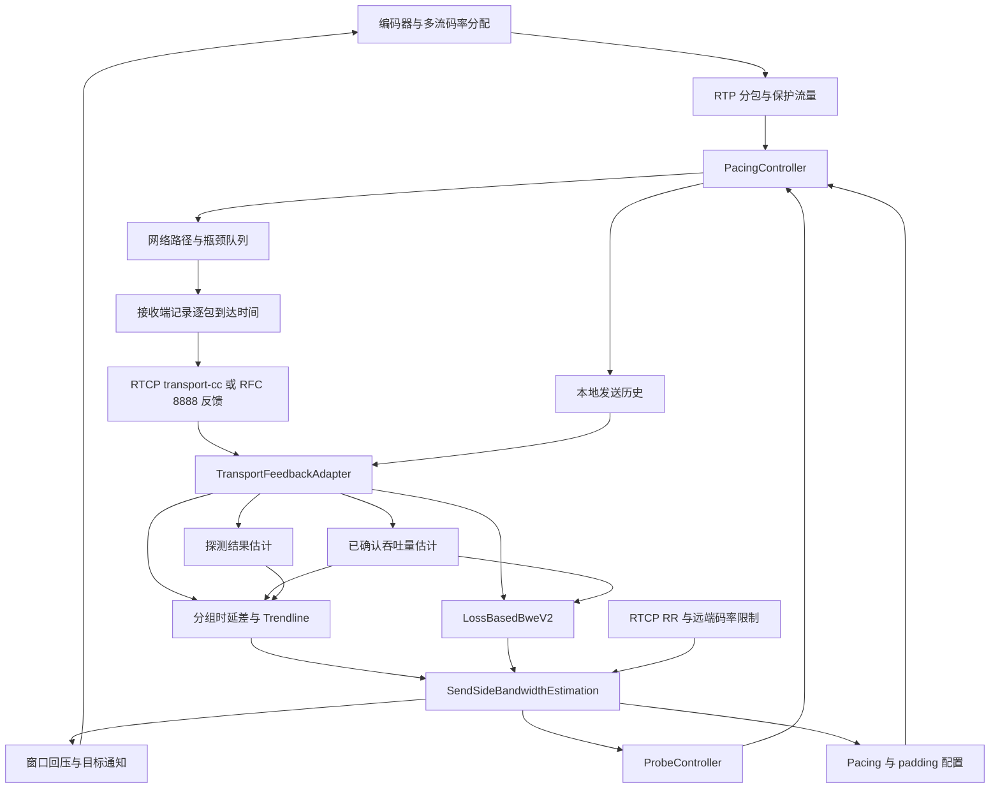
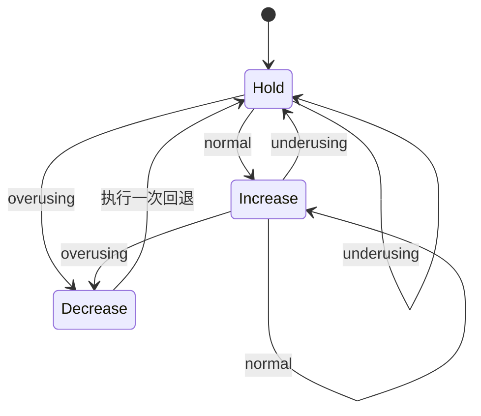
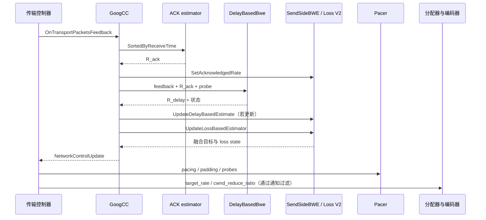

# WebRTC 拥塞控制技术详解：基于当前源码的 GoogCC 实现

> 源码基线：`src` 仓库提交 `6655e210cf9fe602fb7c60a36af505f6b2ede03f`，提交日期 **2025-06-26**。文档编写日期：2026-10-22。
>
> 本文依据本地 C++ 实现、默认配置及相关测试源码编写，重点解释默认发送侧 GoogCC。文中“默认”指未覆盖 Field Trials、未注入自定义控制器时的源码默认值，不代表所有浏览器或产品的线上配置。公式中明确标注的近似模型用于解释原理，不能代替代码的全部边界条件。本文未运行网络仿真或性能测试。

## 目录

1. [目标、范围与核心概念](#sec-1)
2. [源码结构与端到端闭环](#sec-2)
3. [逐包反馈如何变成控制输入](#sec-3)
4. [已确认吞吐量估计](#sec-4)
5. [时延信号：从包分组到 Trendline](#sec-5)
6. [AIMD 如何把拥塞状态变成码率](#sec-6)
7. [LossBasedBweV2 的概率模型与决策](#sec-7)
8. [估计融合、传统丢包控制与 RTT 保护](#sec-8)
9. [带宽探测](#sec-9)
10. [ALR：区分应用受限与网络受限](#sec-10)
11. [拥塞窗口与回压](#sec-11)
12. [Pacing、padding 与编码器执行](#sec-12)
13. [一次反馈的完整调用顺序](#sec-13)
14. [典型网络场景推演](#sec-14)
15. [默认参数与实验开关](#sec-15)
16. [接收侧估计、RFC 8888 与扩展边界](#sec-16)
17. [排障、测试与源码阅读路线](#sec-17)
18. [容易误读的实现细节](#sec-18)
19. [源码索引](#sec-19)

<a id="sec-1"></a>
## 1. 目标、范围与核心概念

### 1.1 WebRTC 要控制的是什么

实时音视频的发送速率既要接近可用带宽，又要避免长时间排队。码率过高会堆积队列、增加时延并导致丢包；码率过低则浪费带宽、降低画质。编码器生成数据还具有明显突发性，例如关键帧远大于普通帧，平均码率合理也不代表瞬时发送合理。

用一个只用于理解的单瓶颈流体模型表示：

$$
\frac{dQ(t)}{dt}=R_{send}(t)-C(t),\qquad d_q(t)=\frac{Q(t)}{C(t)}
$$

这里 `Q` 是瓶颈队列数据量，`C` 是服务速率，`R_send` 是进入该队列的流量速率；队列为空时不能继续减少，队列满时会丢包。存在竞争流量时，应将其他流量一起计入，或者用本流可获得的有效服务速率理解 `C`。

由此产生三个互补问题：

- **队列是否在增长？** 时延趋势可以在丢包之前给出预警。
- **实际有多少数据成功到达？** 已确认吞吐量为降码率、恢复及探测校验提供依据。
- **丢包是否与发送速率有关？** 丢包控制尝试区分固有损失与过载损失。

GoogCC 围绕这些信号持续闭环控制，并通过主动探测解决“发送量不足时看不到剩余容量”的问题。它不是一个单独的带宽公式，而是多个估计器、状态机和执行器的组合。

### 1.2 不应混淆的几个速率

| 概念 | 本文符号 | 在实现中的含义 |
|---|---|---|
| 链路容量/可用带宽 | `C` | 隐藏的网络属性，不能直接从一个低负载样本读出 |
| 已确认吞吐量 | `R_ack` | 根据成功接收的包及其发送、接收时刻估算的有效传输速率 |
| 时延侧估计 | `R_delay` | `DelayBasedBwe` 内部 AIMD 的结果，后续作为融合约束 |
| 丢包侧融合目标 | `R_loss` | `SendSideBandwidthEstimation::target_rate()` 的输出；名称虽含 loss，实际已包含其他限制 |
| 窗口回压后目标 | `R_push` | 在 `R_loss` 基础上根据 outstanding data 进行回压的结果 |
| Pacer 速率 | `R_pace` | 发送调度速率，通常高于持续媒体目标，用于及时排出帧级突发 |
| Padding 速率 | `R_pad` | 非媒体填充的调度预算，与媒体已发送数据共同记账 |
| 编码器目标 | `R_encoder` | 经多流分配、传输/保护开销处理及视频侧控制后的目标 |

`R_ack` 低不一定说明 `C` 低；`R_pace` 高不意味着编码器应该按该速率长期产出；最终编码目标也不等于总传输预算。[相关类型定义][types]

### 1.3 本文的范围

主体是 RTP 音视频传输中的 GoogCC。接收侧 REMB 路径作为兼容分支介绍，PCC 作为可替换控制器点到为止。DataChannel 的传输控制、编解码算法本身、NACK/FEC 的完整恢复机制不在本文展开范围内，但会说明它们与带宽预算的关系。

<a id="sec-2"></a>
## 2. 源码结构与端到端闭环

### 2.1 分层职责

| 层次 | 关键对象 | 职责 |
|---|---|---|
| 传输编排 | `RtpTransportControllerSend` | 接收反馈、记录发包、驱动控制器、应用控制结果 |
| 协议适配 | `TransportFeedbackAdapter` | 将 RTCP 反馈与发送历史关联，构造统一 `PacketResult` |
| 控制接口 | `NetworkControllerInterface` | 定义事件输入和 `NetworkControlUpdate` 输出 |
| 默认算法 | `GoogCcNetworkController` | 编排吞吐量、时延、丢包、探测、ALR、窗口控制 |
| 调度执行 | `TaskQueuePacedSender` / `PacingController` / `BitrateProber` | 按速率发包、执行探测簇、产生 padding |
| 媒体执行 | `Call` / `BitrateAllocator` / `VideoSendStreamImpl` / `VideoStreamEncoder` | 将总传输预算分给各流并调整编码和丢帧 |

工厂默认创建 `GoogCcNetworkController`，也支持注入其他 `NetworkControllerFactoryInterface`。该接口要求调用串行化，本身不保证线程安全；这使控制算法不必直接处理 socket、RTP 解析和多线程同步。[工厂][factory]、[接口][interface]、[控制器创建][create-controller]

### 2.2 总体闭环



图中是职责关系，不表示各估计器并发执行。真正的调用次序由 `OnTransportPacketsFeedback()` 决定，详见第 13 节。[主反馈入口][gcc-feedback]

### 2.3 输入和输出不是单一的“带宽回调”

主要输入事件：

- `OnSentPacket`：实际发包，更新 ALR、在途数据及 RTT 超时保护状态。
- `OnTransportPacketsFeedback`：逐包接收/丢失及到达时间，是发送侧估计的核心输入。
- `OnTransportLossReport`：RTCP report block 聚合丢包统计，和逐包反馈属于不同路径。
- `OnRoundTripTimeUpdate`：协议层获得的 RTT，影响 AIMD 和传统丢包回退间隔。
- `OnRemoteBitrateReport`：接收端提供的码率上限，例如 REMB。
- `OnProcessInterval`：周期处理初始化、探测状态、估计更新和目标通知。
- 网络可用性、路由、流配置和 min/max/start bitrate 的变化。

输出 `NetworkControlUpdate` 可以同时携带四类更新：`target_rate`、`pacer_config`、`probe_cluster_configs`、`congestion_window`。可选字段为空表示这次没有更新，而非“设为零”。默认工厂的过程调用间隔为 **25 ms**，但收到反馈和发送包时也会执行控制逻辑，因此不能把所有算法理解为“每 25 ms 采样一次”。[接口][interface]、[类型][types]、[工厂][factory]

<a id="sec-3"></a>
## 3. 逐包反馈如何变成控制输入

### 3.1 为什么需要传输级序列号

同一传输上可能有音频、多个视频 SSRC、重传和 padding。单条媒体流的 RTP 序列号无法直接描述这些包的整体发送顺序。transport-cc 使用传输级序列号，使接收端报告整个传输上的包到达情况，发送端再与本地历史对齐。

发送历史记录的关键内容有：

| 数据 | 用途 |
|---|---|
| 展开回绕后的传输序列号 | 匹配反馈，统一排序 |
| 实际 `send_time` | 计算发送间隔及反馈 RTT |
| `size` | 速率、在途数据、丢失字节统计 |
| `pacing_info` | 将包归属到对应探测簇 |
| `audio` | 可选的音视频分离时延检测 |
| `network_route` | 排除旧路由反馈污染 |
| SSRC 和 RTP 序列号 | 支持 RTP 维度反馈关联，例如 RFC 8888 |

`AddPacket()` 先保存包元数据，`ProcessSentPacket()` 再填入实际发送时刻。编码完成或进入 pacer 的时刻不能替代实际发送时刻，否则本地队列等待会被混入网络信号。[反馈适配器][adapter]

### 3.2 接收端发送什么

接收端 `ReceiveSideCongestionController::OnReceivedPacket()` 选择反馈/估计路径：

1. 启用 RFC 8888 时，交给相应 feedback generator；这版代码对带 transport sequence number 的包还保留 transport-cc 反馈，处于兼容过渡逻辑。
2. 普通 transport sequence number 路径：记录序号与接收时刻，发送逐包反馈。
3. 没有传输序列号的视频包：进入接收侧远端带宽估计。
4. 没有传输序列号的音频包：普通分支不执行接收侧 BWE。

`TransportSequenceNumberFeedbackGenenerator` 的普通周期反馈默认初始间隔 **100 ms**，按反馈预算调整到 **50～250 ms**；预算估算使用约 5% 的带宽。`TransportSequenceNumberV2` 则有请求触发反馈机制，不能把普通周期反馈规则无条件套到它上面。[接收侧路由][receive-cc]、[传输序号反馈生成器][twcc-generator]

反馈描述“哪些包已收到、哪些包尚未收到、收到包的时间差”。发送时间不需要接收端回传，发送端已经保留了对应的本地历史。

### 3.3 三种时间必须区分

- `sent_packet.send_time`：发送端时钟上的实际发出时刻。
- `receive_time`：从远端反馈重建的接收时刻，保持接收时间差语义。
- `feedback_time`：这份反馈到达发送端的本地时刻。

适配器用本地选取的基准加远端报告的时间增量重建 `receive_time`，它不是严格同步后的真实本地到达时刻。因此：

$$
(r_i-r_{i-1})-(s_i-s_{i-1})
$$

适合用于时延变化估计，而直接把 `r_i-s_i` 当绝对单向时延不成立。固定时钟偏移在差分中抵消；时钟频率误差、突变及量化仍可能影响结果，源码因此包含异常检测与重置。[反馈时间重建][adapter-feedback]

### 3.4 丢包、乱序与在途数据的语义

`PacketResult::IsReceived()` 判断 `receive_time` 是否不是正无穷；尚未收到的包保留发送信息，但接收时间为正无穷。

时延估计和吞吐量估计读取 `SortedByReceiveTime()` 返回的已接收样本；LossBasedBweV2 接收 `packet_feedbacks`，包括已收到和报告丢失的包。一个列表不能不加筛选地同时用于所有估计器。[反馈类型][types]、[反馈编排][gcc-feedback]

适配器中还有两项值得注意的实现：

- 报告为丢失的包暂时保留历史，因为后续反馈可能证明只是晚到；已收到的包则移除对应历史。
- `InFlightBytesTracker` 按反馈进展移除相应序号范围的数据，**包括反馈已经覆盖的丢失包**。它不是 TCP 那种“所有未成功 ACK 字节永远保持在途”的语义。

历史窗口为 **60 s**，且按路由匹配。查不到发送记录、收到反馈时还没有发包通知或反馈属于旧路由，都会影响有效样本。[发送历史及在途跟踪][adapter]

<a id="sec-4"></a>
## 4. 已确认吞吐量估计

### 4.1 当前默认实现是 RobustThroughputEstimator

`AcknowledgedBitrateEstimatorInterface::Create()` 根据 `WebRTC-Bwe-RobustThroughputEstimatorSettings` 选择实现。该配置的 `enabled` **默认 true**，因此这版默认使用 `RobustThroughputEstimator`；关闭后才使用 `AcknowledgedBitrateEstimator` 包装的 `BitrateEstimator`。[工厂选择][ack-factory]、[默认配置][ack-config]

这点很关键：不能把旧的贝叶斯平滑窗口当成当前默认路径。

### 4.2 滑动窗口与两侧速率

默认参数：至少 10 个包才给出估计；窗口裁剪参考 20 个包和 1 s 的接收跨度；硬上限是 500 个包和 5 s。软裁剪需要同时满足“超过包数门槛”和“超过时间门槛”，不是固定每 1 s 清空一次。

为简化推导，先忽略乱序剔除和 `prior_unacked_data`，设窗口里有 `N` 个已收到的包，总大小为 `B`：

$$
R_{send-window}=\frac{B-B_{last-send}}{s_{max}-s_{min}}
$$

$$
T_{recv}^{*}=(r_{max}-r_{min})-g_{max}+g_{second-max}
$$

$$
R_{recv-window}=\frac{B-B_{first-recv}}{T_{recv}^{*}}
$$

发送侧有效样本足够时：

$$
R_{ack}=\min(R_{send-window},R_{recv-window})
$$

这里大小统一使用 bit 时结果为 bit/s；C++ 通过 `DataSize / TimeDelta` 处理单位。时间分母下限为 1 ms。[吞吐量计算][robust]

### 4.3 为什么分别减掉首包、尾包

`N` 个等大的包、相邻间隔为 `T` 时，首尾时间跨度只有 `(N-1)T`。直接用 `N` 个包的总大小会高估。

- 发送时间间隔不覆盖最后一个包之后的 pacing 间隔，因此去掉最后发送包的大小。
- 接收时间间隔不覆盖第一个接收包之前的序列化过程，因此去掉最先接收包的大小。

例如 10 个 1000 Byte 的包，相隔 10 ms，正确速率是 `9000 Byte / 90 ms = 800 kbit/s`，不是 `10000 Byte / 90 ms ≈ 889 kbit/s`。

### 4.4 为什么替换最大的接收间隔

无线调度或暂时阻塞可能产生“停顿一下，然后突发到达”。如果直接以首尾跨度估算，会把单次时延尖峰过多解释为容量降低。算法将最大的接收间隔替换成第二大的间隔，减少这种尖峰影响。

这也可能高估接收速率，所以通常再用发送侧速率封顶。需要保留一个例外：乱序过滤后，如果发送侧有效样本不足，代码直接返回接收侧速率，不能宣称“所有情况下都取两者最小值”。

窗口保持接收时间有序；新反馈相对窗口最新接收时间倒退超过 1 s 时会清空窗口。用于计算发送速率时，还会排除发送时间过旧、可能因乱序造成长跨度低估的包。[乱序与窗口逻辑][robust]

### 4.5 这里的吞吐量仍不等于容量

若应用只生成 300 kbit/s，即便链路能承载 5 Mbit/s，成功接收的流量也只能证明当前这约 300 kbit/s 能到达。`R_ack` 是当前负载下的观测量；剩余带宽需要结合 ALR、主动探测和时延侧增长来发现。

`prior_unacked_data` 可以把参与分配、但没有逐包反馈的流量按权重补入统计；默认权重 1.0。它是一种记账补偿，不能理解成对这些字节逐个获得了 ACK。[配置说明][ack-config]

### 4.6 可选旧路径：BitrateEstimator

关闭 RobustThroughputEstimator 后，旧路径以窗口采样再平滑：初始窗口默认 500 ms，后续窗口默认 150 ms；按样本与现有估计的差异计算样本不确定性，再融合：

$$
\hat R_{new}=\frac{V_s\hat R_{old}+V_pR_{sample}}{V_s+V_p},\qquad V_p=V_{old}+5
$$

`V_s` 为样本方差；样本越不可信，旧估计权重越大。ALR 结束时 `ExpectFastRateChange()` 增加估计方差，使后续样本更快改变结果。

**默认 Robust 路径的 `SetAlr()` 和 `SetAlrEndedTime()` 是空实现**。ALR 对整个系统仍有作用，但上述方差调整属于可选旧路径。[旧估计器][bayes]、[ACK 包装器][ack-old]、[Robust 接口实现][robust-header]

<a id="sec-5"></a>
## 5. 时延信号：从包分组到 Trendline

### 5.1 核心观测量是时延变化

设相邻两个包组的代表性发送时刻为 `s_i`、`s_(i-1)`，接收时刻为 `r_i`、`r_(i-1)`：

$$
\Delta s_i=s_i-s_{i-1},\qquad\Delta r_i=r_i-r_{i-1}
$$

$$
\delta_i=\Delta r_i-\Delta s_i
$$

在传播时延和时钟频率相对稳定时，`δ_i` 近似描述两组包之间的排队时延变化。持续为正表示队列增长，持续为负表示队列排空；围绕零抖动则可能只是正常调度噪声。

例如发送组间隔均为 10 ms，接收组间隔变成 12、13、14 ms，则相应时延增量为 2、3、4 ms。算法关注的是这种持续趋势，不是某个包的“绝对延迟超过 100 ms”。

### 5.2 InterArrivalDelta：为什么先分组

编码帧可能拆成多个紧邻的 RTP 包，逐包间隔还会受到操作系统批处理和网络突发影响。直接逐包求差容易把噪声当成拥塞。

`DelayBasedBwe` 创建 `InterArrivalDelta` 时，发送分组长度设为 **5 ms**。分组不是按照视频帧 ID，而是按发送时间，并带有 burst 合并规则：

- 包的发送时刻相同，视为同一 burst。
- 接收间隔减发送间隔为负、接收间隔不超过 5 ms、组内接收跨度小于 100 ms 时，也可以继续归到同一 burst。
- 否则，距离当前组第一个发送时刻超过 5 ms，就进入新组。

开始下一个组时，才用已经完成的两个组计算发送差、接收差和大小差。因而“20 个趋势样本”不是“收到 20 个 RTP 包立刻完成估计”。[包分组实现][interarrival]、[时延输入][delay-input]

异常保护包括：忽略早于当前组起始发送时刻的包；连续三次组间接收乱序则重置；接收时间差相对系统时间差跳变达到 3 s 则重置。连续反馈处理间隔超过 2 s 时，`DelayBasedBwe` 重建分组器和趋势检测器，**不是把整个 GoogCC 的所有码率状态清零**。

### 5.3 累积与平滑

每得到一个有效组间差，`TrendlineEstimator` 执行：

$$
A_i=A_{i-1}+\delta_i
$$

$$
S_i=0.9S_{i-1}+0.1A_i
$$

`A_i` 是从某个起点累计的时延变化，`S_i` 是平滑后的值。累计值不是绝对排队时延；它保留了队列增长或缩短的相对轨迹。

### 5.4 对平滑轨迹做线性回归

默认保存最近 **20 个有效差分样本**。令 `x_i` 为相对首个接收时刻的毫秒数，`y_i=S_i`，线性拟合斜率为：

$$
k=\frac{\sum_i(x_i-\bar x)(y_i-\bar y)}{\sum_i(x_i-\bar x)^2}
$$

- `k > 0`：排队时延上升。
- `k < 0`：排队时延下降。
- `k ≈ 0`：没有明显持续变化。

在固定容量、连续发送等简化条件下，可把斜率与相对过载程度联系起来，但它不是精确的链路容量反解。真实实现还受到分组、平滑、采样窗口和时钟噪声影响。

默认 `sort=false`、`cap=false`。可选 cap 功能用窗口首尾部分的低时延样本约束正斜率，以抑制过度 overuse 判定；不能把该实验逻辑写成默认必经步骤。[Trendline 参数和更新][trend]

### 5.5 自适应阈值与三态检测

判定使用的不是原始斜率，而是：

$$
T=\min(N,60)\cdot k\cdot4.0
$$

`N` 是累计有效差分次数，计数内部最多到 1000，而判定乘数最多使用 60。阈值 `θ` 初始为 12.5。

| 条件 | 行为 |
|---|---|
| `T > θ` | 累积 overuse 时间和次数，满足持续性条件后进入 `kBwOverusing` |
| `T < -θ` | 重置 overuse 累积，进入 `kBwUnderusing` |
| `-θ ≤ T ≤ θ` | 重置 overuse 累积，进入 `kBwNormal` |

正向 overuse 还有三个确认条件：累计超过 **10 ms**、计数大于 1、当前斜率不小于上一次斜率。计时首次取半个发送组间隔，以后累加发送组间隔。超阈值但尚未满足确认条件时，保留已有假设，而不是立即切成 overuse。

阈值更新为：

$$
\theta_{new}=\operatorname{clamp}\left(\theta+K(|T|-\theta)\Delta t,6,600\right)
$$

其中 `Δt` 使用毫秒且最大 100；`|T| < θ` 时 `K=0.039`，否则 `K=0.0087`。若 `|T| > θ+15`，这次不调整阈值，避免巨大时延尖峰把阈值抬高到失去敏感性。

这里的 `12.5` 是缩放后的趋势判定阈值，**不是 12.5 ms 的绝对网络时延上限**。[检测与阈值更新][trend-detect]

### 5.6 为什么不把 underuse 当作立即加速信号

underuse 表示队列正在下降，常发生在刚刚降码率后的排队清空阶段。如果此时立即加速，就可能尚未清空队列又把它填满。后续 AIMD 会在 underuse 时保持，回到 normal 后再增长。

这版 `recovered_from_overuse` 的具体判定是 **underusing → normal**，并不是变量名直观暗示的 overusing → normal。它用于后续有条件的恢复探测。[反馈状态转换][delay-input]

<a id="sec-6"></a>
## 6. AIMD 如何把拥塞状态变成码率

### 6.1 状态转换

`TrendlineEstimator` 只输出网络使用状态；`AimdRateControl` 才维护时延侧码率。



正常状态允许增长，过载触发回退，排空状态保持。`DelayBasedBwe` 还在外层决定当前是否允许再次减少、是否直接采纳探测值。[AIMD 实现][aimd]、[时延结果决策][delay-update]

### 6.2 探索阶段：乘性增长

没有可信的历史链路容量估计时：

$$
\alpha=1.08^{\min(\Delta t_{seconds},1)}
$$

$$
\Delta R=\max((\alpha-1)R,1000\ bit/s)
$$

这近似提供每秒 8% 的增长尺度，但由于每次至少增长 1 kbit/s，以及其他上界和更新时机，不能描述成严格恒定的“每秒恰好 8%”。

一般增长上限为：

$$
R_{increase-limit}=1.5R_{ack}+10\ kbit/s
$$

其目的是避免缺乏实际流量验证时无限上调。若已在这个上限之上，普通增长逻辑不会仅因此立即降低现值；时延 overuse、丢包及外部约束仍可触发下降。

### 6.3 接近已知容量：加性增长

当 `LinkCapacityEstimator` 已有估计时，改用：

$$
R_{new}=R+v\Delta t
$$

增加速率 `v` 根据当前码率估算平均包大小，并使用 `2×(RTT+100 ms)` 的响应时间计算，最低 **4000 bit/s 每秒**。代码使用 30 fps 和 1200 Byte 包大小作估算，不意味着所有视频必须以 30 fps 发送。

`LinkCapacityEstimator` 在 overuse 时用吞吐量样本更新容量，使用指数平滑和偏差范围；当吞吐量偏离其上下界时会重置，以便重新探索。它是 AIMD 内部的历史容量辅助量，与可注入的 `NetworkStateEstimator` 不是同一个对象。[AIMD 增长逻辑][aimd]、[容量辅助估计][link-capacity]

### 6.4 过载回退：目标低于实际吞吐量

默认 `β=0.85`，初步候选是：

$$
R_{candidate}=0.85R_{ack}
$$

若候选大于 5 kbit/s，再减去 5 kbit/s。若候选反而大于当前目标，可能改用 `β × 历史容量估计`；过载分支自身不会借此增加码率。最后还要执行下限和可选网络估计约束。

例如当前目标为 1 Mbit/s，观测吞吐量为 800 kbit/s，忽略其他边界时：

$$
R_{candidate}=0.85\times800-5=675\ kbit/s
$$

低于实际送达能力才能让已有队列排空。降到“刚好等于容量”通常只能停止继续积累，未必能及时清掉积压。

再次降码率通常要求距离上次码率变化达到 `clamp(RTT,10 ms,200 ms)`；如果吞吐量已经低于当前估计的一半，可提前允许回退。[AIMD 回退及节流][aimd]

### 6.5 没有 ACK 吞吐量时的特殊情况

如果已经有有效码率估计，但 overuse 时还没有 `R_ack`，`DelayBasedBwe` 会尝试直接减半。

**本版本有一处需要按实现而非注释理解的差异：**调用处注释写“每 200 ms 减半”，但 `InitialTimeToReduceFurther()` 调用 `TimeToReduceFurther(now, LatestEstimate()/2 - 1 bit/s)`，会命中“小于当前值一半”的快速条件。因此不能把“固定 200 ms”当作这一版本无条件成立的真实节流周期。[减半分支][delay-update]、[实际节流函数][aimd]

### 6.6 探测、初始化与边界

非 overuse 时，合法探测结果可以通过 `SetEstimate()` 直接设置时延侧估计，跳过缓慢增长。overuse 时先处理降码率，探测结果不能直接压过该分支。

发送侧控制器通常通过 `starting_rate` 初始化，因此不能把 AIMD 内部“无初始码率时等待吞吐量 5 s”的备用初始化逻辑理解为每次通话都必须等待 5 s。

时延侧 `ClampBitrate()` 处理配置下限及可选网络容量边界；全局最大码率和接收端限制还会在融合层处理。仅看 AIMD 内部的 `max_configured_bitrate_` 字段，不能推断最终所有上限的实际执行位置。

<a id="sec-7"></a>
## 7. LossBasedBweV2 的概率模型与决策

### 7.1 为什么需要独立的丢包控制

时延检测并不能覆盖所有路径：浅队列可能很快丢包，网络整形可能丢弃超额流量，接收时间噪声也可能掩盖信号。另一方面，无线随机丢包并不总能通过降码率消除。

LossBasedBweV2 维护两个模型参数：

- `inherent_loss`，记为 `p₀`：与超过估计容量无关的固有丢失概率。
- `loss_limited_bandwidth`，记为 `B`：能够解释当前发送速率与丢包关系的带宽参数。

它通过多段观测寻找更合理的参数，而不是直接把“当前丢包率”套入固定缩放表。此处的固有丢包是模型解释，不能视为对真实物理丢包原因的确定性分类。

配置 `WebRTC-Bwe-LossBasedBweV2` 中 `Enabled` 默认 **true**，`UseInStartPhase` 默认 true。准备好输出仍需有有效带宽参数和足够观测。[配置与就绪条件][loss-config]、[V2 主流程][loss-update]

### 7.2 丢失概率模型

给定一个观测区间的发送速率 `S`：

$$
p(S;B,p_0)=
\begin{cases}
p_0, & S\le B\\
p_0+(1-p_0)\frac{S-B}{S}, & S>B
\end{cases}
$$

第二种情况也可以写成 `1-(1-p₀)B/S`。含义是：发送速率不超过 `B` 时只承担固有损失；超出后，超过可承载份额的数据产生额外损失。

示例：若 `p₀=2%`、`B=1 Mbit/s`：

| 发送速率 | 模型预测损失 |
|---|---|
| 0.8 Mbit/s | 2% |
| 1.0 Mbit/s | 2% |
| 1.25 Mbit/s | `0.02+0.98×0.25/1.25=21.6%` |

概率会被夹到 `[10⁻⁶,1-10⁻⁶]`，避免后续 `log(0)` 和数值除零。这是估计模型，并不保证所有真实网络都服从该曲线。[概率函数][loss-probability]

### 7.3 如何构造观测

`PushBackObservation()` 将反馈累积成区间观测，统计总包数、丢包数、总字节、丢失字节和发送速率。区间时长依据**发送时间跨度**，默认至少 **250 ms**，不是按反馈到达间隔直接计算。

默认保存最近 **15 个观测**，至少 **3 个观测**后 `IsReady()` 才成立。因此“约 750 ms 起有机会准备好”只是连续充分反馈下的量级估计，不是严格启动定时器；稀疏发包和反馈延迟会拉长时间。

尚未完成的观测中，丢包集合按序列号维护。后续收到同一包可以从集合中删除，修正这一阶段的晚到包。不能推断已经提交的所有历史观测都会被无限追溯修正。

默认 `UseByteLossRate=true`，概率目标函数按**字节权重**统计，而非简单包计数。大视频包和小音频包权重不同。平均字节丢失率还包含去除极值观测的抗尖峰处理；如果最大丢失观测的发送速率显著高于中位数，则保留它，防止把真实突发过载误删。[观测聚合][loss-observation]、[平均损失计算][loss-average]

### 7.4 候选带宽与固有损失更新

默认从当前 `B` 生成：

$$
\{1.02B,\ 1.0B,\ 0.95B\}
$$

还会按条件加入已确认吞吐量候选、比当前模型值更大的时延侧候选等。ALR 中默认避免使用 ACK 速率候选，但处于特定 padding 恢复阶段时有例外。

对每一个固定的带宽候选，代码用 Newton 形式更新 `p₀`：

$$
p_{0,new}=p_0-\eta\frac{D_1}{D_2}
$$

默认迭代 1 次、步长 `η=0.75`。`D₁`、`D₂` 来自源码 `GetDerivatives()` 的加权损失计算；这里按代码描述该数值更新，不把它扩大解释为对所有参数联合求出的精确全局最优。

`p₀` 还受到可行域限制：默认下界 `0.001`，上界为：

$$
p_{0,max}(B)=\min\left(1,0.05+\frac{100\ kbit/s}{B}\right)
$$

这防止模型在很高带宽假设下，把大量损失全部解释成固有随机丢失。[候选生成][loss-candidates]、[优化目标与更新][loss-objective]

### 7.5 目标函数：解释观测，同时适度偏好高带宽

对第 `i` 个观测，令 `L_i`、`U_i` 分别为丢失和成功接收的权重；默认使用十进制 kByte 作为字节权重单位，关闭字节模式后才使用包数。令 `w_i=0.9^{age_i}`：

$$
J(B,p_0)=\sum_iw_i\left[L_i\log p_i+U_i\log(1-p_i)+(L_i+U_i)h(B)\right]
$$

前两项是解释观测的加权对数似然，`h(B)` 是带宽偏好。源码把线性带宽项与 `log(1+B_kbps)` 项组合，并按平均损失调整偏好系数：低损失时偏好较高带宽；损失超过配置门槛时，该偏好可反向，避免总选过大的模型。

算法选 `J` 最大的候选；分数相同则选带宽更大的候选。**它是在有限候选集合上搜索，并对固有损失作有限迭代，不是解析地一次算出真实容量。**[目标函数][loss-objective]

### 7.6 最优候选之后仍有工程约束

选择统计上最优的候选还不够，输出前有多层稳定控制：

1. 平均报告损失高于候选固有损失时，默认禁止继续提高模型带宽。
2. 丢包受限后的恢复窗口限制增长速度；默认 300 ms 窗口配合 1.3 倍上限。
3. 恢复上界参考 ACK 速率，普通恢复系数默认 1.5，hold 场景使用更保守的系数。
4. 用瞬时损失约束、时延侧估计及配置下限进一步夹取结果。

瞬时损失上界的默认公式是：

$$
B_{instant-upper}=\frac{100\ kbit/s}{\bar p-0.05},\quad\bar p>0.05
$$

否则使用配置的最大码率。这里 `p̄` 是经过加权和抗尖峰处理的平均损失，不一定等于最近一份反馈的丢失比例。

默认瞬时下界包括 `1.0×R_ack` 和配置最小码率。若时延估计有效，V2 的一处结果约束可概括为：

$$
B_{bounded}=\max\left(B_{lower},\min(B_{candidate},B_{instant-upper},R_{delay})\right)
$$

外层 max 表明 V2 内部下界可能高于某个上界；后续 `SendSideBandwidthEstimation` 还会重新应用时延与最大码率限制。因此不能仅拿这一行当最终传输目标的完整定义。[V2 主决策][loss-update]、[瞬时上下界][loss-bounds]

### 7.7 四种结果状态和恢复机制

| `LossBasedState` | 实际含义及影响 |
|---|---|
| `kDelayBasedEstimate` | 当前主要由时延侧/外部上限控制，重置 loss hold 信息 |
| `kDecreasing` | 处于丢包受限或 hold 阶段；不意味着每次更新数值都一定下降 |
| `kIncreasing` | 丢包受限后的恢复增长；探测上限受到限制 |
| `kIncreaseUsingPadding` | 用 padding 支持恢复观测，普通主动探测被抑制 |

进入丢包受限后，hold 从 **300 ms** 起步，默认按 **2 倍**扩大，最多 **60 s**，避免反复“刚降下来就立刻升回去”。回到时延侧主导后会重置 hold，避免长期卡在低码率。

默认恢复 padding 时段为 **2 s**；状态变化会影响 `GetPacingRates()` 的 padding 目标。这个机制与独立 probe cluster 不同，前者是在恢复阶段提供持续观测流量，后者是专门设计的短时探测簇。[状态切换][loss-states]、[输出速率配置][pacing-rates]

<a id="sec-8"></a>
## 8. 估计融合、传统丢包控制与 RTT 保护

### 8.1 SendSideBandwidthEstimation 是融合层

该对象维护 `current_target_`、`delay_based_limit_`、`receiver_limit_`、配置 min/max、RTT backoff 和 LossBasedBweV2。其 `UpdateEstimate()` 的主要优先级是：

1. RTT 过大：优先进入回退保护。
2. 无丢包的启动阶段、且 V2 尚不能用于启动：允许利用时延/接收端估计快速抬升。
3. 更新最近的目标历史；尚无有效 RTCP 丢包报告时先应用已有上限。
4. V2 就绪时采用其结果。
5. 否则使用传统按丢包比例调整的逻辑。

值得特别区分：V2 从逐包反馈生成观测，但本版本 `UpdateEstimate()` 在消费其结果之前仍有 `last_loss_packet_report_` 的检查。RTCP report block 路径和逐包反馈路径在编排层都需要考虑，不能只读 V2 类就推断完整集成行为。[融合主逻辑][send-side]

### 8.2 最终目标可怎样概括

在默认 receiver-limit 模式下，可以把主要夹取关系写成：

$$
R_{current}=\max\left(R_{min},\min(R_{selected},R_{delay},R_{max})\right)
$$

$$
R_{loss}=\max\left(R_{min},\min(R_{current},R_{receiver})\right)
$$

`R_selected` 来自 V2、传统分支、启动或 RTT 保护等逻辑。REMB 默认作为输出 cap，保留内部目标的行为和直接修改内部目标不同；`WebRTC-Bwe-ReceiverLimitCapsOnly` 可以改变这种方式。

配置下限最终优先执行，因此当最小码率设得高于网络可承载速率时，控制器不一定能继续往下退。库级底线为 **5 kbit/s**，还可能被业务最小值和 `min_total_allocated_bitrate` 抬高。

探测结果被采纳时会先 `SetSendBitrate()`，它重置旧的时延上限，再 `UpdateDelayBasedEstimate()` 放入新的上限。顺序颠倒会把刚更新的时延上限又清掉。[目标限制][send-side]、[探测融合顺序][gcc-feedback]

### 8.3 传统丢包逻辑仍然存在，但不是全部 GCC

`UpdatePacketsLost()` 将 report block 的总包数与丢失数累积，至少达到 20 个预期包才生成新的丢包比例，使用 Q8 近似 `fraction_loss≈256×p`。

默认传统逻辑：

| 损失比例 | 行为 |
|---|---|
| `p ≤ 2%` | `R_new≈1.08×过去约1秒内最小目标+1 kbit/s` |
| `2% < p ≤ 10%` | 保持 |
| `p > 10%` | `R_new≈R_current×(1-0.5p)` |

高损失回退受 `300 ms + RTT` 间隔以及“每份新丢包统计至多一次”的限制；反馈过旧时不会一直沿用这些增减规则。以上仍会经过时延、最大码率和最小码率约束。[传统分支][send-side]

因此，网上常见的“2%、10%、乘 1.08”只解释一个回退路径，不能代表这版默认完整算法。

### 8.4 RTT 保护及无反馈场景

GoogCC 根据收到反馈的包计算：

$$
RTT_{feedback,i}=t_{feedback}-s_i
$$

$$
RTT_{prop,i}^{proxy}=RTT_{feedback,i}-(r_{max}-r_i)
$$

第二式扣除同一批反馈中相对最新到达包的等待差，以减弱批量反馈的影响。它仍可能包含反向路径、反馈生成和调度开销，不能理解成精确的纯传播 RTT。

`RttBasedBackoff` 的 corrected RTT 为：

$$
RTT_{corrected}=RTT_{last-prop}+\max(t_{last-send}-t_{last-prop-update},0)
$$

持续发送但收不到反馈时，第二项会增加；停止发送后它不会仅因墙钟继续走动而无限增大。第一次发包时还会初始化相关状态，避免等待第一份反馈期间完全没有保护。

默认阈值 **3 s**，回退间隔 **1 s**，每次乘 **0.8**，该保护的 floor 为 **5 kbit/s**，最终还受业务最小码率限制。[反馈 RTT 计算][gcc-feedback]、[RTT backoff][rtt]

<a id="sec-9"></a>
## 9. 带宽探测

### 9.1 被动观测为什么不够

当稳定发送 500 kbit/s 且没有排队和丢包时，只能确定这份负载大致可承载，无法知道容量是 600 kbit/s 还是 10 Mbit/s。逐步增加码率能够试探，但很慢。主动 probing 在短时间以更高速率发送一簇包，观察到达间隔，快速验证更高负载能否穿过网络。

三个组件分工明确：

- `ProbeController`：决定何时探测、目标速率和簇参数。
- `BitrateProber` 与 pacer：把计划转换成实际发送。
- `ProbeBitrateEstimator`：从对应簇的逐包反馈推算结果。

### 9.2 初始与后续探测

默认初始探测目标为 `3×start_rate`、`6×start_rate`。例如起始 300 kbit/s，未被上限截断时计划 900 kbit/s 和 1.8 Mbit/s 的探测。

如果反馈后的估计超过上一轮继续探测门槛，通常再按当前估计的 **2 倍**探测；门槛默认是上一簇目标的 **0.7 倍**。等待探测结果的状态超时为 **1 s**。

探测并非无限增长：会受到最大码率、最大总分配码率、可选网络容量估计、网络可用性以及当前带宽受限原因约束。例如最大总分配码率存在时，探测上限还会受到其 2 倍约束。

普通探测簇默认至少 **5 个探测计数单位**、目标持续时间 **15 ms**、最小 probe delta **2 ms**。重复初始探测和外部网络估计路径可使用其他 duration/delta 参数；不能把某个 `initial_probe_duration=100 ms` 字段误读成所有初始探测必定持续 100 ms。[探测配置和计划][probe-control]、[探测实际执行][bitrate-prober]

### 9.3 其他触发条件

- 启动、网络重新可用和路由重置后的重新发现。
- 最大分配码率或码率约束提高。
- 明确启用的周期 ALR probing：默认间隔参数 5 s，目标尺度 2 倍。
- 大幅下降后满足恢复条件时的探测请求。
- 可注入的网络估计表明可能存在额外空间。

**周期 ALR probing 默认开关为 false**，参数里有 5 s 不代表每次通话都每 5 s 发一次 probe。

`InitiateProbing()` 会在时延增长/排空限制、RTT backoff、丢包受限等状态抑制探测。`kIncreasing` 的丢包恢复状态可以受限探测，`kIncreaseUsingPadding` 则使用 padding 恢复路线。[触发与限制][probe-control]

### 9.4 如何从探测簇算出带宽

与普通吞吐量窗口类似，探测簇分别计算：

$$
R_{probe-send}=\frac{B_{total}-B_{last-send}}{s_{last}-s_{first}}
$$

$$
R_{probe-recv}=\frac{B_{total}-B_{first-recv}}{r_{last}-r_{first}}
$$

主要有效性要求：

- 反馈数量达到配置探测数的约 80%，字节量达到配置最小字节数的 80%；包数阈值按代码整数转换，不能假定总是向上取整。
- 发送与接收跨度均大于 0 且不超过 1 s。
- `R_probe-recv / R_probe-send ≤ 2`，否则认为时间压缩/数据异常使结果不可靠。

一般结果为两侧速率最小值。如果接收速率低于发送速率的 90%，认为可能已经打到瓶颈，结果取接收速率的 **95%**，预留余量。

例如探测发送速率 2 Mbit/s、接收速率 1 Mbit/s，则结果约 950 kbit/s。若两者都是 2 Mbit/s，只能说明该探测负载被良好承载，不能证明真实容量恰好是 2 Mbit/s。[探测估计][probe-estimator]

### 9.5 结果还会被校验和融合

GoogCC 可忽略低于外部容量下界且低于现有时延估计的探测结果。默认还有避免过度下探的限制：

$$
R_{probe}'=\max\left(R_{probe},\min(R_{delay-old},0.85R_{ack})\right)
$$

这里的 0.85 是探测结果保护比例，与 AIMD 默认 `β=0.85` 是两个独立用途相同数值的参数。经过保护也不代表结果一定立刻成为编码目标：还要经过时延分支、丢包融合、窗口控制和分配。[探测保护][gcc-feedback]

<a id="sec-10"></a>
## 10. ALR：区分应用受限与网络受限

### 10.1 什么是 ALR

ALR（Application Limited Region）表示应用当前产生的流量不足以充分验证网络承载能力。例如静止屏幕、低复杂度视频、静音以及编码器自身限制，都可能让实际发送速率明显低于带宽目标。

若把这种吞吐量下降直接当作容量下降，会形成不良反馈：应用少发 → 测得吞吐量低 → 降低目标 → 更少发 → 更难恢复。

### 10.2 用预算积累检测，而非单点百分比

`AlrDetector` 维护 `IntervalBudget`：

- 预算增长速率为当前估计码率的 **0.65 倍**。
- 已发送的字节消耗预算。
- 预算容量按 **500 ms** 的目标流量计算，并允许累积 underuse。
- 预算比例超过 **0.80** 时进入 ALR，低于 **0.50** 时退出。

用近似连续形式表示：

$$
Budget_{new}\approx\operatorname{clamp}\left(Budget+0.65R_{estimate}\Delta t-B_{sent},-B_{max},B_{max}\right)
$$

实际代码依次扣除发送字节、增加时间预算，并在每步按预算类规则裁剪。进入/退出阈值形成迟滞，避免状态在边缘抖动。0.65 是预算补充速率比例，不能直接简化为“某一瞬间发送低于 65% 就进入 ALR”。[ALR 实现][alr]、[预算实现][budget]

### 10.3 ALR 会影响哪些模块

| 模块 | 行为 |
|---|---|
| AIMD | 可选 `WebRTC-DontIncreaseDelayBasedBweInAlr` 开启时，ALR 内限制普通时延侧增长；该开关默认未开启 |
| LossBasedBweV2 | 默认避免在一般 ALR 状态下加入低 ACK 速率候选，padding 恢复阶段有例外 |
| ProbeController | 启用周期 ALR probing 后，用人工负载主动验证网络 |
| 可选旧 ACK 估计器 | ALR 结束时提高方差，允许更快适应新的吞吐量 |
| 默认 Robust 估计器 | 不直接响应两个 ALR setter，仍按其窗口计算 |

ALR 说明观测受应用负载限制，不意味着完全停止拥塞控制，也不意味着可以忽略真实时延增长和丢包。[AIMD][aimd]、[V2 候选][loss-candidates]、[探测控制][probe-control]

<a id="sec-11"></a>
## 11. 拥塞窗口与回压

### 11.1 为什么有了目标码率还需要窗口保护

码率控制存在反馈时延，编码器也可能超发；在这段时间里，在途数据与本地队列已经快速增长。窗口回压提供额外约束，尽量减少继续生产数据，降低积压风险。

默认 `WebRTC-CongestionWindow` 空配置会替换成：

```text
QueueSize:350,MinBitrate:30000,DropFrame:true
```

所以这版源码默认启用窗口与 pushback，且默认采用 DropFrame 模式。是否把 pacer 队列字节也加入填充率则由另一个实验控制，默认不加入。[默认窗口配置][rate-settings]

### 11.2 窗口大小怎么估计

GoogCC 保存最近最多 **32 份有效反馈**的最大 feedback RTT，然后取其中最小值作为一个基准：

$$
T_{window}=\min(\{RTT_{feedback-max}\}_{recent})+350\ ms
$$

$$
W_{raw}=R_{loss}\cdot T_{window}
$$

窗口最低 **3000 Byte**。有上一个窗口时：

$$
W_{new}=\max\left(3000\ Byte,\frac{W_{raw}+W_{old}}2\right)
$$

没有上一个窗口则直接取 `max(3000 Byte,W_raw)`。这里使用的是 feedback RTT 代理量及额外允许时间，不能把它写成严格的“真实最小传播 RTT × 带宽”的纯 BDP。[窗口计算][cwnd-size]

### 11.3 用填充比例调节生成速率

$$
f=\frac{outstanding\_bytes\ [+pacer\_bytes]}{W}
$$

pushback 维护 `encoding_rate_ratio`，按每次调用更新：

| 填充比例 | 比例更新 |
|---|---|
| `f > 1.5` | 乘 0.90 |
| `1 < f ≤ 1.5` | 乘 0.95 |
| `f < 0.1` | 直接恢复到 1.0 |
| 其他 | 乘 1.05，最大 1.0 |

然后计算 `R_push=R_loss×ratio`，施加最低 pushback 目标等保护。默认 30 kbit/s 是这一层回压保护值，不是全系统绝对最低发送码率；原估计本来低于该值时仍尊重原估计。

这些乘法以**调用次数**为尺度；调用可能来自发包事件、反馈和周期过程，不应直接换算成固定每秒下降百分比。[pushback 算法][pushback]、[发送事件][gcc-sent]

### 11.4 降目标与丢帧模式的区别

普通 pushback 模式直接通知 `target_rate=R_push`。

默认 DropFrame 模式则输出：

$$
target\_rate=R_{loss},\qquad cwnd\_reduce\_ratio=\frac{R_{loss}-R_{push}}{R_{loss}}
$$

视频编码器收到比例后，若超过 1%、目标高于 codec 最小码率等条件成立，会选择丢帧间隔，最多丢弃约一半输入帧，并相应调整编码目标。帧在进入实际编码前就被丢弃，避免先花编码成本再把包积在队列里。

因此日志里看到传输 `target_rate` 未明显降低，不代表窗口回压没有生效；还要观察 `cwnd_reduce_ratio`、视频输入帧丢弃计数和编码器目标。该比例向视频侧生效的实现不能无条件推广成所有音频发送也按相同方式丢帧。[目标通知][gcc-notify]、[编码器回压处理][encoder-cwnd]

另一个集成细节是 `CongestionControlHandler::GetUpdate()` 会按目标码率、损失率和 RTT 等条件过滤重复通知，这版没有单独以 `cwnd_reduce_ratio` 变化作为通知条件。因此控制器内部比例变化与媒体侧每次都收到回调并非同义。[通知过滤][control-handler]

<a id="sec-12"></a>
## 12. Pacing、padding 与编码器执行

### 12.1 Pacing 负责时间分布

假设 30 fps 视频以 1.2 Mbit/s 编码，平均每帧约 5 kByte。每帧编码完成时可能瞬间产生多个 RTP 包。即使一秒总量没有超标，把这些包一次推到网络也会形成突发。

Pacer 将已产生的包分散发送，但允许适度 burst，且音频、重传、探测有专门调度规则。因此它是调度器，不是要求每两个包永远等间隔的理想恒速器。

GoogCC 默认配置：

$$
R_{pace}=2.5\times\max(R_{loss},R_{min-total-allocated})
$$

注意它使用 **pushback 前的** `R_loss`。若窗口回压降低媒体生成量，同时也用同样比例降低 pacer 速度，已有队列可能更难排出，所以二者有意分开。[Pacing 配置][pacing-rates]

### 12.2 为什么 2.5 倍不意味着长期超发 2.5 倍

`R_pace` 决定“已有包时可以多快发出去”，媒体目标决定“长期生产多少包”。只要输入长期受控，pacer 更快排完一帧后就会空闲，不会凭空创造 2.5 倍媒体内容。

但 probe 和 padding 会主动增加流量，因此分析真实网络负载时必须把它们纳入。业务超发、FEC/RTX 增多或错误的 overhead 记账也可能破坏理想预算关系。

### 12.3 当前 pacer 使用 debt 记账

`PacingController` 维护 `media_debt_` 和 `padding_debt_`：

- 发包后增加对应债务。
- 随时间流逝，以配置速率消减债务。
- 下一次允许发送的时间由剩余债务和速率推算。

概念上可以写成：

$$
D_{new}=\max(0,D_{old}-R\Delta t)+B_{sent}
$$

实际执行还包含债务上限、burst 间隔、keepalive、暂停状态、未 pacing 的音频和探测豁免等分支。不要因为 ALR 使用 `IntervalBudget`，就把当前 pacer 的实现也描述成同一个 budget 对象。[Pacer 调度与记账][pacer]

### 12.4 Padding 不是简单额外叠加的固定码率

一般情况下：

$$
R_{pad}=\min(max\_padding\_rate,R_{push})
$$

LossBasedBweV2 处于 `kIncreaseUsingPadding` 时，先将 padding 需求提高到至少 `R_loss`，随后仍被 `R_push` 限制。

媒体发包也会影响 padding debt；pacer 在合适条件下填充不足的发送量，而不是无条件发送“媒体码率 + padding 配置码率”。探测还会请求额外 padding 来组成短时探测簇，实际可生成量依赖 RTP sender 的能力和当前状态。[padding 目标][pacing-rates]、[Pacer 执行][pacer]

### 12.5 本地队列过大时还有两层处理

第一层，若允许 drain large queues，pacer 根据队列大小与剩余允许排队时间提高实际调度速率：

$$
R_{needed}=\frac{QueueBytes}{\max(1\ ms,QueueTimeLimit-AverageQueueTime)}
$$

当它高于基础 pacing 速率时，使用更快的排出速度。这是用更强发送换取更低本地延迟，可能将压力转移到网络，需要其他控制层配合。

第二层，`CongestionControlHandler` 在网络不可用或预期 pacer 队列时间超过 **2 s** 时，把向上层通知的目标设为零，暂停编码。此时原始 BWE 可能仍非零；需要区分网络估计和执行层暂停。[队列排出][pacer]、[执行保护][control-handler]

### 12.6 目标最终如何作用到编码器

```text
GoogCcNetworkController::MaybeTriggerOnNetworkChanged
  → RtpTransportControllerSend::PostUpdates
  → CongestionControlHandler::GetUpdate / UpdateControlState
  → Call::OnTargetTransferRate
  → BitrateAllocator::OnNetworkEstimateChanged
  → VideoSendStreamImpl::OnBitrateUpdated
  → VideoStreamEncoder::OnBitrateUpdated
  → 编码器码率设置、分层分配和必要的编码前丢帧
```

`BitrateAllocator` 把总预算分给注册的发送流；视频发送层经过 RTP payload/protection 预算及编码器最大值处理，再传给编码器。所以“GCC 估计 2 Mbit/s”不等于“某一条视频编码器得到 2 Mbit/s”。总码率、各流码率、payload 码率、保护开销和实际 wire rate 应分开记录。[结果应用][post-updates]、[Call 回调][call-rate]、[码率分配][allocator]、[视频流回调][video-rate]

<a id="sec-13"></a>
## 13. 一次反馈的完整调用顺序

以下为 `GoogCcNetworkController::OnTransportPacketsFeedback()` 的结构化伪代码，省略日志和部分条件，保留关键先后关系：

```text
若 packet_feedbacks 为空：返回空更新

更新 pushback 的 outstanding data
从已收到的包计算反馈 RTT 和 propagation RTT 代理量
更新近期 RTT 窗口和 RTT backoff 状态

读取 ALR 状态
若刚离开 ALR：通知 ACK estimator 与 ProbeController

已接收包按接收时间排序
更新 acknowledged bitrate estimator，得到 R_ack
把 R_ack 交给 SendSideBandwidthEstimation / LossBasedBweV2

遍历属于 probe cluster 的包，更新探测结果估计
若注入 NetworkStateEstimator：更新外部网络估计
取出并清空本轮最新 probe 结果
对 probe 结果执行低估保护

调用 DelayBasedBwe(report, R_ack, probe, network_estimate, in_alr)
若时延结果更新：
    若采纳了 probe：先 SetSendBitrate
    再 UpdateDelayBasedEstimate

更新 LossBasedBweV2，内部触发 SendSideBandwidthEstimation::UpdateEstimate
若时延结果更新：MaybeTriggerOnNetworkChanged

若 underusing → normal：按条件请求恢复 probe

用有效 RTT 更新窗口大小
把窗口交给 pushback，或作为 congestion_window 输出
返回 NetworkControlUpdate
```

几个集成上的要点：

- **ACK 吞吐量先于时延和丢包更新**，使两个控制器可以使用本轮新观测。
- **时延估计先于 V2 更新**，V2 接收更新后的时延限制。
- `UpdateLossBasedEstimator()` 的签名虽然带 `delay_detector_state` 和 `probe_bitrate`，这版实现把它们标为未使用；实际调用 V2 时传入的是逐包结果、时延码率限制和 ALR 状态。
- 此入口在 `result.updated` 为真时触发目标通知，其他变化还可以由周期 `OnProcessInterval()` 等路径推动，不要认定每份反馈必有一份新的编码目标。
- 本次反馈末尾计算的新窗口不一定在前面的目标通知中已经生效；后续发包或周期过程会继续使用更新后的窗口。



主线入口：[GoogCC 反馈编排][gcc-feedback]、[发送侧融合][send-side]、[控制结果应用][post-updates]。

<a id="sec-14"></a>
## 14. 典型网络场景推演

以下是依据代码推导的解释性例子，用来说明因果关系，不是本机实际运行得到的测量结果。实际收敛时间取决于反馈周期、发包频率、窗口积累、RTT、实验参数和业务约束。

### 14.1 通话启动：先建立观测，再快速探索

初始目标 300 kbit/s 时，首次过程调用将约束送入各组件，并计划约 900 kbit/s 和 1.8 Mbit/s 的探测。Pacer 发送媒体和必要的 padding，发送历史保留探测标签。

反馈返回后，探测估计可以让时延侧快速跳到可承载的更高目标；V2 累积观测，达到准备条件后参与更完整的丢包决策。探测受业务上限限制，不能据此认为任何应用都会探索到物理链路的全部带宽。

### 14.2 容量突然从 2 Mbit/s 降为 800 kbit/s

| 阶段 | 可观察变化 | 控制行为 |
|---|---|---|
| 旧速率尚未调整 | 包接收间隔变大，在途数据上升 | 分组时延差开始偏正 |
| 趋势持续 | 平滑累计时延上升，斜率超过动态阈值 | 进入 overusing |
| 首次回退 | ACK 吞吐量可能逐渐接近新承载能力 | AIMD 将目标降到吞吐量以下 |
| 出现丢失 | 字节损失比例上升 | V2 也可能给出更低候选或更强限制 |
| 反馈滞后/积压较大 | outstanding/window 比例上升 | 窗口回压减少媒体生成 |
| 队列排空 | 时延斜率变负 | underusing 时保持，避免立即填满队列 |
| 恢复稳定 | 趋势回到 normal | 有限增长，符合条件时申请恢复探测 |

若此时 `R_ack≈800 kbit/s`，AIMD 的基础回退候选约为 675 kbit/s。它只是时延侧候选；最终速率还受 V2、min/max、REMB 和回压影响。

### 14.3 有少量随机丢包，但没有持续排队

时延斜率接近零，而某些损失可由较高 `p₀`、较高 `B` 的模型解释，V2 因而可能避免像简单丢包控制那样一直降低速率。

但这不是“随机丢包永远不降码率”的保证：固有损失上界、目标函数偏好、瞬时损失限制和可观测数据量都会限制输出。缺少足够的不同发送速率观测时，也很难唯一辨别两类损失。

### 14.4 静态屏幕使实际输出降到 100 kbit/s

原估计可能仍有 2 Mbit/s，但应用内容很简单。ALR 预算逐渐积累并进入受限状态；低 ACK 速率说明当前实际负载小，不足以证明网络退化。

若配置了 ALR probing，可以用探测验证链路；V2 会调整 ACK 候选使用策略。画面重新运动后，足够流量和反馈会重新提供容量信息。默认 Robust estimator 不执行旧 ACK 估计器的方差重置，恢复细节要按实际所选实现分析。

### 14.5 接收端突发到达，或反馈链路拥堵

接收端先停顿再集中到包，会造成接收侧速率尖峰。Robust estimator 通过间隔修正和通常的发送速率封顶减小异常影响；probe estimator 对过高接收/发送速率比会拒绝结果。

反向 RTCP 链路拥堵首先增加 `feedback_time-send_time`，不等价于接收端原始 `receive_time` 间隔同样变大；但它会让控制反应变慢、在途记账长期得不到释放，并影响 RTT 保护和窗口。排障时应把正向排队、接收端调度和反向反馈延迟分开。

### 14.6 路由切换

`RtpTransportControllerSend` 先判断是否属于需要重置的路由变化，再触发控制器 `OnNetworkRouteChange()`。并非任何地址或路由通知都会无条件重启 BWE。

GoogCC 在该回调中重建 ACK estimator、probe estimator 和 delay BWE，重置发送侧估计与 probe 状态，再应用新约束。启用安全重置时可以用旧估计限制新起始值，减少把旧的高容量假设带到新网络的风险。

适配器的 route 更新和过滤又受集成配置影响；定位切网异常时，需要同时查看传输层的路由变更判断与算法层的 reset，而不只看一个函数。[路由编排][transport-route]、[GoogCC 重置][gcc-route]

<a id="sec-15"></a>
## 15. 默认参数与实验开关

以下数值均来自本源码基线。更改 Field Trials、流配置或注入工厂会改变实际行为。

| 模块 | 源码默认值 | 作用/注意事项 |
|---|---|---|
| GoogCC process | 25 ms | 周期驱动间隔，不是统一反馈周期 |
| 普通 transport-cc | 初始 100 ms，调整范围 50～250 ms | V2 请求反馈路径另算 |
| Robust throughput | enabled=true | 默认 ACK estimator |
| Robust 窗口 | 20 包 / 1 s，硬上限 500 包 / 5 s | 两个软门槛同时满足才裁剪 |
| Robust 最低样本 | 10 包 | 不是一定等满 1 s 才能首次估计 |
| 时间分组 | 5 ms | 带 burst 合并逻辑 |
| Trendline | 窗口 20、平滑系数 0.9、gain 4 | 样本为有效组间差 |
| Trendline 阈值 | 初值 12.5，范围 6～600 | 缩放后趋势量，不是绝对延迟 |
| Overuse 确认 | 超过 10 ms、超过 1 次、趋势不下降 | 还需过阈值 |
| AIMD β | 0.85 | 大于 5 kbit/s 的回退候选还减 5 kbit/s |
| AIMD 增长 | 1.08 的时间指数；增量至少 1 kbit/s | 已知容量时改用加性增长 |
| V2 启用 | true | 就绪和融合消费还有条件 |
| V2 观测 | 最少 250 ms；窗口 15；就绪至少 3 个 | 采用发送时间跨度 |
| V2 候选 | 1.02、1.0、0.95 倍 | 另外按条件追加候选 |
| V2 损失权重 | 默认按字节 | 与 RTCP RR 包损失统计不同 |
| V2 hold | 初值 300 ms；倍增 2；最大 60 s | 按状态进入和重置规则执行 |
| V2 padding | 2 s | 恢复阶段参数 |
| 初始 probing | 3 倍、6 倍 | 受最大速率等约束 |
| 继续 probing | 估计超过上一簇目标的 0.7 倍，下一次 2 倍估计 | 还受状态与超时限制 |
| 普通 probe 簇 | 5、15 ms、2 ms | 分别为计数目标、duration、min delta |
| 周期 ALR probing | 默认关闭；间隔参数 5 s | 需要配置启用 |
| ALR | usage=0.65，start=0.80，stop=0.50 | 后两者是预算比例 |
| 窗口 | QueueSize=350 ms，MinBitrate=30 kbit/s，DropFrame=true | 默认 pushback 与丢帧模式 |
| 窗口最低数据量 | 3000 Byte | 两个 1500 Byte 包量级 |
| Pacing factor | 2.5 | 可由 StreamsConfig 覆盖 |
| RTT backoff | 3 s；间隔 1 s；乘 0.8；floor 5 kbit/s | 还受业务最小码率影响 |
| 控制器库级最低码率 | 5 kbit/s | 业务及分配下限可以抬高 |

对应源码：[工厂][factory]、[反馈生成][twcc-generator]、[ACK 配置][ack-config]、[Trendline][trend]、[AIMD][aimd]、[Loss V2 配置][loss-config]、[Probe 配置][probe-control]、[ALR][alr]、[窗口配置][rate-settings]、[RTT][rtt]。

常见配置入口与排查方向：

| Field Trial / 配置 | 排查方向 |
|---|---|
| `WebRTC-Bwe-RobustThroughputEstimatorSettings` | 是否使用默认 Robust 实现，窗口和样本阈值 |
| `WebRTC-Bwe-TrendlineEstimatorSettings` | 回归窗口、排序、正斜率 cap |
| `WebRTC-Bwe-LossBasedBweV2` | V2 启用、候选、损失权重、hold、恢复约束 |
| `WebRTC-Bwe-ProbingConfiguration` 及专用覆盖项 | 探测尺度、间隔、duration 和状态限制 |
| `WebRTC-AlrDetectorParameters` | ALR 预算速率和进入/退出阈值 |
| `WebRTC-DontIncreaseDelayBasedBweInAlr` | ALR 内是否抑制普通时延侧增长 |
| `WebRTC-CongestionWindow` | 窗口、最低回压目标、DropFrame |
| `WebRTC-AddPacingToCongestionWindowPushback` | 是否把本地 pacer 队列加入窗口填充量 |
| `WebRTC-Bwe-MaxRttLimit` | 严重延迟/反馈中断回退 |
| `WebRTC-Bwe-ReceiverLimitCapsOnly` | 接收端 cap 对内部状态和输出的处理 |
| `WebRTC-RFC8888CongestionControlFeedback` | RFC 8888 反馈生成配置 |
| `StreamsConfig`、`TargetRateConstraints` | 应用传入的分配范围、pacing 和码率约束 |

调参前先确认是哪一个约束限制了当前目标。仅修改 AIMD 增长速度，不一定能突破 V2 hold、REMB cap、业务最大值或低负载 ALR。

<a id="sec-16"></a>
## 16. 接收侧估计、RFC 8888 与扩展边界

### 16.1 接收侧 REMB 路径

没有适用的逐包发送侧反馈时，视频可以由接收端估计码率，再经 REMB 反馈给发送端。`ReceiveSideCongestionController` 根据 `AbsoluteSendTime` 扩展选择 `RemoteBitrateEstimatorAbsSendTime`，否则使用 `RemoteBitrateEstimatorSingleStream`。

看到 AST 可立即切换；已经使用 AST 后，连续 30 个没有 AST 的包才回到另一策略。接收侧估计经 `RembThrottler` 输出，发送端通过 `OnRemoteBitrateReport()` 更新 receiver limit。

这与 transport-cc 的分工不同：REMB 回传的是接收端算好的码率，transport-cc 回传的是逐包观测，由发送端融合更多本地信息后决策。两条路径的观测方式和参数不能混写成一个实现。[接收侧选择][receive-cc]、[融合层 receiver estimate][send-side]

### 16.2 历史实现与当前 Trendline 不应混用

接收侧 AST 实现仍包含 `InterArrival`、`OveruseEstimator`、`OveruseDetector` 和 `AimdRateControl`。默认发送侧本文主线则是 `InterArrivalDelta + TrendlineEstimator + AimdRateControl`。

因此阅读历史 GCC 资料时，必须先辨认它解释的是哪一条路径。不能把旧接收侧 overuse estimator 的状态和方程直接搬到当前发送侧 Trendline 上。[接收侧 AST 类组成][receive-ast]、[发送侧时延模块][delay-input]

### 16.3 RFC 8888 支持不等于已实现完整 ECN 控制

这版源码有 `OnCongestionControlFeedback()` 和适配器支持，可按 SSRC、RTP 序号关联反馈，传递 ECN 标记及 transport ECN 能力信息。

但 `RtpTransportControllerSend::HandleTransportPacketsFeedback()` 中仍有明确 TODO：未来需要根据 ECN 反馈自适应；当前收到反馈后停止按 ECT(1) 发送。GoogCC 主反馈处理也没有本文之外可直接声称成立的 ECN 拥塞控制闭环。

所以“代码里有 ECN 字段”不能推导出“当前默认 GoogCC 已实现 L4S/DCTCP 风格的 ECN 算法”。本文只陈述本 checkout 的协议接入和现有行为。[反馈入口与 ECN TODO][transport-feedback]、[适配器][adapter]

### 16.4 自定义控制器与外部预测器

`NetworkControllerInterface` 允许替换整个算法；目录内也存在 PCC 实现。GoogCC 工厂还可注入 `NetworkStateEstimator` 和 `NetworkStatePredictor`。

前者可以提供上下容量边界等网络状态，后者可参与时延状态预测。是否启用取决于调用方注入，不应因为接口存在，就认为默认二进制一定运行了这些组件。[控制器工厂][factory]、[接口][interface]

<a id="sec-17"></a>
## 17. 排障、测试与源码阅读路线

### 17.1 把信号链画在同一个时间轴

建议按统一时间轴观察以下变量，避免只看最后一个 bitrate：

| 层次 | 建议观察项 | 能回答的问题 |
|---|---|---|
| 业务与实际发送 | 分配目标、编码目标、实际媒体速率、RTX/FEC/padding | 是网络限制还是应用没有产出？ |
| 反馈与记录 | 反馈间隔、有效样本数、history lookup 失败、路由 | 估计器是否真的获得有效输入？ |
| 吞吐量 | `R_ack`、窗口包数、发送/接收跨度 | 当前送达能力与输入负载如何变化？ |
| 时延 | 分组差、累计/平滑时延、trend、threshold、三态 | 是否发生持续排队？ |
| 丢包 | 字节/包损失率、V2 candidate、inherent loss、state、hold | 为什么是丢包侧而非时延侧限制？ |
| 探测 | cluster id、请求/实际速率、反馈比例、失败原因 | 是否发出探测，结果是否被采纳？ |
| 窗口 | outstanding、window、pushback ratio、cwnd reduce ratio | 目标之外是否有积压保护？ |
| 执行 | pacer 速率、queue time、encoder pause、cwnd 丢帧 | 控制结果是否落到实际发送？ |

这些并非全部都是现成公开 stats 字段。部分可从 RTC event log 获取，部分需在相应函数增加调试日志或使用已有测试打印器。事件包括 delay/loss BWE 更新、probe 创建及成功/失败、ALR 状态和路由变化；`GoogCcStatePrinter` 可辅助研究内部状态。[调试打印器][printer]

### 17.2 按症状定位

| 症状 | 优先检查 |
|---|---|
| RTT 很高但 trend 接近零 | 队列可能已经稳定在高位；差分检测不是绝对时延计。看 RTT backoff、窗口及竞争流量 |
| 带宽恢复后码率上不去 | ALR、是否允许 probing、V2 hold、REMB/max cap、历史估计是否重置 |
| 码率突然大幅降低 | overuse、V2 损失上界、RTT 超限、probe 结果、路由重置，逐层定位最先变化者 |
| GCC 目标高但实际发送低 | 内容复杂度、编码器资源、流分配、codec min/max、暂停和丢帧 |
| GCC 目标未变但帧率下降 | `cwnd_reduce_ratio`、编码队列阻塞、视频自适应；区分不同丢帧原因 |
| Pacer 队列持续增长 | 编码超发、保护流量、错误开销记账、pacing 配置、网络不可写 |
| Probe 失败或波动大 | 未凑足簇字节/计数、实际发包时间、接收压缩、cluster 超时和状态抑制 |
| 低码率仍持续拥塞 | 业务最小码率是否过高、未受控流量、反馈是否中断、竞争流量 |
| 切网后估计异常 | route 变更判断、adapter 过滤、safe reset 起始码率、旧样本残留 |

上述条目是源码机制对应的排查假设，需要结合实际日志验证，不应仅凭单个指标断言根因。

### 17.3 可以复核行为的现有测试

下表列出已阅读或定位的测试源码；**仅作为行为证据和复现入口，不表示本次已编译运行通过**。部分测试设置了专用 Field Trials，阅读时先看 fixture 和配置。

| 文件 | 代表测试 | 验证重点 |
|---|---|---|
| [robust_throughput_estimator_unittest.cc][test-robust] | `DefaultEnabled`、`CappedBySendRate`、`DelaySpike`、`DeepReordering` | 默认选择、尖峰、限幅和乱序 |
| [delay_based_bwe_unittest.cc][test-delay] | `CapacityDropOneStream`、`TestTimestampGrouping`、`TestInitialOveruse` | 容量变化、分组、初始过载 |
| [aimd_rate_control_unittest.cc][test-aimd] | `BweLimitedByAckedBitrate`、`EstimateDoesNotIncreaseInAlr` | 吞吐量约束与特定 ALR 配置 |
| [loss_based_bwe_v2_test.cc][test-loss] | `UseAckedBitrateForEmegencyBackOff`、`NoBweChangeIfObservationDurationUnchanged` | ACK 回退候选、观测时长约束；名称保留源码拼写 |
| [probe_bitrate_estimator_unittest.cc][test-probe] | `TooFastReceive`、`IgnoreSizeLastSendPacket`、`IgnoreSizeFirstReceivePacket` | 探测有效性和边界包记账 |
| [goog_cc_network_control_unittest.cc][test-gcc] | `CongestionWindowPushbackDropFrameOnNetworkDelay`、`FallbackToLossBasedBweWithoutPacketFeedback` | 默认组件的集成和兼容路径 |

若要验证网络性能，优先用已有 scenario 框架构造可控带宽、传播时延、缓冲区、随机丢包、突发丢包及反向反馈延迟。结果至少记录吞吐量、排队时延、损失、恢复时间和媒体质量，不能仅用“最终码率较高”评价算法更好。

### 17.4 推荐阅读顺序

1. [network_types.h][types]：建立每个字段和单位的含义。
2. [RtpTransportControllerSend 的反馈入口][transport-feedback] 与 [PostUpdates][post-updates]：看输入输出怎样接上真实传输。
3. [GoogCC 反馈主流程][gcc-feedback]：先掌握组件顺序。
4. [RobustThroughputEstimator][robust]：理解 ACK 速率究竟测了什么。
5. [InterArrivalDelta][interarrival] → [TrendlineEstimator][trend] → [DelayBasedBwe][delay-update] → [AimdRateControl][aimd]：完整时延路径。
6. [LossBasedBweV2][loss-update] → [SendSideBandwidthEstimation][send-side]：区分模型结果和最终融合。
7. [ProbeController][probe-control] → [ProbeBitrateEstimator][probe-estimator]：主动探索和结果计算。
8. [ALR][alr]、[pushback][pushback]、[Pacer][pacer]、[视频编码器][encoder-cwnd]：理解为何估计值与最终媒体行为不同。

<a id="sec-18"></a>
## 18. 容易误读的实现细节

| 常见误解 | 本版本实际情况 |
|---|---|
| GCC 就是一套 AIMD | AIMD 只是时延侧码率控制，外围还有 V2、探测、ALR、RTT、窗口和执行保护 |
| transport-cc 是另一种与 GCC 并列的算法 | 它提供逐包反馈，GoogCC 使用这些观测执行控制 |
| 默认 ACK 速率由 500/150 ms 贝叶斯窗口计算 | 默认使用 RobustThroughputEstimator，贝叶斯路径为可选回退 |
| LossBasedBweV2 需要显式 Enabled 才启用 | 本版配置默认 true；注意部分注释措辞沿用旧描述 |
| 20 个包就能获得完整 Trendline | 回归窗口需要有效组间差，存在分组与样本积累 |
| `threshold=12.5` 表示超过 12.5 ms 延迟就拥塞 | 它作用于缩放后的趋势，不是绝对延迟 |
| underuse 应立刻升码率 | AIMD 在 underuse 保持，让队列排空 |
| 时延降码率只是当前目标乘 0.85 | 基于吞吐量回退，并有减 5 kbit/s、历史容量及边界处理 |
| 无 ACK 时固定每 200 ms 减半 | 本版实际 helper 有快速条件，不能照搬调用处注释 |
| `recovered_from_overuse` 就是 overuse → normal | 本版具体检测 underuse → normal |
| V2 方法签名中的 probe/state 都参与模型 | 发送侧包装方法中这两个参数在本版未使用 |
| 有 5 s 的 ALR probing 参数就默认定期探测 | 周期 ALR probing 开关默认关闭 |
| pacing_factor=2.5 就会持续占用 2.5 倍带宽 | 它控制排出速度，长期负载还由媒体生产和额外流量决定 |
| cwnd 是逐个成功 ACK 才释放的 TCP 窗口 | 本实现按反馈进展更新 outstanding，且默认通过媒体回压工作 |
| DropFrame 模式下 target 不降说明回压没生效 | 还需查看回压比例、编码器目标和编码前丢帧 |
| 网络能力恢复必然马上恢复码率 | 还受可观测负载、反馈、hold、探测允许条件和业务上限影响 |
| 任何有 ECN 字段的实现都支持完整 ECN 算法 | 本版仍有待实现的 ECN 自适应 TODO |

阅读源码时，**以当前调用链、条件分支、构造默认值和测试配置为准**。注释、成员名和旧文章可以帮助理解意图，但不能替代版本核对。

<a id="sec-19"></a>
## 19. 源码索引

以下链接对应本机 checkout，包含实现或定义的起始行。行号固定于本次文档编写时的源码；切换提交后应按符号重新定位。本文使用本地绝对路径，迁移到其他机器时需替换根目录 `/Users/bytedance/code/other/webrtc-checkout/src`。

| 源码入口 | 文件与定位符号 |
|---|---|
| [网络控制接口][interface] | `api/transport/network_control.h:59` |
| [GoogCC 工厂及周期][factory] | `api/transport/goog_cc_factory.cc:28` |
| [控制器创建][create-controller] | `call/rtp_transport_controller_send.cc:695` |
| [控制结果应用][post-updates] | `call/rtp_transport_controller_send.cc:780` |
| [反馈入口和 ECN 集成][transport-feedback] | `call/rtp_transport_controller_send.cc:640` |
| [路由变更编排][transport-route] | `call/rtp_transport_controller_send.cc:343` |
| [GoogCC 逐包反馈主流程][gcc-feedback] | `modules/congestion_controller/goog_cc/goog_cc_network_control.cc:410` |
| [目标通知和回压输出][gcc-notify] | `modules/congestion_controller/goog_cc/goog_cc_network_control.cc:585` |
| [GoogCC 路由重置][gcc-route] | `modules/congestion_controller/goog_cc/goog_cc_network_control.cc:156` |
| [发送事件][gcc-sent] | `modules/congestion_controller/goog_cc/goog_cc_network_control.cc:265` |
| [Pacing 与 padding 配置][pacing-rates] | `modules/congestion_controller/goog_cc/goog_cc_network_control.cc:658` |
| [拥塞窗口计算][cwnd-size] | `modules/congestion_controller/goog_cc/goog_cc_network_control.cc:390` |
| [ACK estimator 工厂][ack-factory] | `modules/congestion_controller/goog_cc/acknowledged_bitrate_estimator_interface.cc:84` |
| [Robust 默认配置][ack-config] | `modules/congestion_controller/goog_cc/acknowledged_bitrate_estimator_interface.h:27` |
| [旧 ACK 包装器][ack-old] | `modules/congestion_controller/goog_cc/acknowledged_bitrate_estimator.cc:42` |
| [Robust 窗口与估计][robust] | `modules/congestion_controller/goog_cc/robust_throughput_estimator.cc:40` |
| [Robust ALR 接口][robust-header] | `modules/congestion_controller/goog_cc/robust_throughput_estimator.h:25` |
| [可选窗口与贝叶斯平滑][bayes] | `modules/congestion_controller/goog_cc/bitrate_estimator.cc:68` |
| [反馈适配器与发送历史][adapter] | `modules/congestion_controller/rtp/transport_feedback_adapter.cc:39` |
| [反馈时间重建][adapter-feedback] | `modules/congestion_controller/rtp/transport_feedback_adapter.cc:185` |
| [接收侧选择和分流][receive-cc] | `modules/congestion_controller/receive_side_congestion_controller.cc:57` |
| [接收侧 AST 实现组成][receive-ast] | `modules/remote_bitrate_estimator/remote_bitrate_estimator_abs_send_time.h:38` |
| [transport-cc 反馈生成][twcc-generator] | `modules/remote_bitrate_estimator/transport_sequence_number_feedback_generator.cc:37` |
| [发送包分组与组间差][interarrival] | `modules/congestion_controller/goog_cc/inter_arrival_delta.cc:33` |
| [时延反馈输入与分组器管理][delay-input] | `modules/congestion_controller/goog_cc/delay_based_bwe.cc:99` |
| [时延结果、探测和降码率选择][delay-update] | `modules/congestion_controller/goog_cc/delay_based_bwe.cc:212` |
| [Trendline 参数、回归和滤波][trend] | `modules/congestion_controller/goog_cc/trendline_estimator.cc:38` |
| [Trendline 判定和阈值][trend-detect] | `modules/congestion_controller/goog_cc/trendline_estimator.cc:270` |
| [AIMD 状态机和速率控制][aimd] | `modules/remote_bitrate_estimator/aimd_rate_control.cc:34` |
| [AIMD 内部容量辅助估计][link-capacity] | `modules/congestion_controller/goog_cc/link_capacity_estimator.cc:21` |
| [V2 损失概率模型][loss-probability] | `modules/congestion_controller/goog_cc/loss_based_bwe_v2.cc:57` |
| [V2 主决策][loss-update] | `modules/congestion_controller/goog_cc/loss_based_bwe_v2.cc:189` |
| [V2 默认配置][loss-config] | `modules/congestion_controller/goog_cc/loss_based_bwe_v2.cc:406` |
| [V2 平均损失与极值处理][loss-average] | `modules/congestion_controller/goog_cc/loss_based_bwe_v2.cc:785` |
| [V2 候选生成][loss-candidates] | `modules/congestion_controller/goog_cc/loss_based_bwe_v2.cc:896` |
| [V2 目标函数、偏好及数值更新][loss-objective] | `modules/congestion_controller/goog_cc/loss_based_bwe_v2.cc:944` |
| [V2 瞬时上下界][loss-bounds] | `modules/congestion_controller/goog_cc/loss_based_bwe_v2.cc:1093` |
| [V2 观测聚合][loss-observation] | `modules/congestion_controller/goog_cc/loss_based_bwe_v2.cc:1149` |
| [V2 恢复状态与 hold][loss-states] | `modules/congestion_controller/goog_cc/loss_based_bwe_v2.cc:344` |
| [发送侧融合、传统丢包与约束][send-side] | `modules/congestion_controller/goog_cc/send_side_bandwidth_estimation.cc:150` |
| [RTT 保护][rtt] | `modules/congestion_controller/goog_cc/send_side_bandwidth_estimation.cc:111` |
| [探测配置、触发及限制][probe-control] | `modules/congestion_controller/goog_cc/probe_controller.cc:85` |
| [探测结果估计][probe-estimator] | `modules/congestion_controller/goog_cc/probe_bitrate_estimator.cc:32` |
| [探测簇执行][bitrate-prober] | `modules/pacing/bitrate_prober.cc:100` |
| [ALR 检测与预算][alr] | `modules/congestion_controller/goog_cc/alr_detector.cc:73` |
| [IntervalBudget][budget] | `modules/pacing/interval_budget.cc:21` |
| [窗口与视频控制默认配置][rate-settings] | `rtc_base/experiments/rate_control_settings.cc:30` |
| [窗口回压比例][pushback] | `modules/congestion_controller/goog_cc/congestion_window_pushback_controller.cc:45` |
| [Pacer 调度、记账与长队列处理][pacer] | `modules/pacing/pacing_controller.cc:320` |
| [暂停保护与通知过滤][control-handler] | `modules/congestion_controller/rtp/control_handler.cc:42` |
| [Call 目标回调][call-rate] | `call/call.cc:1331` |
| [多流码率分配][allocator] | `call/bitrate_allocator.cc:485` |
| [视频流目标处理][video-rate] | `video/video_send_stream_impl.cc:915` |
| [编码器窗口回压处理][encoder-cwnd] | `video/video_stream_encoder.cc:2321` |
| [GoogCC 调试打印器][printer] | `modules/congestion_controller/goog_cc/test/goog_cc_printer.cc:133` |
| [统一网络类型与反馈输出][types] | `api/transport/network_types.h:110` |
| [Robust throughput 测试][test-robust] | `modules/congestion_controller/goog_cc/robust_throughput_estimator_unittest.cc:70` |
| [Delay BWE 测试][test-delay] | `modules/congestion_controller/goog_cc/delay_based_bwe_unittest.cc:33` |
| [AIMD 测试][test-aimd] | `modules/remote_bitrate_estimator/aimd_rate_control_unittest.cc:38` |
| [Loss V2 测试][test-loss] | `modules/congestion_controller/goog_cc/loss_based_bwe_v2_test.cc:174` |
| [Probe estimator 测试][test-probe] | `modules/congestion_controller/goog_cc/probe_bitrate_estimator_unittest.cc:62` |
| [GoogCC 集成与场景测试][test-gcc] | `modules/congestion_controller/goog_cc/goog_cc_network_control_unittest.cc:274` |

[interface]: /Users/bytedance/code/other/webrtc-checkout/src/api/transport/network_control.h:59
[factory]: /Users/bytedance/code/other/webrtc-checkout/src/api/transport/goog_cc_factory.cc:28
[create-controller]: /Users/bytedance/code/other/webrtc-checkout/src/call/rtp_transport_controller_send.cc:695
[post-updates]: /Users/bytedance/code/other/webrtc-checkout/src/call/rtp_transport_controller_send.cc:780
[transport-feedback]: /Users/bytedance/code/other/webrtc-checkout/src/call/rtp_transport_controller_send.cc:640
[transport-route]: /Users/bytedance/code/other/webrtc-checkout/src/call/rtp_transport_controller_send.cc:343
[gcc-feedback]: /Users/bytedance/code/other/webrtc-checkout/src/modules/congestion_controller/goog_cc/goog_cc_network_control.cc:410
[gcc-notify]: /Users/bytedance/code/other/webrtc-checkout/src/modules/congestion_controller/goog_cc/goog_cc_network_control.cc:585
[gcc-route]: /Users/bytedance/code/other/webrtc-checkout/src/modules/congestion_controller/goog_cc/goog_cc_network_control.cc:156
[gcc-sent]: /Users/bytedance/code/other/webrtc-checkout/src/modules/congestion_controller/goog_cc/goog_cc_network_control.cc:265
[pacing-rates]: /Users/bytedance/code/other/webrtc-checkout/src/modules/congestion_controller/goog_cc/goog_cc_network_control.cc:658
[cwnd-size]: /Users/bytedance/code/other/webrtc-checkout/src/modules/congestion_controller/goog_cc/goog_cc_network_control.cc:390
[ack-factory]: /Users/bytedance/code/other/webrtc-checkout/src/modules/congestion_controller/goog_cc/acknowledged_bitrate_estimator_interface.cc:84
[ack-config]: /Users/bytedance/code/other/webrtc-checkout/src/modules/congestion_controller/goog_cc/acknowledged_bitrate_estimator_interface.h:27
[ack-old]: /Users/bytedance/code/other/webrtc-checkout/src/modules/congestion_controller/goog_cc/acknowledged_bitrate_estimator.cc:42
[robust]: /Users/bytedance/code/other/webrtc-checkout/src/modules/congestion_controller/goog_cc/robust_throughput_estimator.cc:40
[robust-header]: /Users/bytedance/code/other/webrtc-checkout/src/modules/congestion_controller/goog_cc/robust_throughput_estimator.h:25
[bayes]: /Users/bytedance/code/other/webrtc-checkout/src/modules/congestion_controller/goog_cc/bitrate_estimator.cc:68
[adapter]: /Users/bytedance/code/other/webrtc-checkout/src/modules/congestion_controller/rtp/transport_feedback_adapter.cc:39
[adapter-feedback]: /Users/bytedance/code/other/webrtc-checkout/src/modules/congestion_controller/rtp/transport_feedback_adapter.cc:185
[receive-cc]: /Users/bytedance/code/other/webrtc-checkout/src/modules/congestion_controller/receive_side_congestion_controller.cc:57
[receive-ast]: /Users/bytedance/code/other/webrtc-checkout/src/modules/remote_bitrate_estimator/remote_bitrate_estimator_abs_send_time.h:38
[twcc-generator]: /Users/bytedance/code/other/webrtc-checkout/src/modules/remote_bitrate_estimator/transport_sequence_number_feedback_generator.cc:37
[interarrival]: /Users/bytedance/code/other/webrtc-checkout/src/modules/congestion_controller/goog_cc/inter_arrival_delta.cc:33
[delay-input]: /Users/bytedance/code/other/webrtc-checkout/src/modules/congestion_controller/goog_cc/delay_based_bwe.cc:99
[delay-update]: /Users/bytedance/code/other/webrtc-checkout/src/modules/congestion_controller/goog_cc/delay_based_bwe.cc:212
[trend]: /Users/bytedance/code/other/webrtc-checkout/src/modules/congestion_controller/goog_cc/trendline_estimator.cc:38
[trend-detect]: /Users/bytedance/code/other/webrtc-checkout/src/modules/congestion_controller/goog_cc/trendline_estimator.cc:270
[aimd]: /Users/bytedance/code/other/webrtc-checkout/src/modules/remote_bitrate_estimator/aimd_rate_control.cc:34
[link-capacity]: /Users/bytedance/code/other/webrtc-checkout/src/modules/congestion_controller/goog_cc/link_capacity_estimator.cc:21
[loss-probability]: /Users/bytedance/code/other/webrtc-checkout/src/modules/congestion_controller/goog_cc/loss_based_bwe_v2.cc:57
[loss-update]: /Users/bytedance/code/other/webrtc-checkout/src/modules/congestion_controller/goog_cc/loss_based_bwe_v2.cc:189
[loss-config]: /Users/bytedance/code/other/webrtc-checkout/src/modules/congestion_controller/goog_cc/loss_based_bwe_v2.cc:406
[loss-average]: /Users/bytedance/code/other/webrtc-checkout/src/modules/congestion_controller/goog_cc/loss_based_bwe_v2.cc:785
[loss-candidates]: /Users/bytedance/code/other/webrtc-checkout/src/modules/congestion_controller/goog_cc/loss_based_bwe_v2.cc:896
[loss-objective]: /Users/bytedance/code/other/webrtc-checkout/src/modules/congestion_controller/goog_cc/loss_based_bwe_v2.cc:944
[loss-bounds]: /Users/bytedance/code/other/webrtc-checkout/src/modules/congestion_controller/goog_cc/loss_based_bwe_v2.cc:1093
[loss-observation]: /Users/bytedance/code/other/webrtc-checkout/src/modules/congestion_controller/goog_cc/loss_based_bwe_v2.cc:1149
[loss-states]: /Users/bytedance/code/other/webrtc-checkout/src/modules/congestion_controller/goog_cc/loss_based_bwe_v2.cc:344
[send-side]: /Users/bytedance/code/other/webrtc-checkout/src/modules/congestion_controller/goog_cc/send_side_bandwidth_estimation.cc:150
[rtt]: /Users/bytedance/code/other/webrtc-checkout/src/modules/congestion_controller/goog_cc/send_side_bandwidth_estimation.cc:111
[probe-control]: /Users/bytedance/code/other/webrtc-checkout/src/modules/congestion_controller/goog_cc/probe_controller.cc:85
[probe-estimator]: /Users/bytedance/code/other/webrtc-checkout/src/modules/congestion_controller/goog_cc/probe_bitrate_estimator.cc:32
[bitrate-prober]: /Users/bytedance/code/other/webrtc-checkout/src/modules/pacing/bitrate_prober.cc:100
[alr]: /Users/bytedance/code/other/webrtc-checkout/src/modules/congestion_controller/goog_cc/alr_detector.cc:73
[budget]: /Users/bytedance/code/other/webrtc-checkout/src/modules/pacing/interval_budget.cc:21
[rate-settings]: /Users/bytedance/code/other/webrtc-checkout/src/rtc_base/experiments/rate_control_settings.cc:30
[pushback]: /Users/bytedance/code/other/webrtc-checkout/src/modules/congestion_controller/goog_cc/congestion_window_pushback_controller.cc:45
[pacer]: /Users/bytedance/code/other/webrtc-checkout/src/modules/pacing/pacing_controller.cc:320
[control-handler]: /Users/bytedance/code/other/webrtc-checkout/src/modules/congestion_controller/rtp/control_handler.cc:42
[call-rate]: /Users/bytedance/code/other/webrtc-checkout/src/call/call.cc:1331
[allocator]: /Users/bytedance/code/other/webrtc-checkout/src/call/bitrate_allocator.cc:485
[video-rate]: /Users/bytedance/code/other/webrtc-checkout/src/video/video_send_stream_impl.cc:915
[encoder-cwnd]: /Users/bytedance/code/other/webrtc-checkout/src/video/video_stream_encoder.cc:2321
[printer]: /Users/bytedance/code/other/webrtc-checkout/src/modules/congestion_controller/goog_cc/test/goog_cc_printer.cc:133
[types]: /Users/bytedance/code/other/webrtc-checkout/src/api/transport/network_types.h:110
[test-robust]: /Users/bytedance/code/other/webrtc-checkout/src/modules/congestion_controller/goog_cc/robust_throughput_estimator_unittest.cc:70
[test-delay]: /Users/bytedance/code/other/webrtc-checkout/src/modules/congestion_controller/goog_cc/delay_based_bwe_unittest.cc:33
[test-aimd]: /Users/bytedance/code/other/webrtc-checkout/src/modules/remote_bitrate_estimator/aimd_rate_control_unittest.cc:38
[test-loss]: /Users/bytedance/code/other/webrtc-checkout/src/modules/congestion_controller/goog_cc/loss_based_bwe_v2_test.cc:174
[test-probe]: /Users/bytedance/code/other/webrtc-checkout/src/modules/congestion_controller/goog_cc/probe_bitrate_estimator_unittest.cc:62
[test-gcc]: /Users/bytedance/code/other/webrtc-checkout/src/modules/congestion_controller/goog_cc/goog_cc_network_control_unittest.cc:274
